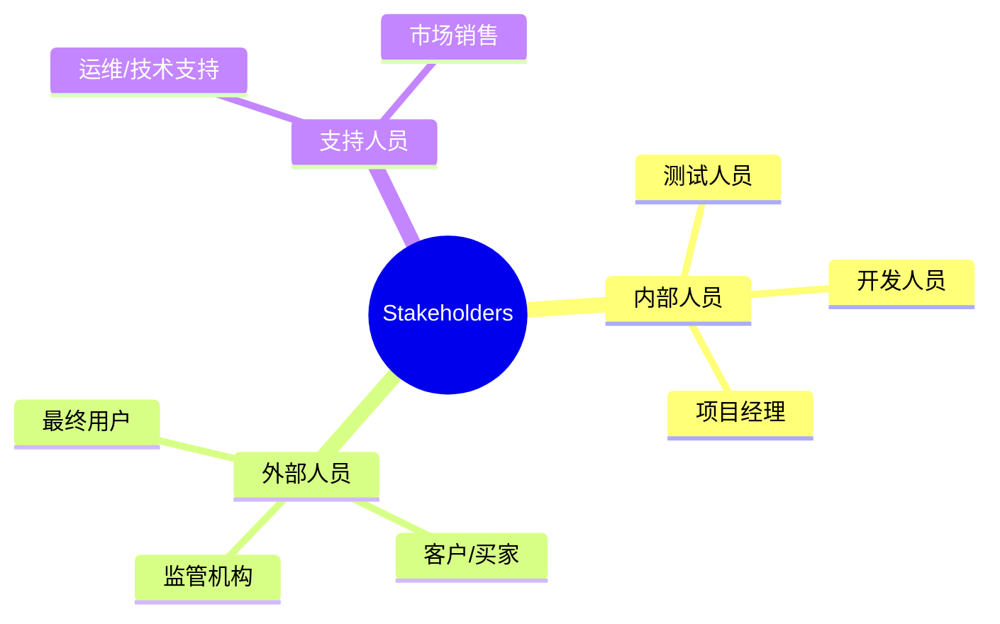

# 人员（People）：利益相关者（Stakeholders）

## 利益相关者（Stakeholders）是什么

在软件工程中，==People== 是成功项目最重要的元素。而 **利益相关者（Stakeholders）** 是指任何从正在开发的系统中直接或间接受益的人或组织。他们不仅仅是“用户”，还包括业务经理、市场销售人员、技术支持人员、顾问以及软件开发团队本身。

> [!IMPORTANT]
> 核心定义：Stakeholders = 所有受系统影响或能影响系统的人。
> 关键原则：**People — the most important element.**

如果忽视某类利益相关者，可能导致需求遗漏。例如，仅关注最终用户而忽略**技术支持人员**，可能导致系统缺乏可维护性日志；仅关注功能而忽略**高级管理人员**的业务目标，可能导致项目预算失控。

## 为什么需要识别利益相关者

软件开发的本质是沟通与协作。识别利益相关者的目的在于：
1.  **明确需求来源**：不同角色关注点不同。架构师关注非功能性需求（长期影响），项目经理关注交付日期和预算（短期约束），工程师关注技术实现。
2.  **降低沟通噪音**：通过建立人员列表，确保信息传递给正确的人。
3.  **避免“毒性”环境**：模糊的角色定义会导致推诿责任。明确的 Stakeholder 列表有助于建立问责机制。

## 如何管理与协作

敏捷宣言强调：“**项目开发期间，业务人员和开发人员必须天天都在一起工作**”。管理利益相关者的具体做法包括：

1.  **创建人员列表**：需求工程师需列出所有共利益者，并确认是否有遗漏。
2.  **定期评审**：与所有相关人员一起评审范围陈述或用例集。
3.  **原型反馈循环**：
    *   收集用户故事（User Stories）。
    *   构建原型（Prototype）。
    *   利益相关者评审并提出具体变更建议。

> [!TIP]
> 协作技巧：使用 CRC 卡片或用例表（Use Case Table）时，明确列出“主参与者”和“次要参与者”，并在“项目相关人利益说明”栏中填写各方获益点，以此达成共识。

## 常见误区与辨析

| 概念 | 区别点 |
| :--- | :--- |
| **用户 (User)** | 直接操作系统的人，是 Stakeholder 的子集。 |
| **客户 (Customer)** | 购买软件的人，可能不是最终用户。 |
| **开发团队** | 也是 Stakeholder，因为他们受项目进度和技术债务影响。 |

> [!WARNING]
> **常见坑：原型陷阱**
> 开发人员为快速展示原型，常采用折衷手段（如低效算法、不合适的语言）。若未及时重构，这些“临时选择”可能变成系统永久部分，导致“大泥球（Big Ball of Mud）”反模式。务必让利益相关者明白：**原型用于沟通，而非最终产品。**

## 实例分析：SafeHome 系统

在 SafeHome 案例中，利益相关者包括：
*   **房主（最终用户）**：关注易用性（Usability）和安全性。
*   **市场销售人员**：撰写“产品要求”，关注卖点。
*   **技术支持人员**：作为次要参与者，关注故障诊断能力（如通过电话线远程监控传感器）。

若忽略技术支持人员这一 Stakeholder，系统可能无法提供必要的远程诊断接口，导致售后成本激增。因此，在用例设计中，需将“技术支持人员”列为次要 Actor，并定义其与传感器的交互路径。
