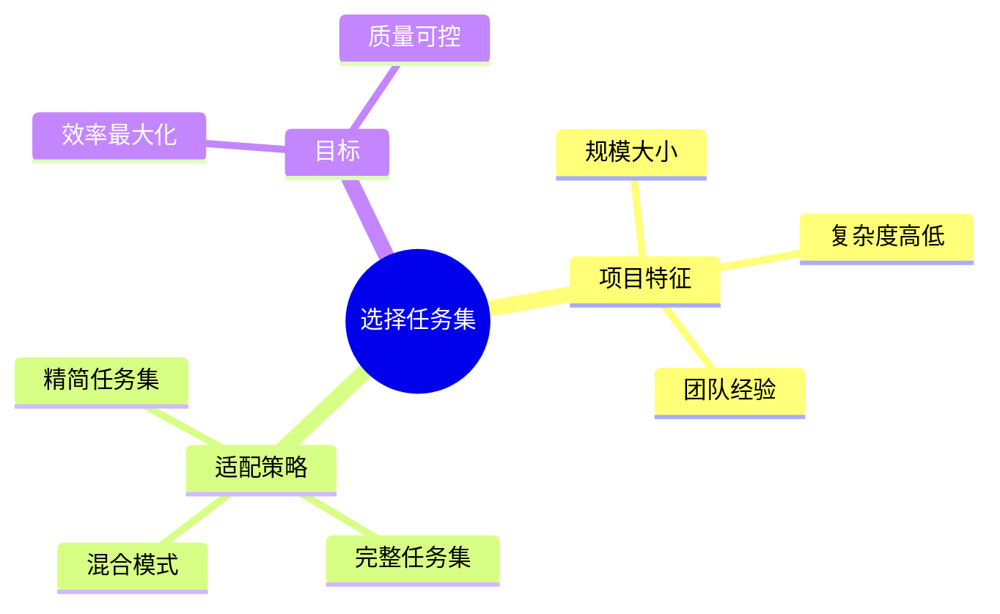

# 定义框架活动与识别任务集（Identifying a Task Set）

## 什么是框架活动与任务集

在软件过程（Software Process）中，**框架活动（Framework Activity）**是通用的、高层次的工程阶段，如沟通、计划、建模、构建和部署。而**任务集（Task Set）**则是为了完成某个框架活动所必须执行的具体软件工程任务、工作产品和里程碑的集合。

简单来说，框架活动是“做什么”的大方向，任务集是“具体怎么做”的操作指南。

> [!IMPORTANT]
> 核心定义：**Task Set = Tasks + Work Products + QA Points + Milestones**。它是框架活动的具体实例化。

## 为什么需要识别任务集？

不同的项目具有不同的特征（规模、复杂度、团队经验等）。如果对所有项目使用完全相同的任务集，会导致资源浪费或质量失控。

- **小型项目**：可能只需要简化的任务集，减少文档和管理开销。
- **大型关键系统**：需要严格的测试、评审和详细设计任务集。

==软件团队必须根据问题和项目的特征来选择任务集==，而不是盲目套用固定模板。

## 如何选择任务集？

选择过程通常基于以下调整因子：
1.  **项目类型**：Web应用、嵌入式系统或数据分析平台的需求不同。
2.  **项目规模**：小团队敏捷开发 vs 大团队瀑布模型。
3.  **不确定性**：需求是否清晰？技术是否成熟？

## 常见误区与辨析

许多初学者容易混淆“框架活动”与“任务集”，或者认为存在一个“万能任务集”。

| 概念 | 描述 | 特点 |
| :--- | :--- | :--- |
| **框架活动** | 通用的高层阶段 | 适用于所有软件项目，相对稳定 |
| **任务集** | 具体执行的步骤集合 | **随项目特征变化**，具有灵活性 |
| **过程模式** | 解决常见问题的最佳实践 | 可复用于不同任务集中 |

> [!WARNING]
> **易错点**：认为“一个好的团队总是对每个项目使用相同的任务集以保证质量”。
> **正解**：**False**。僵化的任务集会降低效率，优秀的团队会根据项目上下文**适配（Adapt）**任务集。

## 典型例题解析

**题目**：Different projects demand different task sets. The software team chooses the task set based on problem and project characteristics. (True/False)

**解析**：
这是软件过程适应性的核心体现。
1.  **判断依据**：课件明确指出 "Different projects demand different task sets"。
2.  **逻辑推导**：若项目简单（如内部工具），过多的文档任务（Work Products）是浪费；若项目复杂（如航空控制），缺少严格测试任务（QA Points）是灾难。
3.  **结论**：**True**。

> [!TIP]
> **记忆技巧**：记住 **"One size does not fit all"**（一刀切行不通）。任务集是**可裁剪（Tailorable）**的，而非固定的。

## 任务集的组成示例

以“设计”这一框架活动为例，其任务集可能包含：
- **Tasks**: 创建架构视图、定义接口、设计类。
- **Work Products**: 设计模型、接口规范。
- **QA Points**: 设计评审、静态代码分析。
- **Milestones**: 设计基线确认。

通过合理识别和选择任务集，团队能在保证质量的前提下，最大化开发效率。
