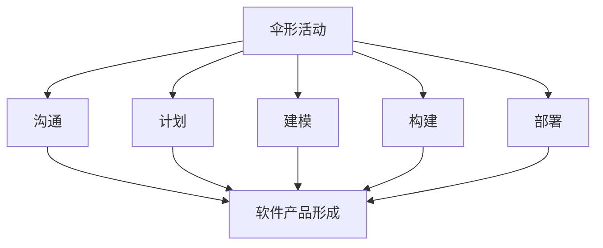

# 伞形活动（Umbrella Activities）

## 什么是伞形活动

**伞形活动（Umbrella Activities）**是贯穿软件项目始终的普适性活动，用来保证项目的开发过程得到控制。它们不像“沟通、计划、建模、构建、部署”那样直接产生软件产品，而是为这些框架活动提供管理与技术上的支持。

> [!IMPORTANT]
> 软件过程通常由两类活动组成：直接产生软件产品的**框架活动**，以及贯穿项目全过程、提供保障的**伞形活动**。伞形活动不是只在项目初期执行。

软件工程的实施框架通常定义 **5 个框架活动**与 **8 个伞形活动**。常见的伞形活动包括软件配置管理、进度跟踪、质量保证、风险管理、评审与审计、度量、文档管理以及可复现性管理等。

## 为什么需要伞形活动

伞形活动解决的是“项目能否按要求、可控地完成”的问题。例如：

- **软件配置管理（SCM）**：控制需求、代码、文档等版本，确保团队使用的是一致且可追溯的成果。
- **质量保证（QA）**：检查过程是否符合规定，避免“测试通过”却仍交付了错误产品。
- **风险管理**：持续识别、评估并应对技术、成本、进度和组织风险。
- **评审与审计**：检查产品及过程是否满足要求，发现缺陷并推动改进。
- **度量**：用规模、工作量、进度、缺陷等指标支持决策。

它们像伞一样覆盖整个项目生命周期，因此称为“伞形活动”。

> [!TIP]
> 判断题口诀：**框架活动负责“造软件”，伞形活动负责“管过程”。**

## 伞形活动与框架活动有什么区别

| 对比项 | 框架活动 | 伞形活动 |
|---|---|---|
| 主要目的 | 直接产生或交付软件产品 | 保证项目过程受控、质量可保障 |
| 常见内容 | 沟通、计划、建模、构建、部署 | 配置管理、QA、风险、评审、度量等 |
| 执行方式 | 通常具有阶段性和目标产物 | 贯穿整个项目，并持续应用 |
| 与产品的关系 | 直接相关 | 间接相关，但不可缺少 |

需要注意：**框架活动也不是僵化的一次性线性步骤**。软件过程具有迭代和递增特征，同一框架活动可能在多个迭代中反复出现；伞形活动则通常持续覆盖这些迭代。

## 如何在不同项目中调整

框架活动应依据项目特点进行适应性调整，而不是机械执行。

| 调整依据 | 调整思路 |
|---|---|
| 项目规模 | 小项目可简化文档和评审；大项目需要更细的计划、分工与配置管理 |
| 团队经验 | 成熟团队可减少部分形式化活动；新团队应加强培训、文档、评审和检查 |
| 项目复杂度 | 复杂系统增加建模、原型、测试与风险分析；简单系统可采用较轻量的过程 |
| 利益相关者参与 | 利益相关者密集时，应增加沟通频率和反馈回路 |
| 风险水平 | 高风险项目应提前做风险分析、验证性原型，并预留应对时间 |
| 时间与成本约束 | 进度紧张时可优先交付关键功能，但仍不能取消必要质量保障 |

例如，一个功能简单、期限紧且团队经验丰富的项目，可以采用轻量计划并通过迭代开发；但仍需进行基本需求确认、代码评审、测试和版本控制。

## 常见易错点

> [!WARNING]
> “伞形活动只在初始阶段执行”是错误的。配置管理、风险管理、QA 和度量等活动要持续到项目结束及后续维护阶段。

另一个常见误区是把“伞形活动”理解成某个具体开发阶段。实际上，它是对**整个软件过程起保障作用的通用活动集合**。

## 算对了的例子

题目：“Software engineering umbrella activities are only applied during the initial phases of software development projects.”

判断：伞形活动是否只用于软件开发的初始阶段？

- 伞形活动需要贯穿整个项目；
- 初始阶段并未结束，软件项目仍需配置管理、质量保证、风险监控等；
- 因此该说法错误。

**答案：B. False。**
