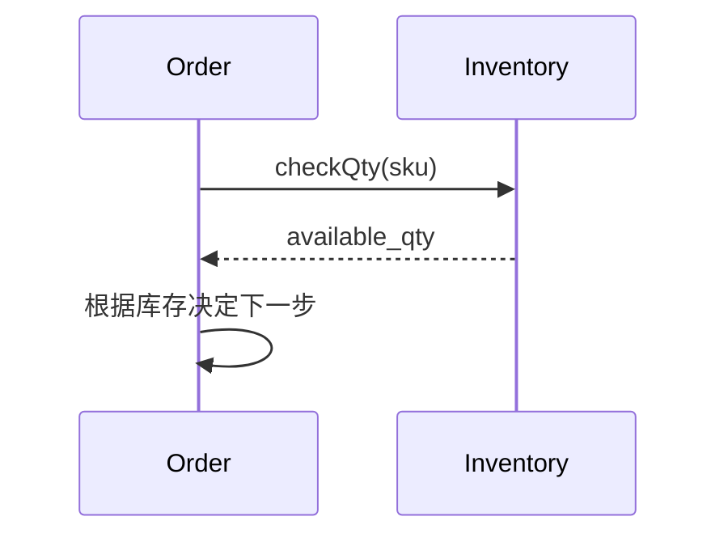

# 传统方法与面向对象方法的测试策略对比

## 为什么需要不同的测试策略

先想一个问题：传统软件由“函数”组成，面向对象软件由“类”组成，这两者在测试时能完全照搬同一套方法吗？

传统方法中，模块是一个函数或过程，输入走进去，输出走出来。测试的核心是控制流——函数的入口、出口、内部路径。而面向对象方法中，类封装了状态（属性）和行为（方法），方法之间通过共享的成员变量产生隐式交互。单独测一个方法时，必须考虑它如何影响对象状态，以及状态变化又如何影响后续方法调用。

> [!IMPORTANT]
> ==传统测试以函数为最小单元，关注控制流；面向对象测试以类为最小单元，关注状态与行为的交互。==

---

## 单元测试：从“函数”到“类”

传统单元测试相对直观：
- 被测单元是一个函数或子程序
- 需要驱动模块（driver）调用它，需要桩模块（stub）替代它调用的下层模块
- 测试用例围绕输入参数和预期返回值设计

面向对象单元测试中，最小的可测单元变成了**类**。一个类可能包含多个方法，它们通过类的私有属性相互影响：

如果只测“取钱”方法而不初始化“余额”，测试无法进行。==测一个方法前，必须先通过其他方法（或构造函数）将对象置为某个已知状态。== 这同时也意味着，测试顺序与类中的方法依赖关系紧密绑定，不再是简单的独立函数输入输出。

---

## 集成测试：从“模块集成”到“类协作”

传统集成测试基于**调用层次**，策略清晰：

| 策略 | 做法 | 优点 |
|------|------|------|
| 自顶向下 | 从主控模块逐步下沉 | 早期见功能框架 |
| 自底向上 | 从叶子模块逐步上升 | 底层构件先用先稳 |
| 增量式 | 每次只加一两个模块 | 错误定位极快 |

> [!TIP]
> ==增量集成==的核心价值：程序一小步一小步地构造和测试，错误更容易隔离和修正，远比“大爆炸”式集成划算。

自顶向下策略中，深度优先与广度优先的取舍值得留意：
- **深度优先**：沿一条主控路径把所有相关构件集成完，能快速实现并演示一个完整功能切片，是对利益相关者的有力信心保障。
- **广度优先**：横向逐层集成，每一层的直接下属一次纳入，结构更稳但功能出得慢。

面向对象集成测试关注的是**类之间的协作**。在传统方法里，我们强调模块间“可控连接”；在面向对象里，对应的是“实现设计类之间的可控连接”。它关心消息传递的正确性：A 对象调用 B 对象的方法时，传参是否合规？返回值是否被正确处理？B 的内部状态变化是否反过来影响 A 的后续行为？

> [!CAUTION]
> 面向对象集成测试不能简单沿用“自顶向下 / 自底向上”去集成为一棵调用树。类之间的协作是网状关系，需要从场景出发，按**协作路径**或**主题**增量集成。

---

## 另一个关键差异：构件的可替换性

传统方法也推崇高内聚低耦合，但面向对象将“==构件的可替换性==”推到了更核心的位置。某个类的具体实现能被替换（例如策略模式中的不同算法类），只要接口一致，系统其他部分不受影响。这就要求测试不仅覆盖当前实现，还要验证替换后的构件在协作链路中是否依然满足契约。

> [!WARNING]
> 常见坑：只测具体子类，漏测父类定义的契约在替换后是否仍然成立。可替换性不是语法的，是行为的——接口签名一样 ≠ 行为正确。

---

## 一个简化的对比总结

| 维度 | 传统测试 | 面向对象测试 |
|------|----------|--------------|
| 单元测试最小单元 | 函数 / 模块 | 类（含状态） |
| 单元测试关注点 | 控制流与输入输出 | 状态与方法的交互 |
| 集成测试基础 | 调用层次结构 | 类协作与消息传递 |
| 集成策略 | 自顶向下/自底向上/增量 | 基于协作路径的增量 |
| 构件替换考量 | 相对次要 | 核心要求，契约验证 |

在 OOA 和 OOD 阶段产生的模型（需求模型、设计模型），同样可以在编码前进行审查与验证测试——这是传统方法中较少被强调的一环。最终，两种策略并非对立：传统测试中的增量思想、桩与驱动的构造技巧，在面向对象测试中依然有效，只是需要适配到“状态—协作—替换”这三个新支点上。
