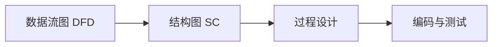
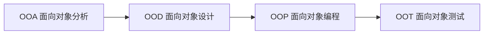

# 传统方法学与面向对象（OO）方法学

## 传统方法学与面向对象方法学

### 两个问题引出两种方法

在动手开发软件之前，先看两个问题：

- **问题一**：一个学生选课系统，需要完成“录入成绩”“查询课表”“统计学分”等功能。如果重点是把这些**功能**一条条理清楚，你打算怎么组织代码？
- **问题二**：同样是这个系统，里面到处都有“学生”“课程”“成绩单”这些概念。如果重点是把这些**事物及其关系**先建好模，再让功能围绕它们展开，你又会怎么组织代码？

这两个问题分别对应了软件工程的两大方法学：==传统方法学（结构化方法学）==和==面向对象方法学==。南邮《软件工程（双语）》课程中，第 1 章引入这对概念，是为了让你从一开始就清楚：**软件工程没有唯一正确的方法，只有更适合问题的方法。**

### 传统方法学：功能驱动，自顶向下

传统方法学也叫**结构化方法学**，它的基本思路是：

> 软件 = 数据结构 + 算法，开发 = 功能分解。

它以**功能**为中心，把系统看成一连串数据变换的过程。典型流程是：



- **结构化分析**：用数据流图（DFD）描述数据在系统中的流动和变换。
- **结构化设计**：把数据流图映射为模块结构图（SC），强调高内聚、低耦合。
- **结构化编程**：用顺序、选择、循环三种基本控制结构实现模块。

它的优点很清楚：**自顶向下、逐步求精**，逻辑严密，适合需求相对稳定、功能边界明确的系统。但它也有天然的短板：当需求频繁变化时，一个功能的改动常常波及多个模块，因为数据和对数据的操作是**分离**的。

> [!WARNING]
> 传统方法学中，数据与操作分离是最大的隐患。一旦数据结构变了，所有操作它的模块都要改。

### 面向对象方法学：对象驱动，自底向上

面向对象方法学的核心是一个公式：

> 面向对象 = 对象 + 类 + 继承 + 消息通信

它把世界看成一组**相互协作的对象**，每个对象把**数据（属性）**和**行为（服务/方法）**封装在一起。开发过程不再是“先分析功能再设计数据结构”，而是：



- **OOA**：找出问题域中的对象、类及其关系。
- **OOD**：把分析模型扩展为可实现的设计模型，引入设计模式与原则。
- **OOP**：用面向对象语言实现。
- **OOT**：以类为基本测试单元，围绕继承与多态设计测试用例。

面向对象方法学不是简单地把“结构化”换个说法，它的**关注点从功能转移到了对象**。功能的实现方式隐藏在对象内部，外部只能通过消息请求服务，这就是**封装**带来的好处。

> [!IMPORTANT]
> ==面向对象方法学中，测试的基本单元是类，而不是孤立的函数。== 因为多态使得同一个方法在不同子类中有不同行为，脱离类上下文测试单个操作没有意义。

### 面对面对比

| 维度 | 传统方法学 | 面向对象方法学 |
|------|-----------|--------------|
| 核心关注点 | 功能与数据流 | 对象及其协作 |
| 基本单元 | 模块（函数/过程） | 类与对象 |
| 数据与操作 | 分离 | 封装在一起 |
| 分析工具 | DFD、ER 图 | 类图、用例图、CRC 卡片 |
| 设计原则 | 高内聚、低耦合 | 开闭原则、里氏替换、依赖倒置 |
| 应对变化 | 功能变化波及面大 | 通过扩展类而非修改类应对变化 |
| 典型场景 | 数据流清晰、需求稳定的系统 | 业务逻辑复杂、持续演进的系统 |

### 三个关键的设计原则

面向对象方法学之所以能更好地应对变化，靠的是三条核心原则：

**开闭原则（OCP）**：软件实体（类、模块等）应该对==扩展开放，对修改关闭==。新增功能时尽量写新类，而不是改旧类。

**里氏替换原则（LSP）**：子类必须能够替换父类而不引起程序行为异常。如果一个继承关系会导致调用方需要判断对象到底是父类还是子类，这个继承多半不合适。

**依赖倒置原则（DIP）**：高层模块不应该依赖低层模块，二者都应该依赖==抽象==；抽象不应该依赖细节，细节应该依赖抽象。

> [!TIP]
> 记忆口诀：**“开闭”是目标，“里氏”是约束继承的规则，“依赖倒置”是用抽象解耦的手段。**

### 一个具体例子：出行策略

下面以“出行策略”为例，看面向对象方法学如何同时体现三个原则。

```
TravelStrategy（接口，抽象）
    ├── AirplaneStrategy  —— 坐飞机
    ├── TrainStrategy     —— 坐火车
    └── BicycleStrategy   —— 骑自行车

Person 类持有 TravelStrategy 引用，不关心具体交通工具
```

- **Person 依赖 TravelStrategy 接口**，不依赖任何具体策略类——这就是**依赖倒置**。
- **Person 可以接受任何实现 TravelStrategy 的对象**，换策略不改 Person——子类能替换父类接口，这就是**里氏替换**。
- **想加一种“轮船交通方式”，只需新增 ShipStrategy 实现接口**，不用修改 Person 或已有策略类——这就是**对扩展开放，对修改关闭**。

三条原则在同一套设计中互相成就，这是面向对象思维方式的精髓。

### 常见的坑

- **误以为“用 Java/Python 写的就是面向对象”**：把函数塞进类里、把所有数据都设成 public，本质还是结构化思维。==封装和职责分配才是核心，不是语法形式。==
- **把继承用作代码复用工具**：为了少写几行代码就乱继承，容易违反 LSP，导致子类行为与父类不一致。优先考虑组合而非继承。
- **在 OO 测试中按结构化方法测函数**：面向对象的错误往往不是单个方法内部的逻辑错误，而是**对象之间的协作错误**（消息序列、状态变化）。测试必须从类的职责和交互出发设计用例。

> [!CAUTION]
> 面向对象软件开发中，最容易犯的错误是把“分析”变成“设计”，又把“设计”变成“编码”的一部分。OOA 关注“做什么”，OOD 才关注“怎么做”，界线混乱会导致模型无法验证、需求无法追踪。
