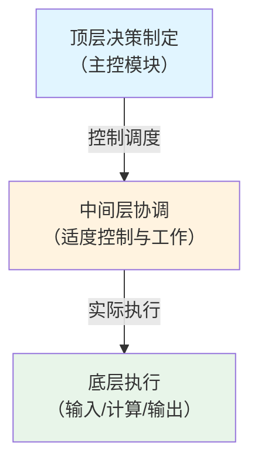

# 第一级分解、第二级分解与继续精化体系结构

从数据流图（DFD）到软件体系结构的映射采用 ==变换分析（Transform Analysis）== 方法，其精髓在于==自顶向下、逐步精化==。

## 第一级分解：搭建三层骨架

第一级分解（First-level Factoring）将系统划分为**三大功能层次**，建立初始架构框架：

- **顶层（决策制定）**：负责整体控制流与任务分配，是系统入口
- **中间层（协调）**：完成一部分控制和适度的实际工作，承上启下
- **底层（执行）**：承担大多数输入处理、核心计算和输出操作

> [!IMPORTANT]
> 第一级分解的关键是**职责分离**：顶层只做决策不做具体计算，底层只做执行不做全局控制。

## 第二级分解：从边界向外映射

第二级分解（Second-level Factoring）将 DFD 中的变换（Transform）==从变换中心边界开始，沿输入路径和输出路径向外==，依次映射到软件结构的从属层。

**操作要点：**
1. **确定边界**：在 DFD 上标出输入流边界与输出流边界（变换中心在两者之间）
2. **沿输入路径向外**：从输入侧边界开始，将各个变换（如`获取数据`、`验证格式`）映射为底层或中间层的输入处理模块
3. **沿输出路径向外**：从输出侧边界开始，将各个变换（如`格式化`、`写文件`）映射为底层或中间层的输出处理模块
4. **变换中心映射**：将中心变换（核心计算）映射为中间层或底层的计算模块

> [!WARNING]
> **现实考虑与设计质量**的权衡决定着第二级分解的输出结果。不是每个 DFD 变换都必须对应一个模块，可合并相邻变换或拆分复杂变换以优化内聚性。

## 继续精化：迭代优化结构

完成两级分解后，需**继续精化体系结构**：

- **功能精化**：检查每个模块是否职责单一，必要时进一步分解为子模块
- **接口优化**：明确模块间参数传递，减少耦合（如用数据结构代替多个控制标志）
- **结构优化**：调整扇入扇出（Fan-in/Fan-out），顶层扇出不宜过大（通常 $\leq 7$），底层扇入应较高（复用性好的工具模块）

## 与相近概念的区别

| 概念 | 核心特征 | 所处阶段 |
|------|---------|---------|
| **第一级分解** | 划分三层骨架（决策-协调-执行），建立框架 | 架构设计初期 |
| **第二级分解** | 沿数据流边界向外映射变换，填充具体模块 | 架构设计中期 |
| **继续精化** | 优化模块划分与接口，提升设计质量 | 架构设计后期 |

> [!TIP]
> **常见误区**：不要将第二级分解理解为简单的"按顺序列模块"，关键是==从边界向外、逐步细化==，且允许根据现实约束（如性能、团队分工）调整变换与模块的对应关系。

**正确示例**：若输入路径包含`读取传感器 → 校验数据 → 转换格式`，则第二级分解时，这三个变换应映射为输入处理链上的三个模块（或合并为一个输入处理模块），从靠近变换中心的`转换格式`开始向外依次确定，而非先设计顶层控制。
