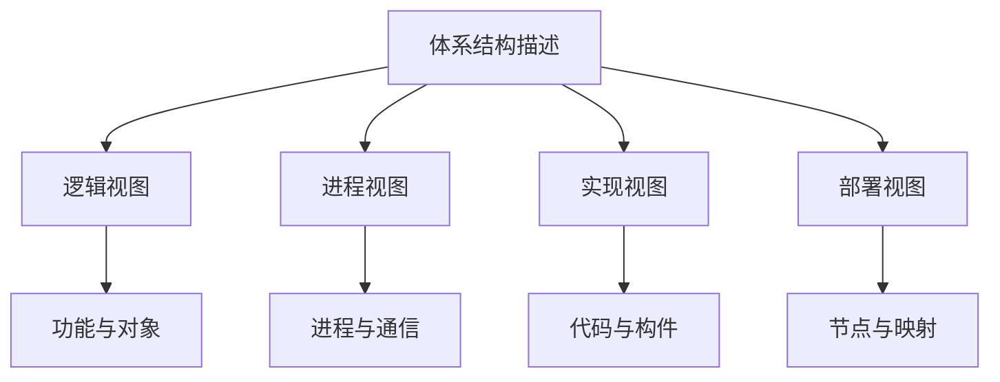

# 体系结构描述（Architectural Descriptions）：逻辑视图、进程视图、实现视图、部署视图

## 什么是体系结构描述

**Architectural Descriptions（体系结构描述）** 就是用一组==有组织的视图==，把软件系统的整体结构、运行方式和部署方式讲清楚。它回答的不是“某个函数怎么写”，而是：

- 系统由哪些部分组成？
- 这些部分如何协作？
- 代码如何组织？
- 最终运行在什么硬件上？

课件提到，IEEE 曾提出 **IEEE-Std-1471-2000**，即 *Recommended Practice for Architectural Description of Software-Intensive Systems*，用于指导软件密集型系统的体系结构描述。

> [!IMPORTANT]
> 一个视图通常只能说明系统的一个侧面，因此体系结构描述往往需要==多个视图共同表达==，而不是只画一张“总架构图”。

## 为什么需要多个视图

不同项目干系人关心的问题不同：客户关心功能，开发人员关心模块，测试和运维人员关心进程、通信与部署。如果只用一种模型，很难同时满足这些需求。

体系结构描述的主要作用是：

1. **促进沟通**：architectural representations can be an enabler for communication among project stakeholders。
2. **支持分析**：便于检查性能、可靠性、可修改性等质量属性。
3. **指导实现与求精**：后续可继续“求精并细化体系结构描述”。
4. **记录设计决策**：说明为什么采用某种结构，而不只是画出结果。

## 四种视图分别看什么

| 视图 | 核心问题 | 典型内容 | 主要使用者 |
|---|---|---|---|
| **逻辑视图 Logical View** | 系统提供什么功能？ | 类、对象、子系统、功能模块及其关系 | 用户、分析人员、设计人员 |
| **进程视图 Process View** | 系统运行时怎样工作？ | 进程、线程、并发、同步、进程间通信 | 性能与并发设计人员 |
| **实现视图 Implementation View** | 软件怎样组织成可构建的代码？ | 源文件、构件、包、库及依赖关系 | 开发、构建与配置管理人员 |
| **部署视图 Deployment View** | 软件安装在哪里运行？ | 硬件节点、网络连接、软件到节点的映射 | 运维、部署与系统工程师 |

例如，一个网上选课系统中：

- 逻辑视图描述“学生、课程、选课记录”等对象；
- 进程视图描述“选课请求处理进程”和“数据库服务进程”的通信；
- 实现视图描述 `CourseService`、`EnrollmentRepository` 等代码构件；
- 部署视图描述应用服务器、数据库服务器及浏览器节点。

> [!NOTE]
> **进程视图不是程序流程图。** 它重点是运行时的进程、线程、并发和通信；某个算法的先后顺序，不必然属于进程视图。

## 与相近概念的区别

| 概念 | 与体系结构描述的关系 |
|---|---|
| **Architectural Genre** | 面向特定应用领域的总体架构类别，如信息系统、嵌入式系统 |
| **Architectural Style / Pattern** | 可复用的结构方案，如分层、客户端—服务器；pattern 可作为架构设计基础 |
| **Architectural Context** | 描述系统与外部实体、环境和相邻系统的关系 |
| **ADL** | Architectural Description Language，提供描述软件体系结构的==语法与语义== |
| **Architecture Template** | 组织体系结构文档的模板，不等于体系结构本身 |

还要区分三类模型：**structural models** 表示组成结构，**functional models** 表示系统功能，**dynamic models** 表示系统行为。它们都可以用于表达架构设计的不同方面。

## 常见误区

> [!WARNING]
> 可运行原型不是体系结构的最佳表示。原型能展示部分功能或行为，却可能隐藏模块划分、质量属性和部署约束，因此不能替代正式的体系结构描述。

- 不要把四视图理解成“四张必须固定格式的 UML 图”；关键是关注点不同。
- 不要把实现视图与部署视图混淆：前者是**代码构件如何组织**，后者是**软件放到哪些节点运行**。
- 不要认为体系结构描述只供架构师阅读，它也是干系人沟通工具。
- 描述架构时不能只写“采用分层风格”，还应说明分层如何体现在相关视图中。

## 例题

**题目：** Which of the following can be used to represent the architectural design of a piece of software?

A. Dynamic models  
B. Functional models  
C. Structural models  
D. All of the above

**正确答案：D。**

**解析：** 动态模型可辅助说明运行行为，功能模型可说明系统提供的功能，结构模型可说明组成部分及其关系。三者表达的是不同侧面，与多视图描述的思想一致，因此选 **D**，而不是只承认结构模型。
