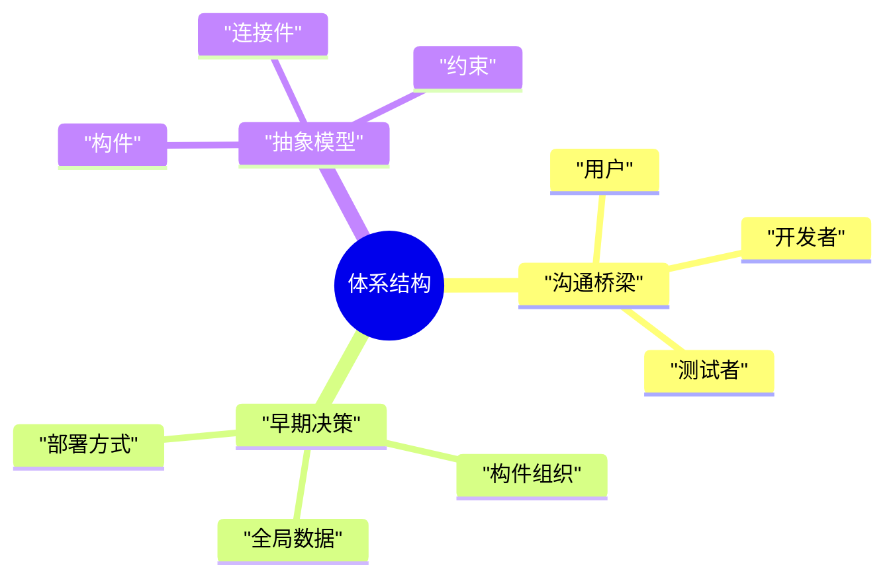
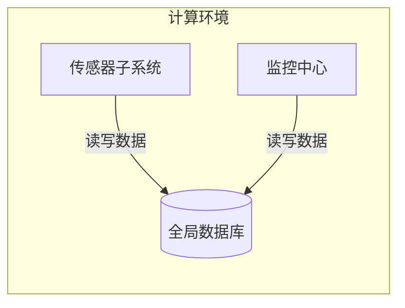

# 体系结构（Architecture）及其属性

体系结构（Architecture）是软件的==整体结构（the overall structure）==，它描述了系统的主要构件、这些构件之间的关系与协作方式，以及约束这些组织方式的风格、模式与规则。

先想一个问题：拿到"做一个智能家居安全系统"的需求后，直接开始写代码会怎样？很快你会发现，各模块的数据格式不统一、通信方式混乱、加个新传感器就要改一堆地方。所以，在写代码之前，必须先决定**系统怎么被组织起来**——这就是体系结构要回答的问题。

## 它是什么

> [!IMPORTANT]
> Architecture is not the operational software, it is a **representation**.
> 体系结构不是可运行的软件本身，而是一种**表示**，它让软件工程师能够：
> 1. 分析设计在满足需求方面的有效性；
> 2. 在修改成本还很低的阶段比较不同的架构方案；
> 3. ==降低与软件构造相关的风险==。

## 为什么需要它

体系结构的重要性体现在三点：

1. ==促进所有利益相关者之间的沟通==（facilitates communication among all stakeholders）；
2. 突出**早期设计决策**，这些决策对后续所有软件工程工作影响深远；
3. 构成一个相对小的抽象模型（a set of abstractions），描述系统构件如何结构化并协同工作。

## 怎么做：体系结构设计的要点

设计体系结构时，有几个关键动作：

- **构件（Components）**：对已被确定为体系结构模型一部分的构件，应建立==命名约定（naming conventions）==，并进一步精细化，使其成为构件级模型的一部分。
- **全局数据结构**：不要忘记==容纳构件的体系结构==与==服务于多数构件的全局数据结构==——很多同学只画框框（构件），却忘了数据怎么流动。
- **部署（Deployment）**：==部署图是体系结构设计的一部分==，用于示意系统功能（常表现为子系统）容纳在计算环境中。

## 与相近概念的区别

| 概念 | 关注点 | 产物示例 |
|---|---|---|
| 需求分析 | 做**什么** | SRS 文档 |
| ==体系结构设计== | 系统**怎么组织** | 构件图、部署图、风格选择 |
| 构件级设计 | 单个构件**内部怎么实现** | 类图、CRC 卡片 |

## 常见的坑

> [!CAUTION]
> 缺乏定义的软件体系结构，容易滑向**反模式（anti-patterns）**：
> - **Blob（大泥球/上帝类）**：单个类拥有大量不相关的属性和操作，缺乏凝聚力；
> - **Stovepipe system（炉管系统）**：几乎不可维护；
> - **Spaghetti code（意大利面条代码）**：结构混乱难懂。
>
> 典型原因：缺乏 OO 体系结构、抽象技能不足、开发中不断向现有类堆功能。
> 解决思路：**重构（refactoring）**——把行为从 Blob 中移除，重新分配给其他对象。

> [!TIP]
> 记忆点：体系结构三件事——==构件是什么、怎么连接、怎么部署==。
> 设计时**面向未来（Be Open to the Future）**：用抽象类 + 多态留出扩展点（如"宠物"抽象类而非只写"猫"）。

> [!NOTE]
> 体系结构还会衍生出许多术语：体系结构风格（styles，如星型、层次式、调用返回式）、体系结构模式（patterns）、体系结构原型（archetypes）、部署图（deployment diagram）、瘦客户端 vs 富客户端等，在后续章节展开。
