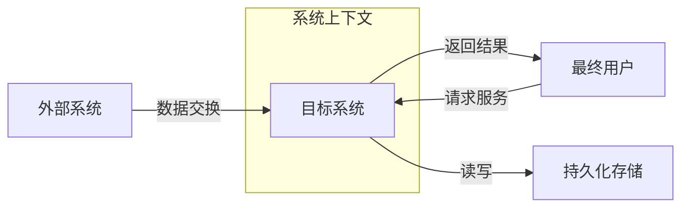
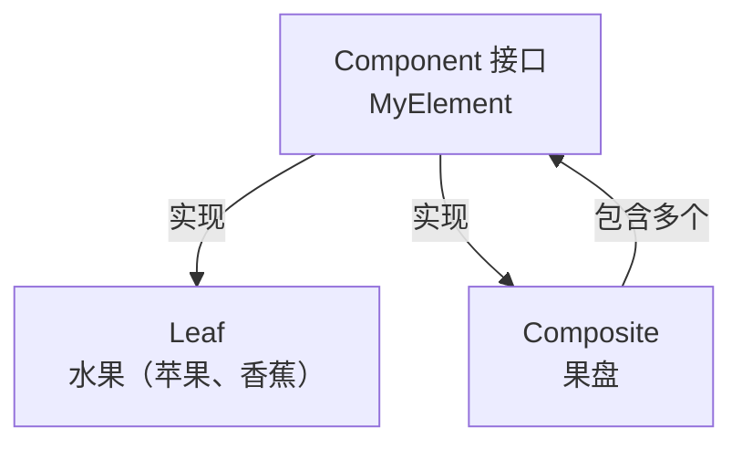

# 体系结构设计（Architectural Design）与体系结构上下文（Context）

## 什么是体系结构设计

体系结构设计的本质是回答一个问题：==软件系统由哪些“大块”组成，它们之间如何交互？==

从课件中的定义出发：设计是一个多步骤过程，综合信息需求来构建数据与程序结构、接口特征、过程细节的表达。其中，体系结构设计关注的是**较高层次上各部分之间的相互关系**，而不是某个模块内部的实现细节。

可以类比为建造一栋教学楼：体系结构设计决定楼层分布、楼梯位置、水电管井走向，而构件级设计才决定每间教室的桌椅摆放和白板位置。

## 为什么需要体系结构设计

没有良好的体系结构，系统会面临三个典型问题：

1. **难以评估复杂度**——无法在编码前判断方案是否可行
2. **变更成本高**——一处改动引发连锁反应
3. **团队协作混乱**——不同开发者对系统全局缺乏共同理解

> [!IMPORTANT]
> 体系结构设计是软件工程中**最早做出的、影响最深远的决策集合**。一旦选定某种结构风格，后续的质量属性（性能、安全性、可维护性）就被大体框定。

从考试角度来看，评估一个体系结构的整体复杂度时，有效的技术是考察构件的 **流依赖（flow dependencies）** 和 **共享依赖（sharing dependencies）**，而不是单纯看构件大小或内聚度。

## 体系结构上下文是什么

**体系结构上下文**描述了一个系统所处的环境，以及系统与外部实体之间的边界和交互关系。

课件中强调：==体系结构上下文图展示了系统如何融入其环境==。它画出的不是内部结构，而是系统作为一个黑盒，与外部参与者（用户、其他系统、数据库、传感器等）之间的数据流和控制流。

> [!WARNING]
> 常见误区：把体系结构上下文图画成了内部组件图。上下文图只画**系统边界**和**外部实体**，内部细节属于后续的构件图或部署图。

## 怎么做：体系结构设计过程

课件将体系结构设计过程概括为几步迭代动作：

1. **定义体系结构上下文**——画清系统边界与外部接口
2. **识别原型（archetypes）**——找出代表系统核心抽象的通用构件类型（如“控制器”“存储库”“传感器接口”）
3. **将系统分解为构件**——依据关注点分离原则划分子系统
4. **选择体系结构风格/模式**——根据需求匹配适当的方案（层次结构、客户端/服务器、管道/过滤器等）
5. **精炼与验证**——使用体系结构描述语言（ADL）或评审手段检查设计质量

> [!NOTE]
> 课件中明确提到：IEEE-Std-1471-2000 定义了软件密集型系统体系结构描述的推荐实践。体系结构设计可以使用一种或多种模型来表达，例如结构模型、动态模型、部署模型等。

关于原型的判断题考点：**一旦选定原型，在体系结构设计推进过程中始终需要进一步精炼**（答案：True）。原型不是一次性定稿的，而是随着设计深入不断细化和具体化。

## 体系结构风格与模式

课件对 Genre、Style 和 Pattern 做了区分：

| 术语 | 含义 | 举例 |
|------|------|------|
| Architectural Genre | 体系结构的“流派”，按应用领域分类 | 人工智能系统风格、嵌入式系统风格 |
| Architectural Style | 按结构组织形式命名的风格 | 层次风格、客户端/服务器风格 |
| Architectural Pattern | 针对特定问题的可复用解决方案 | MVC、微内核、管道/过滤器 |

> [!TIP]
> 记忆口诀：Genre 看“圈层”（领域），Style 看“形状”（结构），Pattern 看“套路”（问题—解决方案对）。

## 组合模式例子：果盘系统

题干中给出的组合模式案例，可以这样理解：

**为什么用组合模式？** 因为“单个水果”和“由多个水果组成的果盘”需要被客户端统一对待。客户端调用 `getPrice()` 时，不需要判断当前是单个苹果还是一个混合果盘——组合模式保证了==统一接口==。

**算对了的例子**：
- 苹果价格 = 5 元
- 香蕉价格 = 3 元
- 小果盘 = 苹果 + 香蕉 = 8 元
- 大果盘 = 小果盘 + 苹果 = 8 + 5 = 13 元

客户端代码只需遍历树结构并调用同一个接口方法，无需区分 Leaf 和 Composite，实现了“部分—整体”层次结构的透明化处理。

## 敏捷过程中的常见误区

> [!CAUTION]
> 判断题考点：**“敏捷软件过程模型中不需要体系结构设计”——错误。**

即使采用敏捷方法，体系结构设计依然存在，只是表现形式不同：它可能以“架构刺探（architectural spike）”、白板草图或持续演进的轻量文档出现，而非厚重的 upfront design。课件明确指出这一说法为 False。
