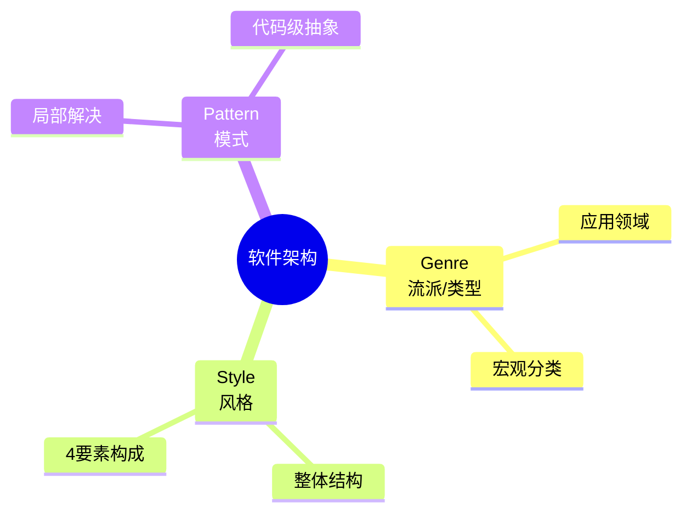

# 体系结构风格/流派（Architectural Genres）分类

## 什么是体系结构流派与风格

在软件架构设计中，**Architectural Genres（流派/类型）** 是对系统整体类别的宏观划分，而 **Architectural Styles（风格）** 则是实现该流派的具体结构范式。

> [!IMPORTANT]
> ==核心定义==：Architecture Genre 决定了构建结构时可能采用的总体方法（Architectural Approach）。它由应用领域和系统特性决定，如 AI、通信或金融系统。

想象一下建筑行业：
*   **Genre（流派）**：是“住宅”、“办公楼”还是“工厂”？这决定了基本用途。
*   **Style（风格）**：是“四合院”、“哥特式”还是“现代简约”？这决定了整体布局。
*   **Pattern（模式）**：是“门窗位置”、“通风设计”？这关注局部细节。

## 风格的四大构成要素

根据 IEEE 标准及课件定义，一个完整的软件体系结构风格必须包含以下四个要素，缺一不可：

1.  **一组构件 (Components)**：执行系统所需功能的模块（如数据库、计算单元）。
2.  **一组连接件 (Connectors)**：实现构件间通信、协调与合作的机制。
3.  **一组约束 (Constraints)**：定义构件如何集成以形成系统的规则。
4.  **语义模型 (Semantic Models)**：使设计者能通过分析部分属性来理解系统整体特性的模型。

> [!TIP]
> 记忆口诀：**构连约语**。即：构件、连接、约束、语义。

## 风格 vs 模式：关键区别

这是考试中的高频混淆点。请注意两者的关注范围不同：

| 维度 | Architectural Style (风格) | Design Pattern (模式) |
| :--- | :--- | :--- |
| **关注点** | ==整体结构== (Global) | ==局部实现== (Local) |
| **类比** | 星型结构、层次体系、OO体系 | 观察者、装饰器、桥接模式 |
| **抽象层级** | 系统级拓扑 | 类/对象级交互 |
| **典型数量** | 9大类 (如数据流、调用返回) | 23种经典设计模式 |

## 常见误区与解题技巧

**误区 1：认为存在从需求到风格的全面映射。**
事实上，==不存在需求模型到体系结构风格的全面映射==。需求工程的作用是 uncover（揭示）系统的 **characteristics and constraints**（特征与约束），从而帮助设计师选择最合适的风格或风格组合，而不是直接生成风格。

**误区 2：混淆 Genre 和 Style 的决定关系。**
判断题常考：“An architectural genre will often dictate the architectural approach...” 答案是 **True**。因为流派（如实时控制系统）通常限制了可用的架构方法（如必须采用事件驱动风格）。

> [!WARNING]
> 做题陷阱：当题目问及“为了确定最佳架构风格，需求工程用于揭示什么？”时，不要选“算法复杂度”或“设计模式”，应选择 **B. characteristics and constraints**。

## 实例分析

假设我们要设计一个**银行交易系统**：
*   **Genre**：金融系统（高一致性、高安全性要求）。
*   **Style**：可能选择 **Layered Architecture（层次风格）** 或 **Client-Server**。
    *   *Components*: Web前端, 业务逻辑层, 数据库。
    *   *Connectors*: HTTP请求, SQL调用。
    *   *Constraints*: 上层只能调用下层，严禁跨层调用。
    *   *Semantic Model*: 事务ACID特性模型。
*   **Pattern**: 在业务逻辑层内部使用 **Strategy Pattern** 处理不同的利息计算算法。

通过这种分层理解，你能清晰地界定架构设计的边界，避免在局部代码优化时迷失整体方向。
