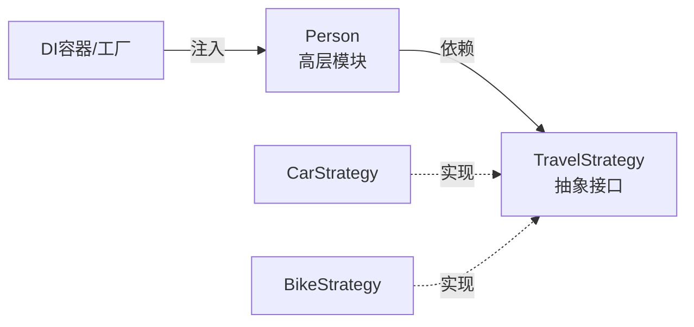

# 依赖倒置原则（Dependency Inversion Principle, DIP）

## 什么是依赖倒置原则

> [!IMPORTANT]
> 依赖倒置原则（Dependency Inversion Principle, DIP）的核心定义是：==高层模块不应依赖低层模块，两者都应依赖抽象；抽象不应依赖细节，细节应依赖抽象。==

在传统结构化设计中，依赖关系通常是“自上而下”的：高层业务逻辑直接调用低层具体实现。一旦低层变更，高层被迫修改。DIP 要求我们将这种关系“倒置”过来，让双方都面向接口或抽象类编程。

思考一下：如果 `Person` 类直接 new 一个 `Car` 对象，当交通工具换成 `Bicycle` 时怎么办？若 `Person` 只依赖 `TravelStrategy` 接口，是否只需替换实现类即可？这就是 DIP 要解决的耦合问题。

## 为什么需要 DIP

DIP 是实现开闭原则（OCP）的关键手段。通过抽象耦合，系统对扩展开放、对修改封闭。同时，它也是里氏替换原则（LSP）的应用前提——只有基于抽象的依赖，子类才能安全替换父类而不破坏程序正确性。

| 维度 | 传统依赖 | DIP 依赖 |
| :--- | :--- | :--- |
| 耦合度 | 高（硬编码） | 低（接口契约） |
| 可测试性 | 难（需真实环境） | 易（Mock 抽象） |
| 扩展方式 | 修改源码 | 新增实现类 |
| 运行时绑定 | 编译时确定 | 注入/工厂动态绑定 |

## 如何实现 DIP

实现 DIP 的关键在于==以抽象方式耦合==，具体手段包括：

1.  **定义抽象接口**：为每个服务提取接口或抽象类。
2.  **依赖注入（DI）**：通过构造器、Setter 或接口注入依赖，而非内部 new。
3.  **工厂模式**：将对象创建逻辑封装，解耦使用与创建。

> [!TIP]
> 记忆口诀：==面向接口不面向实现，注入依赖不新建对象。==

## DIP 与相近概念辨析

-   **DIP vs LSP**：LSP 是 DIP 的基础。DIP 要求依赖抽象，而 LSP 保证抽象可被子类安全替换。违反 LSP 的继承体系会使 DIP 失效。
-   **DIP vs 控制反转（IoC）**：DIP 是设计原则，IoC 是实现该原则的技术模式（如 Spring 容器）。DIP 指导“应该怎样”，IoC 解决“如何做到”。
-   **DIP vs 接口隔离（ISP）**：ISP 强调接口粒度，避免强迫客户端依赖无用方法；DIP 强调依赖方向。两者常配合使用，但关注点不同。

## 常见误区与陷阱

> [!WARNING]
> 并非所有依赖都需要倒置！对于稳定的、极少变化的底层工具类（如 `String`、`Math`），强行抽象反而增加复杂度。==DIP 适用于变化频繁的业务边界，而非所有代码。==

另一个常见错误是“伪抽象”：定义了接口但只有一个实现，且无多态需求。这属于过度设计，违背 YAGNI 原则。抽象的价值在于应对变化，而非形式合规。

## 真题示例解析

回顾课件中的 `TravelStrategy` 案例：`Person` 类不直接依赖 `Car` 或 `Bicycle`，而是依赖 `TravelStrategy` 接口。新增 `CarStrategy` 时，仅需实现接口并注入，`Person` 代码零修改。

此设计同时满足三大原则：
-   **DIP**：`Person` 依赖抽象 `TravelStrategy`；
-   **LSP**：任意 `TravelStrategy` 实现可互换；
-   **OCP**：扩展新策略无需改 `Person`。

这正是考题中“探析设计如何运用 DIP、LSP 满足 OCP”的标准答案范式。
