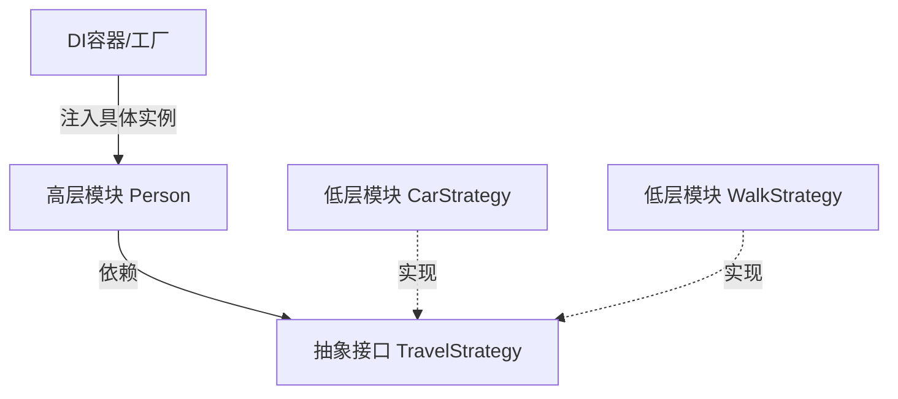

# 依赖倒置原则（Dependency Inversion Principle, DIP）在构件级设计中的应用

## 依赖倒置原则（DIP）在构件级设计中的应用

> [!IMPORTANT]
> 核心定义：Depend on abstractions. Do not depend on concretions.
> ==高层模块不应依赖低层模块，两者都应依赖抽象；抽象不应依赖细节，细节应依赖抽象。==

### 为什么需要“倒置”？

在传统分层设计中，高层业务逻辑往往直接调用低层具体实现（如 `new MySQLDao()`）。思考一下：如果底层数据库从 MySQL 换成 PostgreSQL，或者游戏角色的“机械臂”要换成“生物臂”，高层代码是否必须修改？这种==编译时硬编码==导致耦合度过高，违背了构件级设计中“Dependency management ⟺ impact management”的核心理念。DIP 通过将依赖关系从“具体类”翻转为“接口/抽象类”，实现了影响隔离。

### 如何实现依赖倒置？

DIP 不是空中楼阁，它需要具体的工程手段落地：

-   **定义抽象接口**：提取高层与低层的交互契约（如 `ILimb`, `TravelStrategy`）。
-   **运行时绑定**：通过==依赖注入（Dependency Injection）==或工厂模式，在运行时将具体实现传入高层，而非在高层代码中 `new` 出来。
-   **接口归属权**：注意，这里的抽象接口通常由==高层模块定义==（或独立于两者），低层模块去实现它，这才是真正的“倒置”。

### DIP、LSP 与 OCP 的协同关系

在南邮《软件工程（双语）》考题中，这三者常被捆绑考察。它们并非孤立存在，而是构成了一个逻辑闭环：

| 原则 | 角色定位 | 关键作用 |
| :--- | :--- | :--- |
| **OCP** | ==设计目标== | 对扩展开放，对修改封闭 |
| **DIP** | 架构手段 | 解耦高低层，使扩展无需改高层 |
| **LSP** | 行为保障 | 确保子类替换父类后程序仍正确 |

> [!TIP]
> 答题逻辑链：因为运用了 **DIP**（依赖抽象）和 **LSP**（子类可安全替换），所以当新增功能时只需增加新类实现接口，无需修改现有代码，从而满足了 **OCP**。

### 真题案例解析：游戏人物肢体设计

以简答题中的游戏人物为例，`Character`（高层）需要控制 `Arm/Leg`（低层）。

-   **错误做法**：`Character` 类中直接持有 `MechanicalArm` 对象。换手臂类型需改 `Character` 源码。
-   **DIP 应用**：定义 `ILimb` 接口，`Character` 仅依赖 `ILimb`。`MechanicalArm` 和 `BioArm` 均实现该接口。
-   **LSP 验证**：任何 `ILimb` 的实现类都能无缝传入 `Character`，且 `move()` 语义一致，不会导致动作协调出错。
-   **OCP 达成**：新增“翅膀”构件时，仅需新建 `Wing` 类实现 `ILimb`，`Character` 与控制器代码==零修改==。

### 常见误区与辨析

> [!WARNING]
> DIP ≠ 面向接口编程的全部
> 仅仅定义了接口不等于遵守了 DIP。如果接口是低层定义的（如 JDBC 驱动接口），而高层被迫依赖这个低层接口，这依然是正向依赖。==真正的 DIP 要求抽象属于高层或独立层==，低层只是适配者。

> [!CAUTION]
> 避免过度抽象
> 不要为每个类都强行抽取接口。对于稳定的、极少变更的基础工具类（如 `String`, `Utils`），直接依赖具体类反而更清晰。DIP 应用于==易变点==和==跨层边界==。

在构件级设计中，DIP 是实现高内聚、低耦合的关键支柱。掌握它不仅要记住定义，更要理解它如何作为“桥梁”，连接起 LSP 的行为约束与 OCP 的扩展愿景，这也是应对 15 分综合讨论题的核心得分点。
