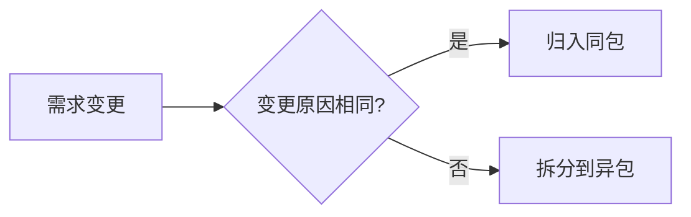

# 共同封闭原则（CCP）与共同重用原则（CRP）

## 什么是 CCP 与 CRP

在构件级设计中，如何划定类的边界是核心难题。若将不相关的类打包在一起，修改一个无关功能却导致整个构件重新发布；若将紧密协作的类拆散，每次改动都要联动多个构件。==共同封闭原则（CCP）与共同重用原则（CRP）正是解决这一矛盾的包设计准则==。

> [!IMPORTANT]
> CCP 强调“一起变更”，CRP 强调“一起复用”。两者分别从维护成本和依赖管理两个维度约束包的粒度。

## 为什么需要这两个原则

试想：若 `UserAuth` 和 `ReportGen` 被放入同一个包，当仅修改报表逻辑时，认证模块的使用者是否也要被迫升级？这违背了最小影响原则。反之，若 `OrderService` 与 `OrderValidator` 分属不同包，新增订单类型时需同时修改两处并协调版本，极易出错。

- **CCP 的动机**：降低变更的传播范围，使包成为高内聚的“变更单元”。
- **CRP 的动机**：避免引入不必要的依赖，防止“传递性依赖污染”。

## 如何应用 CCP 与 CRP

### 共同封闭原则（CCP）

> [!TIP]
> 判断标准：这些类是否总是因为相同的原因而修改？若是，则应归入同一包。

实践中，可通过分析历史提交记录或领域模型中的聚合根来识别“共同封闭”的类集合。例如，所有涉及“支付退款”的类（`RefundService`, `RefundValidator`, `RefundEvent`）应封装在同一包内。

### 共同重用原则（CRP）

> [!WARNING]
> 不要重用你不需要的东西！若包 A 包含类 X、Y、Z，而你只需 X，则 Y、Z 的任何变更都会迫使你重新验证对 A 的依赖。

应用 CRP 时，需审视包内每个类是否都被外部使用者真正需要。若存在“搭车”类，应考虑拆包或提取接口。

## CCP 与 CRP 的区别与权衡

| 维度 | CCP | CRP |
| :--- | :--- | :--- |
| 关注点 | 变更的内聚性 | 重用的纯净性 |
| 驱动因素 | 业务需求变化频率 | 外部依赖者的使用模式 |
| 违反后果 | 修改扩散、回归测试成本高 | 依赖膨胀、构建时间增加 |
| 典型场景 | 领域服务、事务脚本 | 工具库、API 门面 |

> [!NOTE]
> CCP 与 CRP 常存在张力：为满足 CCP 而合并的包可能违反 CRP；为满足 CRP 而拆分的包可能破坏 CCP。==实际设计中需在二者间寻求平衡点，而非绝对遵守其一==。

## 常见误区与正确示例

> [!CAUTION]
> 误将“代码相似”当作“共同封闭”依据。两个类结构相似但变更原因不同（如 `EmailSender` 与 `SmsSender`），不应因代码风格一致而强行合并。

**正确示例**：某电商系统中，`InventoryCheck` 与 `StockReservation` 总随库存策略调整而同步修改（CCP 成立），且所有调用方都同时使用二者（CRP 成立）。因此将它们置于 `inventory-core` 包中是合理的。反之，若 `LoggingUtil` 被塞入该包，尽管它也被库存模块使用，但日志工具的变更与库存无关，违反 CCP；且非库存模块也会依赖此包仅为获取日志功能，违反 CRP——此时应将 `LoggingUtil` 移至独立的 `common-log` 包。
