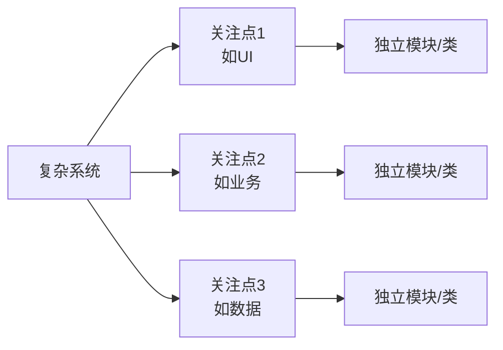
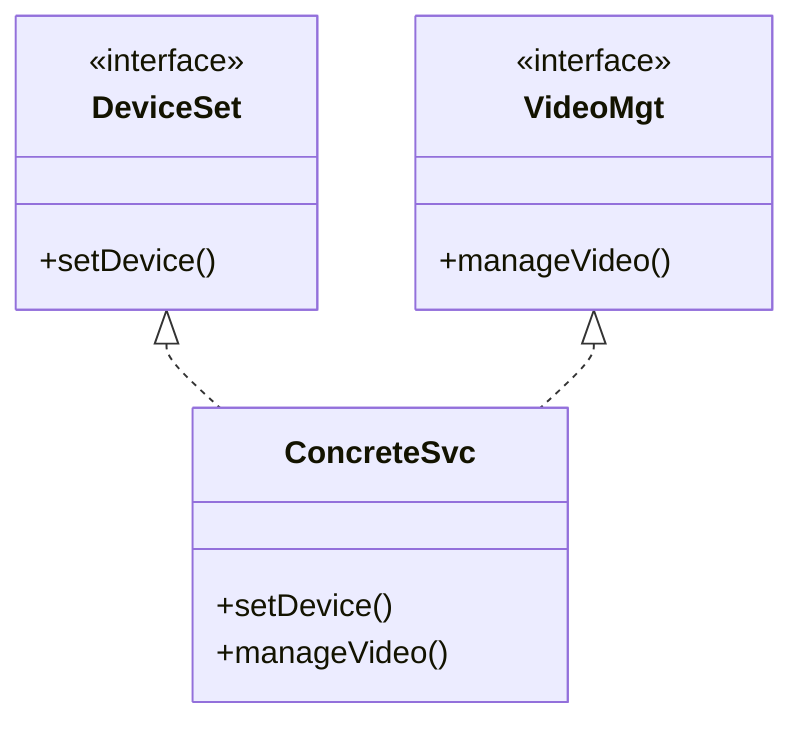

# 关注点分离（Separation of Concerns）

> [!IMPORTANT]
> ==关注点分离（Separation of Concerns, SoC）== 是软件设计的核心概念之一，指将一个复杂系统分解为多个互不重叠的部分，每个部分只解决一个特定的问题或“关注点”。

## 它是什么

思考一个问题：如果你要开发一个电商系统，把订单计算、用户登录和数据库连接全写在一个类里，会发生什么？修改支付逻辑时，可能不小心把登录功能搞崩了。

SoC 的核心思想就是“分而治之”。在传统视图（Traditional-View）中，它体现为模块的 ==single-mindedness（专心致志）==，即一个模块只做一件事；在面向对象视图（OO-View）中，它体现为一组协作的类被合理划分到不同的关注领域中。

## 为什么需要

在 Component-Level Design 阶段，我们需要将架构设计转化为接近代码级别的实现。如果不遵循 SoC：

1. **技术债务（Technical Debt）飙升**：随意修改且未记录的变更会导致系统腐化，后续进行架构重构（Architectural Refactoring）既昂贵又充满风险。
2. **复用困难**：违背了软件工程原则中的 ==Plan Ahead for Reuse==，无法提取可复用的组件（如 COTS）。
3. **高耦合低内聚**：模块之间互相纠缠，无法实现 functional independence。

> [!TIP]
> 记忆口诀：分离是为了独立，独立是为了复用与好维护。

## 怎么做

在实际设计中，SoC 通常通过以下步骤落地：

1. **识别关注点**：区分 problem domain（问题域）和 infrastructure domain（基础设施域）。
2. **接口隔离**：将设计类的操作分类到一个或多个抽象类（或接口）中。例如课件中提到的典型例题，将设备管理与视频管理拆分为 `DeviceSet` 和 `VideoManagement` 两个接口，由 `ConcreteService` 分别实现。
3. **信息隐藏（Information Hiding）**：封装实现细节，仅暴露必要的接口。
4. **遵循 LoD（Law of Demeter）**：每个单元对其他单元的了解应当有限，只与“紧密相关”的单元通信。

## 与相近概念的区别

很多同学容易把 SoC 和其他设计概念混淆。请看下表辨析：

| 概念 | 侧重点 | 与 SoC 的关系 |
| :--- | :--- | :--- |
| **Modularity** | 系统的物理/逻辑分块方式 | SoC 是指导如何正确划分 Modularity 的原则 |
| **Cohesion** | 单个模块内部元素的关联程度 | SoC 追求的结果是高 Cohesion |
| **Coupling** | 模块之间的依赖程度 | SoC 追求的结果是低 Coupling |
| **Abstraction** | 提取本质特征，忽略细节 | Abstraction 是实现 SoC 的手段之一 |

> [!NOTE]
> SoC 是一个宏观的“指导思想”，而 Cohesion 和 Coupling 是用来衡量 SoC 落实得好不好的“定性指标（qualitative measure）”。

## 常见的坑

> [!WARNING]
> **过度分离**：为了分离而分离，把一个简单的功能拆成几十个微小的类，导致类爆炸，反而增加了理解和集成的成本。记住 KISS (Keep It Simple, Stupid!) 原则。

> [!CAUTION]
> **混淆接口分离与类分离**：在 OO-View 中，不要以为建了几个不同的接口就算完成了 SoC。如果底层的类仍然互相强依赖（比如高层直接访问底层数据结构），那么关注点实际上并没有真正分离。应遵循 Dependency Inversion Principle（依赖倒置原则）。

## 算对了的例子

以课件中的**接口分离原则（ISP）典型例题**为例：

假设有一个智能监控系统，包含设备控制和视频处理功能。

**错误做法（未分离关注点）**：
定义一个大而全的接口 `SmartSystem`，包含 `setDevice()` 和 `manageVideo()`。如果某个客户端只需要控制设备，也被迫依赖了它不使用的视频方法。

**正确做法（应用 SoC）**：

在这个模型中，关注点被清晰地划分为“设备设置”和“视频管理”。`ConcreteService` 实现了这两个独立的接口。这样，依赖设备设置的客户端只需知道 `DeviceSet`，完全不需要关心视频管理的存在，完美体现了 single-mindedness 和信息隐藏。
