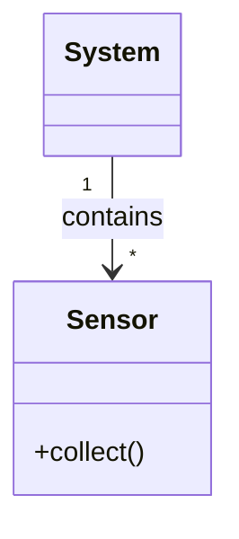
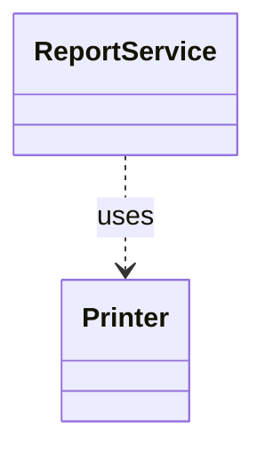
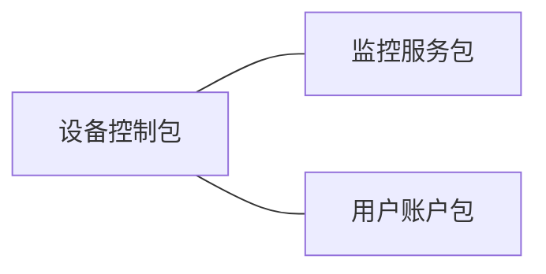
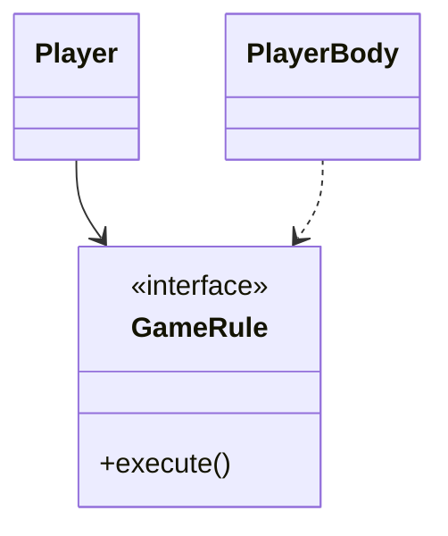

# 关联（Associations）、依赖（Dependencies）与分析包

## 关联与依赖

在需求建模的面向对象分析中，类之间的关系不仅要表达“有哪些类”，还要说明这些类如何协作。**关联（Association）**描述对象之间长期、稳定的信息联系；**依赖（Dependency）**描述某个元素临时“使用”另一个元素。识别二者，有助于明确分析类的职责、协作对象和影响范围。

> [!IMPORTANT]
> 关联回答“彼此知道并保存什么”，依赖回答“临时使用谁”。

### 关联是什么

关联表示两个类所创建的对象之间存在结构上的联系，通常具有长期性和相对稳定性。例如，`Sensor` 对象属于 `System` 对象的一部分，二者需要知道彼此。关联在 UML 类图中通常画成实线，并可标注：

- **角色名**：对象在关系中的身份；
- **重数（multiplicity）**：另一端对象可能出现的数量，如 $1$、$0\ldots1$、$*$。

这里表示一个 `System` 包含多个 `Sensor`，而一个 `Sensor` 只属于一个 `System`。编程时，关联常通过属性实现，例如 `System` 中保存 `Sensor` 对象的集合。

关联还可细分为：

| 关系 | 含义 | 生命周期 |
|---|---|---|
| 普通关联 | 两个对象保持信息联系 | 各自独立 |
| 聚合 | 整体拥有部分 | 部分可脱离整体存在 |
| 组合 | 整体拥有部分 | 部分随整体消失 |

聚合用空心菱形表示，组合用实心菱形表示。

### 依赖是什么

依赖表示一个类在实现某项操作时需要使用另一个类，但通常不保存该类对象的长期引用。最常见的情形是：另一个类的对象被用作方法参数、返回值或局部变量。

UML 中，依赖使用带箭头的虚线表示，箭头从**依赖方**指向**被依赖方**。这说明：如果 `Printer` 的接口发生变化，`ReportService` 可能受到影响。

依赖可以在 UML 中通过构造型（stereotype）进一步说明，例如 `<<create>>`、`<<use>>` 或 `<<realize>>`。构造型用于在标准关系上附加特定语义。

### 如何区分关联与依赖

可依次判断：

1. 是否需要长期保存对方的引用？不需要，通常是依赖。
2. 关系是否表达稳定的领域结构？是，通常是关联。
3. 一方删除或改变后，另一方是否仍可独立存在？若是，更偏向关联或聚合。
4. 是否只是为了完成一次操作而临时使用？是，通常是依赖。

| 对比项 | 关联 | 依赖 |
|---|---|---|
| 语义 | 长期的信息或结构联系 | 临时使用关系 |
| 图示 | 实线 | 带箭头虚线 |
| 实现方式 | 常使用属性保存对象引用 | 常通过参数、返回值或局部变量使用 |
| 变化影响 | 双方可能相互影响 | 通常由依赖方受被依赖方变化影响 |
| 强度 | 相对稳定 | 相对较弱、临时 |

> [!WARNING]
> “方法中出现了另一个类的对象”并不必然意味着依赖。若类长期保存该对象，并将其作为自身领域结构的一部分，也可能应建模为关联。

### 分析包：组织相互联系的类

**分析包（analysis package）**把一组职责相关、协作紧密的分析类组织在一起，使需求模型更易理解、评审和维护。分析包通常来源于需求模型，而不是随意按文件或编程语言划分。

例如，智能家居系统可以划分为：

包之间的连线还应标明所表达的 **depends-upon（依赖……）**联系：依赖方需要被依赖方的信息或服务，因此被依赖方发生变化时，依赖方可能需要重新检查。

### 影响分析与设计原则

关联和依赖不仅用于绘图，也是变更管理的重要依据。如果修改某个 UML 类，需求模型应帮助识别可能受影响的其他类、接口说明和代码构件。

在设计阶段，应尽量减少对具体实现的直接依赖。按照**依赖倒置原则（DIP）**，高层模块和低层模块都应依赖抽象：

`Player` 不直接依赖 `PlayerBody` 等具体实现，而依赖 `GameRule` 接口；具体实现也依赖该接口。这样替换或新增规则时，对高层逻辑的影响更小，更有利于满足开闭原则。

> [!TIP]
> 记忆口诀：**实线长期连，虚线临时用；菱形管整体，虚线箭依赖。**

### 算对了的例子

题目给出类图中的 `◊---->` 和 `◆---->`：

- `◊---->` 表示**聚合**。例如 `Car` 与 `Engine` 是整体—部分关系，但发动机可以脱离汽车独立存在，因此两者生命周期不同。
- `◆---->` 表示**组合**。例如 `Head` 与 `Mouth` 是整体—部分关系，嘴不能脱离头部独立存在，因此部分的生命周期受整体控制。

判断时不能只看连线方向，还要看两端菱形、对象生命周期以及模型表达的领域含义。
