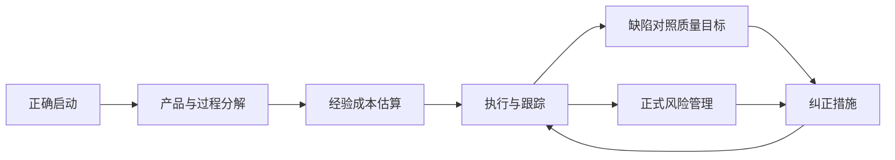

# 关键实践（Critical Practices）

## 关键实践的定位

在软件项目管理中，**关键实践（Critical Practices）**是支撑项目成功的一组核心管理活动。它们不是可选的“锦上添花”，而是==降低软件失败风险、确保项目可控==的必要手段。理解关键实践，需要把它放在管理光谱（Management Spectrum）的四个维度——人员（People）、产品（Product）、过程（Process）、项目（Project）——中考察：关键实践主要落在“项目”维度，但与其他三个维度紧密联动。

## 为什么需要关键实践

软件项目失败往往不是因为技术难题无法攻克，而是因为管理失控：需求蔓延、进度失真、质量缺陷积压、风险爆发时才应对。关键实践的作用，是在项目全生命周期中建立**可度量、可追踪、可纠正**的管理机制。例如，经验成本估算（empirical cost estimation）用历史数据替代主观猜测；缺陷跟踪对照质量目标（defect tracking against quality targets）让质量从口号变为可检查的指标；正式风险管理（formal risk management）把“救火”前移为“防火”。

## 核心关键实践

性能导向项目管理（performance-based project management）的关键实践包括：

- **经验成本估算**：基于历史项目数据与规模度量进行估算，而非拍脑袋。
- **缺陷跟踪对照质量目标**：持续收集缺陷数据，与预设质量目标比较，偏差触发纠正措施。
- **正式风险管理**：系统识别、分析、排序风险，制定缓解与应急计划，并定期复审。

此外，项目启动与进度跟踪同样关键。软件项目经理要最小化失败风险，必须==“开好头”（start on the right foot）并“跟踪进展”（track progress）==：前者包括明确范围、合理分解、建立可行计划；后者包括用可验证的里程碑与度量数据监控偏差。

## 与相近概念的区别

| 概念 | 关注点 | 与关键实践的关系 |
|---|---|---|
| 管理光谱 | 人员、产品、过程、项目四个维度 | 提供整体框架，关键实践是其中项目维度的落地手段 |
| 过程分解 | 将过程框架活动适配到具体项目 | 是关键实践中“正确启动”的一部分 |
| 通用过程框架活动 | 沟通、策划、建模、构建、部署 | ==不可省略，具有不变性==；可调整详细程度，但不能删除 |
| 质量控制 | 通过评审、测试等发现缺陷 | 是关键实践中缺陷跟踪的技术基础 |

## 常见的坑

> [!WARNING]
> 过程分解时，即使项目很小，也不能省略选定的通用过程框架活动。正确做法是==裁剪活动的深度与形式，而非取消活动本身==。

> [!CAUTION]
> 不要把“增加人手”“申请大预算”当作降低失败风险的关键实践。盲目加人可能因沟通开销与 Brooks 定律进一步拖慢进度。

另一个易错点是分解顺序：产品分解（交付哪些功能、采用何种交付过程）与过程分解==随项目计划演化同步进行==，不是先完成一个再开始另一个。项目范围界定中的问题分解，主要针对**待交付功能**与**交付功能所用过程**两大领域。

## 例题解析

**题目**：Which of these are critical practices for performance-based project management?

- A. assessing product usability
- B. defect tracking against quality targets
- C. empirical cost estimation
- D. formal risk management
- E. b, c, d

**答案**：E。

**解析**：性能导向项目管理强调用度量与目标驱动管理。B 将缺陷数据与质量目标对照，C 用经验数据支撑成本估算，D 用正式机制管理风险，三者都是关键实践。A“评估产品可用性”属于产品质量评价活动，重要但不属于这里列出的三项关键实践，因此不能选 A，也不能因 A 看似合理而漏选 E。

> [!TIP]
> 记口诀：==“估算靠经验，缺陷对目标，风险要正式”==。遇到“如何降低失败风险”再加两句：“开局要正确，进展勤跟踪”。
