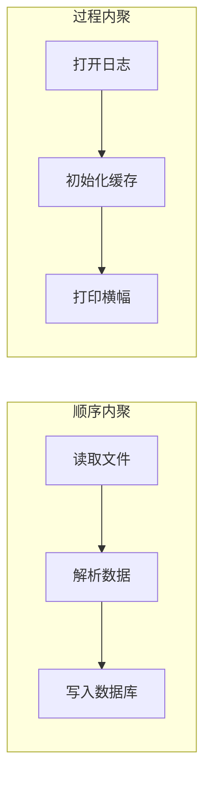

# 内聚（Cohesion）的类型：功能、分层、通信、顺序、过程、时间、实用内聚

## 内聚（Cohesion）的类型

### 它是什么

内聚（Cohesion）是衡量==模块内部各元素之间联系紧密程度==的定性指标。一个模块如果只专注于完成一件明确的事情，其内部的方法、属性都为同一个目标服务，那么这个模块就具有高内聚性。

> [!IMPORTANT]
> 内聚表示模块内部功能的相对强度（module 内部的“向心力”），与耦合相对——耦合描述的是模块之间相互依赖的程度。高内聚的模块通常只完成单一任务，与其他组件的交互很少。

课件中给出的英文定义：

> *Cohesion is an indication of the relative functional strength of a module.*

理解内聚的另一个角度：它是**信息隐藏（information hiding）**概念的自然延伸。一个内聚的模块把相关的数据和操作封装在一起，对外暴露尽可能少的细节。

### 为什么需要关注内聚

构件级设计的核心目标之一是**高内聚、低耦合**。高内聚带来以下直接好处：

- **易于实现**：模块职责单一，逻辑集中，编码时不需频繁在多个关注点之间切换。
- **易于测试**：测试一个只做一件事的模块，用例设计和故障定位都更简单。
- **易于维护**：修改某个功能时，改动被限制在对应的高内聚模块内，不会波及无关代码。
- **易于复用**：功能纯粹的模块更容易被识别和提取出来复用到其他场景。

题中也有直接的说法：表现出功能、分层或通信内聚的类和构件，==相对容易实现、测试和维护==。

### 七种内聚类型

从高到低排列，内聚强度依次递减：

| 类型（英文） | 模块内元素的关系 | 内聚强度 | 举例 |
|---|---|---|---|
| 功能内聚（Functional） | 所有元素共同完成==一个==明确功能 | 最高 | 计算平方根、验证密码 |
| 分层内聚（Layer） | 元素属于同一抽象层次，服务封装在层内 | 高 | 数据访问层只做数据库读写 |
| 通信内聚（Communicational） | 操作使用==同一份输入数据==或产生同一份输出 | 中高 | 对同一份订单数据做校验、统计、打印 |
| 顺序内聚（Sequential） | 一个元素的输出是下一个元素的输入 | 中 | 读文件 → 解析 → 写入数据库 |
| 过程内聚（Procedural） | 元素按==特定顺序==执行，但数据关系弱 | 中低 | 初始化系统时依次执行若干无关操作 |
| 时间内聚（Temporal） | 元素因==同一时刻==被执行而放在一起 | 低 | “初始化模块”里包含打开文件、连接数据库、显示欢迎界面 |
| 实用内聚（Utility/Pragmatic） | 元素之间几乎==没有逻辑关联== | 最低 | 放各种不相关工具函数的“杂项”模块 |

### 如何区分相近的几种内聚

最容易混淆的是**顺序内聚**和**过程内聚**，二者的关键差异在于数据是否在模块内流动：

- **顺序内聚**：A1 的输出是 A2 的输入，A2 的输出是 A3 的输入——数据驱动了执行顺序。
- **过程内聚**：B1、B2、B3 只是碰巧要按这个顺序做，彼此之间没有数据依赖，换一下顺序也说得通。

另一个易混点是**通信内聚**和**功能内聚**：

> [!NOTE]
> 通信内聚强调多个操作“共用同一份数据”；功能内聚强调所有操作“只为一个功能”。比如对同一份销售记录做“查询、导出、打印”，这些操作共用数据，但它们不是同一个功能——这是通信内聚，而非功能内聚。

### 常见的坑

> [!WARNING]
> 内聚强度不是靠“模块代码行数少”或“函数拆分得细”来保证的。把一个大函数机械地切成多个小函数，如果小函数之间依然共享大量上下文、职责边界模糊，内聚性并没有真正提高。

另一个坑：**时间内聚经常被误认为高内聚**。很多开发者习惯写 `initialize()`、`setup()` 这类模块，把“程序启动时要做的所有事”都塞进去。它们只是因为时机关联，逻辑上并无内聚。更合理的做法是把各初始化逻辑拆到各自功能模块中。

### 一个判断例子

**题干**（选择 2，原题节选）：

> Cohesion is a qualitative indication of the degree to which a module（）
>
> - A. can be written more compactly.
> - B. focuses on just one thing.
> - C. is able to complete its function in a timely manner.
> - D. is connected to other modules and the outside world.

**分析过程**：

- A 说的是代码是否紧凑，与内聚无关。
- C 说的是及时完成功能，属于性能，不相关。
- D 描述的是模块与外部的关系，那是**耦合（coupling）**的定义。
- B 说的是“专注于一件事”——这正是内聚的核心含义。

**答案**：B。

**另一个判断题**：

> Classes and components that exhibit functional, layer, or communicational cohesion are relatively easy to implement, test, and maintain.

**分析**：功能内聚（最高）、分层内聚（高）、通信内聚（中高）都属于==较高强度==的内聚类型。这些类型的模块职责相对集中、边界清晰，因此==确实比较容易实现、测试和维护==。

**答案**：True。
