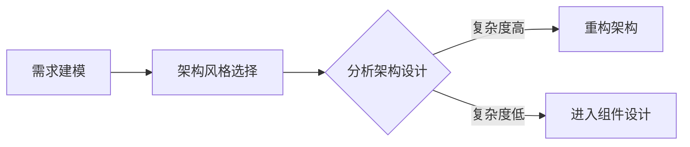

# 分析体系结构设计（Analyzing Architectural Design）的方法

> [!IMPORTANT]
> 分析体系结构设计（Analyzing Architectural Design）是在架构方案提出后，==评估其整体复杂度与质量属性==的过程。

## 它是什么与为什么需要

设计（Design）是一个多步骤过程，它将数据与程序结构、接口特征和过程细节从信息需求中综合出来。当我们完成 Architectural Styles and Patterns 的选择后，怎么知道选出的架构“好不好”？

如果直接写代码才发现组件之间耦合得像一团乱麻，代价将极其高昂。因此，我们需要在编码前 Analyzing Architectural Design，通过量化指标判断架构是否足够清晰、可维护。

## 怎么做：核心分析方法

课件指出，评估一个提议架构（proposed architecture）整体复杂度的实用技术是观察组件间的依赖关系。具体看两类：

1. **Flow dependencies（流依赖）**：组件 A 的输出作为组件 B 的输入，存在控制或数据的流向。
2. **Sharing dependencies（共享依赖）**：多个组件共同读写同一个全局数据结构或资源。

> [!TIP]
> 记忆口诀：**“查复杂度，看两赖”**——流依赖（flow）加共享依赖（sharing），两者结合才能全面反映架构复杂度。

除了依赖分析，还需要借助 Architectural Description Language (ADL)。ADL 为描述软件架构提供了语义（semantics）和语法（syntax），使得架构分析可以被形式化表达，而不仅仅停留在图纸上。

同时，可以通过 Static architectural conformance checking（静态架构一致性检查）来验证源代码是否违背了既定的架构约束。

## 相近概念的区别

初学者常把“分析架构”和“设计模式”混为一谈，或者搞不清依赖和内聚的关系。

| 维度 | Architectural Pattern | Analyzing Architectural Design |
| :--- | :--- | :--- |
| **阶段** | 架构设计时（构造） | 架构设计后（评估） |
| **目的** | 提供可复用的架构解决方案 | 评估架构复杂度与合理性 |
| **举例** | Composite, MVC | 计算 flow/sharing 依赖 |

| 维度 | Cohesion（内聚） | Dependencies（依赖） |
| :--- | :--- | :--- |
| **关注点** | ==单个组件内部==元素的紧密程度 | ==不同组件之间==的交互与耦合 |
| **对复杂度的影响** | 高内聚是好事 | 高依赖通常意味着高复杂度 |

> [!WARNING]
> 常见坑：认为评估架构复杂度只看组件大小（size）或只看内聚（cohesion）。实际上，决定系统级复杂度的关键往往是组件间的**交互依赖**。

## 算对了的例子

结合考试真题来实战演练：

**题目**：A useful technique for evaluating the overall complexity of a proposed architecture is to look at the component （）
A. cohesion  B. flow dependencies  C. sharing dependencies  D. size  E. b and c

**解析**：
- 问的是“evaluating the overall complexity”（评估整体复杂度）。
- 根据知识点，评估架构复杂度的核心技术是查看组件间的 `flow dependencies` 和 `sharing dependencies`。
- `cohesion` 衡量内部紧密度，`size` 衡量体量，均不是评估架构级复杂度的主要手段。
- 因此，B 和 C 都是正确的方法。

**答案**：==E==

> [!NOTE]
> 关于判断题中的 Static architectural conformance checking：它检查的是“源代码是否符合已定义的架构规则”，而**不是**检查“源代码是否匹配用户可见的需求（user visible requirements）”。前者是架构层面的事，后者是测试/验收层面的事，切勿混淆。
