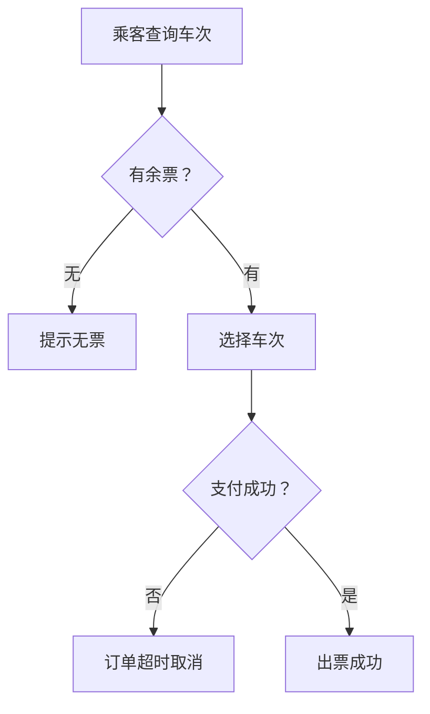

# 创建初始用例（Preliminary Use Case）与细化用例

## 创建初始用例与细化用例

“用户满意”是衡量软件系统成功与否的最佳方式。要让用户满意，首先得准确理解用户想用系统**做什么**。用例（Use Case）正是从用户视角出发，描述系统如何与外部参与者（Actor）交互以完成某个目标的工具。

创建用例不是一步到位的。它通常经历三个阶段：==先写初始用例，再逐步细化，最后形成正式用例文档==。初始用例描述“主场景”——即一切顺利时系统该怎么走；细化用例则补充“备选场景”和异常处理，让需求经得起追问。

### 为什么需要初始用例

想象你要为图书馆开发借书系统。如果一开始就纠结“读者卡丢失了怎么办”“网络断线怎么恢复”，很容易陷进细节里，连最基本的借书流程都写不出来。初始用例的价值就在于：**先抓住主流程，确认方向正确，再补充分支**。

> [!IMPORTANT]
> 初始用例有时被称为 primary scenario（主场景），它只回答一个问题：参与者最常走、最成功的那条路径是什么？

### 从主场景开始

以一个“ATM 取款”用例为例。初始用例可以这样写：

| 要素 | 内容 |
|------|------|
| 用例名 | 取款 |
| 参与者 | 银行客户 |
| 前置条件 | 客户已插入银行卡并输入正确密码 |
| 主场景 | 1. 客户选择“取款”；2. 系统提示输入金额；3. 客户输入 200 元；4. 系统吐出现金并打印凭条 |

你会发现，初始用例只覆盖了“一切正常”的路径——卡里有足够的钱，ATM 里有现金，打印机有纸。但它足够让团队先对“取款”这件事建立共识。

### 细化：追问“如果……会怎样”

第二步是拿着初始用例去**问异常**。这正是细化用例的核心工作：为每一个步骤寻找替代路径（alternative flow）。

| 步骤 | 可能的异常 | 替代交互 |
|------|-----------|---------|
| 步骤 2 | 金额输入非法（如 0 或字母） | 系统提示重新输入 |
| 步骤 4 | 卡内余额不足 | 系统提示余额不足，退卡 |
| 步骤 4 | ATM 内现金不足 | 系统提示无法完成，退卡 |
| 步骤 4 | 凭条纸用完 | 询问客户是否继续（不打印凭条） |

这些替代场景写进细化用例中，让需求从“一句话描述”变成“可测试的契约”。

> [!TIP]
> 问“如果……会怎样”是细化用例的发动机。每个步骤至少问一次，重点问涉及**外部资源**（网络、现金、打印纸）和**用户输入**的步骤。

### 初始用例与细化用例的对比

| 维度 | 初始用例 | 细化用例 |
|------|---------|---------|
| 场景覆盖 | 仅主场景 | 主场景 + 替代场景 |
| 异常处理 | 不涉及 | 每个关键步骤的异常分支 |
| 粒度 | 粗 | 细，可指导测试用例设计 |
| 使用时机 | 需求获取早期 | 需求分析后期 |

### 一个算对了的例子

下面是一个“网上订票”用例的初始版本和细化版本对比。

**初始用例（主场景）**：

**细化后补充的替代路径**：

初始用例只画了最上面的横向流程；细化用例加入了“无票”和“支付失败”两个分叉。==有了这些分支，测试人员才能设计出覆盖异常路径的测试用例==。

### 常见的坑

> [!WARNING]
> 一个最常见的错误是**在初始用例阶段就试图穷尽所有异常**。这会让文档迅速膨胀，团队迟迟拿不出可讨论的主流程。初始用例就是要“快而准”，细化阶段再补全。

> [!CAUTION]
> 不要混淆用例的**粒度**。如果一步写了“系统验证金额合法性”，下一步又写“系统再次检查金额是否为正数”，就是重复。细化不是把一步拆成十步，而是为每一步补充**真正可能发生的分叉**。

创建初始用例和细化用例，本质上是把“用户故事”翻译成“系统行为契约”的必经之路。先走通主流程，再堵住旁路漏洞，需求才算真正落地。
