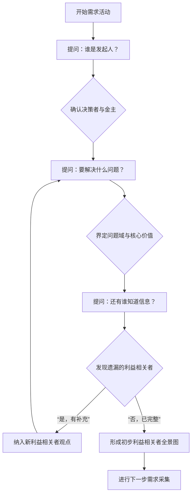

# 确认利益相关者（Stakeholders）与识别多种观点

---

## 确认利益相关者（Stakeholders）与识别多种观点

### 什么是利益相关者？

在任何一个软件项目中，==利益相关者（Stakeholder）是指任何对项目成果有直接或间接利益，或能对其施加影响的人或组织。== 他们不仅仅是付钱的客户，还包括最终用户、开发团队、运维人员、监管机构，甚至是竞争对手。理解了这一点，你就迈出了防止项目偏离正轨的第一步。

[!NOTE]
> **为什么需要识别全部的利益相关者？**
> 如果遗漏了关键的利益相关者，他们的需求在前期就会被忽略。后期当他们介入时，往往会导致大量返工，增加成本，甚至使项目失败。这就像是建了一栋漂亮的房子，却忘了问住户需不需要一个厨房。

### 把握核心：识别多种观点（Viewpoints）

利益相关者之所以重要，是因为他们各自拥有独特的“观点”。同一个系统，在管理者眼中是提升效率的报表工具，在操作员看来可能是简化工作流的自动化助手，而在运维人员眼里则是需要监控和维护的服务器集群。**识别多种观点的过程，就是系统化地从不同利益相关者群体的视角来捕捉和分析需求，避免对系统形成单一的、片面的理解。**

### 如何精准捕捉这些观点？—— 首次提问的艺术

在项目启动之初，我们需要一套结构化的问题来高效地引出需求。这就是“首次提问”的精髓，这些问题通常是“上下文无关”的，旨在从宏观上帮助我们聚焦。下面我们通过一道曾考过的题目，来深入理解如何运用这些问题。

**一个算对了的例子**

请分析以下三个问题的目标及其对方案选择的作用：

**问题1：Who is behind the request for this work？（谁是这项需求的发起人？）**

*   **目标分析**：这个问题的目标是 **识别真正的客户与决策者，明确利益相关者网络的核心节点**。它能帮助我们理清项目资金的来源、最终验收者是谁，以及谁拥有需求优先级排序的最终话语权。
*   **对方案选择的作用**：==确认发起人直接决定了项目的**目标导向**。== 例如，一个由市场部发起的项目，其方案可能会优先选择能快速上线、抢占市场的云服务和现成组件；而一个由研发部发起的项目，则可能更多地考虑技术的前瞻性与架构的优雅性。

**问题2：What problem(s) will this solution address？（这个解决方案将解决什么问题？）**

*   **目标分析**：此问题的目标是 **界定问题域，明确软件系统的业务价值与核心使命**。它将我们的关注点从“我们要建立一个什么系统”拉回到“我们要为谁解决什么痛点”，这是避免镀金和范围蔓延的关键。
*   **对方案选择的作用**：==清晰的问题定义直接界定了技术方案的**边界与复杂度**。== 如果只是解决部门内部数据记录不准确的问题，一个简单的Web表单加数据库即可。如果要解决的是全球用户在高并发下的订单一致性问题，方案就必须引入分布式事务、消息队列等复杂的架构设计。

**问题3：Can anyone else provide additional information？（还有其他人能提供补充信息吗？）**

*   **目标分析**：这个问题是一个“元问题”，其目标是 **验证信息源的完备性，发现遗漏的利益相关者和隐藏的观点**。它承认了单次沟通的局限性，鼓励我们主动探索需求的全貌。
*   **对方案选择的作用**：==这个问题的答案能有效防止“需求震荡”，确保方案决策建立在一个稳定、全面的信息基础上。== 如果通过这个问题，我们找到了一个一线操作员，他提出的性能痛点可能直接颠覆我们原先选定的看似完美的数据处理方案。

### “赢”的条件与协作共赢

识别了利益相关者和他们的观点后，下一步就是分析他们各自“赢”的条件。一个成功的项目，不是零和博弈，而是寻求一种让所有核心利益相关者都认为“我达成了关键目标”的平衡状态。

[!TIP]
> **关键认知：**
> 需求分析不是单方面向用户“索取”需求清单，而是一场促使利益相关者们 **Stakeholders work together（利益相关者协同工作）** 的引导过程。作为分析员，你的角色是让这些不同的观点碰撞、协商并最终融合。

### 常见误区与避坑指南

[!WARNING]
> **混淆“用户”与“客户”：**
> 客户为软件付费，但用户是每天实际操作软件的人。一个常见的坑是只听客户（如部门经理）描绘的理想化流程，而忽略了用户（如一线员工）的实际工作场景和痛点。==遗漏真实用户的需求，是导致软件上线后没人愿意用的首要原因。==

[!CAUTION]
> **被“权威人物”主导：**
> 在需求沟通会上，职位最高的人可能会压制其他人的观点。如果仅仅把他的话奉为圭臬，你会得到一个看似“需求明确”实则片面失衡的系统。作为分析师，你必须具备软化这种单方面影响的技巧，主动去挖掘那些沉默但关键的声音。
