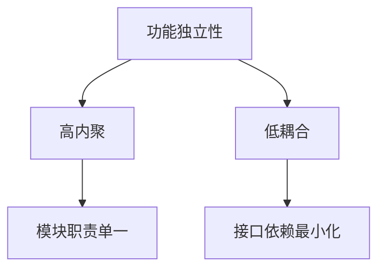
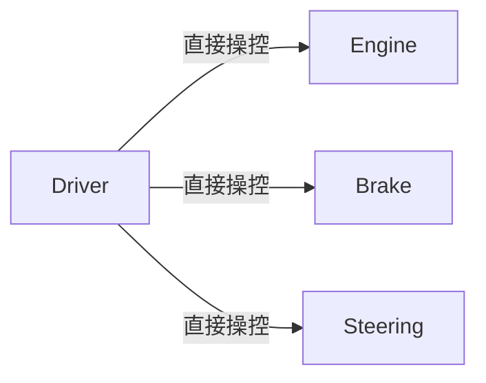
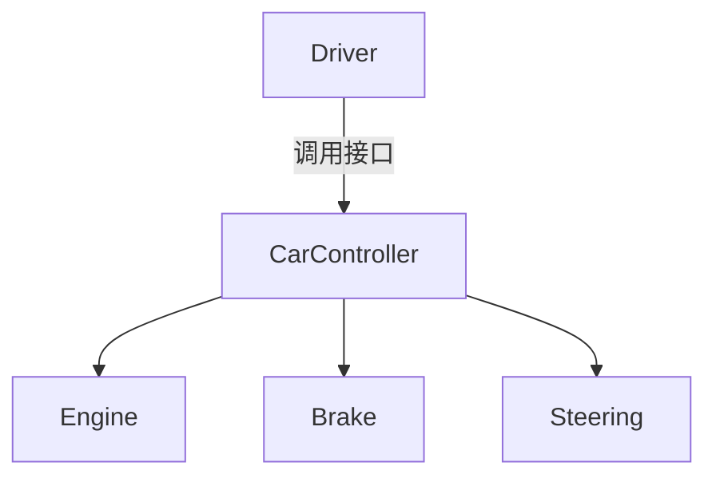

# 功能独立性（Functional Independence）

> [!IMPORTANT]
> 核心定义：功能独立性（Functional Independence）要求 ==模块只执行且仅执行一项计算任务==（performs one and only one computation）。

## 为什么需要它？

试想：如果一个模块同时负责“读取数据”和“格式化输出”，当输出格式改变时，读取逻辑会被迫跟着修改吗？显然会。这就是缺乏功能独立性的代价。

追求功能独立性，本质上是为了实现 ==高内聚、低耦合==：

- **易测试**：每个模块只做一件事，单元测试边界清晰。
- **易维护**：修改一个功能不会引发连锁反应（即减少副作用波及范围）。
- **易复用**：不依赖特定上下文的独立模块，可直接迁移到其他系统。

课件明确指出，良好的软件设计应包含 "functionally independent components"。

## 如何做到功能独立？

功能独立性通过两个定性指标来衡量与落地：**内聚（Cohesion）** 与 **耦合（Coupling）**。

| 维度 | 英文术语 | 关注点 | 目标 |
| :--- | :--- | :--- | :--- |
| **内聚** | Cohesion | 模块内部各元素的关系 | 越高越好，表示相对功能强度（relative functional strength）强 |
| **耦合** | Coupling | 模块与模块之间的关系 | 越低越好，通过接口实现可控连接 |

> [!TIP]
> 记忆口诀：==“内看自己，外看别人”==。内聚审视模块内部是否专注；耦合审视模块间依赖是否克制。

具体做法：
1. **分离关注点（Separation of Concerns）**：将复杂问题拆解为互不重叠的子问题。
2. **信息隐藏（Information Hiding）**：模块内部的实现细节对外部不可见，仅暴露必要接口。
3. **设计重构（Refactoring）**：发现冗余、无用设计元素或不当数据结构时，在不改变外部行为的前提下重组内部结构，提升独立性。

## 与相近概念的区别

很多同学容易把“功能独立”和“模块化（Modularity）”混为一谈。

- **模块化**：把系统切分成多个组件的==动作或结果==。但切分得碎不代表切分得好。
- **功能独立性**：评价这些模块切分质量的==标准==。只有满足“一个模块只做一件事”的模块化，才是有效的模块化。

## 常见误区

> [!WARNING]
> 并非模块越小越独立！如果把“计算平均值”硬拆成“求和”和“除法”两个模块，反而增加了不必要的耦合，破坏了功能完整性。

> [!CAUTION]
> 违反单一职责原则（SRP）是破坏功能独立性的头号杀手。例如考题中的“司机驾车”方案：

在这个错误设计中，`Driver` 类直接依赖了车辆的所有底层组件，导致 `Driver` 承担了过多职责（角色混乱 Role Confusion），严重违反了功能独立性。

## 正确设计示例

针对上述考题，如何利用功能独立性进行重构？引入高层接口（如控制器），让 `Driver` 只与抽象交互，而不是与具体零件纠缠。

> [!NOTE]
> 重构后，`Driver` 只负责“驾驶意图”这一项计算（符合 Functional Independence），`CarController` 负责“指令分发”。类之间依赖关系最小化（低耦合），每个类的职责紧密相关（高内聚），这就是一个组织良好的（well-formed）设计类。
