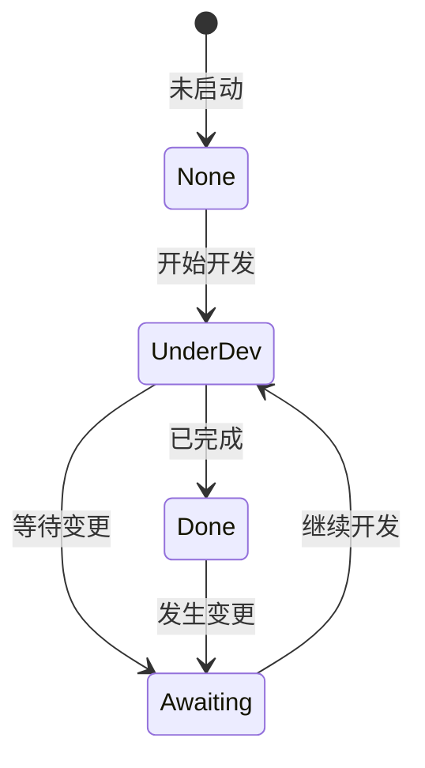

# 并发/协同模型（Concurrent Models）

> [!IMPORTANT]
> 协同模型（Concurrent Models）是一种==用例驱动、阶段并发==的软件过程模型，允许不同工程活动在同一时间处于不同状态。

## 它是什么与为什么需要

传统瀑布模型要求“需求→设计→编码”严格串行。但当一个产品工程项目涉及多个工程团队时，等待上游完全结束再启动下游会造成巨大浪费。

试问：如果系统包含三个独立模块，必须等所有模块的需求分析全部完成，才能开始任何一个模块的设计吗？

显然不必。协同模型正是为了解决这一问题而生。它将开发过程视为一组==任务、子任务之间的相互依赖关系==网络，这些关系可以是顺序的，也可以是并发的或独立的。该模型适用于所有类型的软件开发，尤其在多团队协作的产品工程中优势显著。

## 怎么做：状态机工作流

协同模型不使用传统的线性流程，而是将每个工程活动（如需求分析、设计）看作一个状态机。

- **None（无）**：活动尚未开始。
- **Under Development（开发中）**：活动正在进行。
- **Awaiting Changes（等待变更）**：活动因关联活动的修改而暂停。
- **Done（完成）**：活动产生基线。

> [!TIP]
> 记忆口诀：“不是排队走，而是各自跑；谁被牵连了，谁就停下来等”。

### 算对了的例子

以历年真题场景为例：某项目包含“分析”、“设计”、“实现”三个活动。

1. $t_0$ 时刻：分析进入 `UnderDev`，设计与实现处于 `None`。
2. $t_1$ 时刻：分析产出初步规格说明，设计进入 `UnderDev`（此时分析与设计==并发==执行）。
3. $t_2$ 时刻：客户提出新需求，分析活动需修改。此时设计活动不能继续，必须转入 `Awaiting` 状态。
4. $t_3$ 时刻：分析修改完毕重新回到 `UnderDev`，随后设计解除等待，也恢复为 `UnderDev`。

这种机制确保了在并发推进的同时，通过状态转换严格控制==相互依赖性（interdependency）==。

## 与相近概念的区别

| 对比维度 | 协同模型 (Concurrent) | 增量模型 (Incremental) | 演化模型 (Evolutionary) |
| :--- | :--- | :--- | :--- |
| ==核心思想== | 活动间状态并发与同步 | 分批次交付功能增量 | 迭代逼近最终系统 |
| 关注焦点 | 任务间的依赖与状态流转 | 产品的可运行版本划分 | 应对高度不确定的需求 |
| 适用场景 | 多团队/多组件产品工程 | 需求明确但需分批交付 | 需求模糊需快速原型 |

## 常见的坑

> [!WARNING]
> 不要把“协同模型”和“CVS（Concurrent Versions System）”混为一谈！课件中提到的 CVS 是源代码版本管理工具（支持 Linux、Windows 等平台），而协同模型是软件过程模型。两者虽共享“Concurrent”一词，但属于完全不同的知识域。

> [!CAUTION]
> 在制定进度计划时，协同并发不代表无视约束。必须遵循==工作量确认（effort validation）==原则：确保在任意时段中分配的人员数量，不超过团队成员总人数。否则并发只是纸面游戏，实际无法落地。
