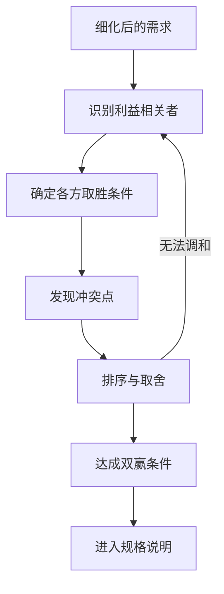

# 需求协商（Negotiation）

## 什么是需求协商

需求协商（Negotiation）是需求工程七步中的第三步：**Inception → Elicitation → Elaboration → Negotiation → Specification → Validation → Requirements Management**。前一步细化（Elaboration）已经用分析模型把用户需求展开，但不同利益相关者（stakeholders）的诉求往往互相冲突，而且都受有限资源约束。

协商的任务就是：==识别冲突、调和冲突，让客户、用户和其他利益相关者就“系统该做什么、做到什么程度”达成一致==。Pressman 教材给出的典型协商活动是：

1. 识别系统或子系统的关键利益相关者；
2. 确定各利益相关者的“取胜条件”（win conditions）；
3. 协商这些取胜条件，把它们调和成一组双赢条件（win-win conditions）。

> [!IMPORTANT]
> 协商的目标不是“谁说了算”，而是 **win-win**：各方都接受、且项目资源能支撑的一组需求，作为后续规格说明的输入。

## 为什么需要协商

- 需求来自多个 viewpoints，天然会冲突：市场要功能多，开发要工期短，运维要稳定。
- 需求与资源（成本、进度、技术可行性）必须匹配，否则规格说明写得再漂亮也无法交付。
- 不协商就进入 Specification，等于把冲突埋进设计阶段，返工代价成倍放大。

## 怎么做：协商流程

实际操作上常用“优先级 + 取舍”来调和冲突：按业务价值、风险、成本给需求排序，高优先级保留，低优先级推迟到后续版本或删除。每次取舍都要让相关方确认，形成可追溯的记录，供需求管理（Requirements Management）跟踪。

## 与相近概念的区别

| 概念 | 关注点 | 典型产物 |
| --- | --- | --- |
| Elicitation（获取） | 把需求问出来、收集全 | 需求清单、访谈记录 |
| Elaboration（细化） | 用分析模型展开需求 | 用例、分析类、分析模式 |
| **Negotiation（协商）** | **解决冲突、排优先级、定范围** | **一致同意的需求集、优先级** |
| Specification（规格说明） | 把结果写成正式文档/模型 | SRS、用例规约 |
| Validation（确认） | 检查需求是否正确、无歧义 | 评审意见、确认记录 |

> [!WARNING]
> 常见坑：把协商当成“需求获取的重复提问”，或当成“写文档前的格式检查”。协商解决的是**冲突与取舍**，不是补问题，也不是校对文字。

## 一个做对了的例子

某校园 App 项目，教务处要求“成绩实时推送”，学生要求“流量消耗低”，开发组评估后认为实时推送需新增服务器，超出预算。

- 取胜条件：教务处要“及时”，学生要“省流量”，开发组要“不超预算”。
- 冲突识别：实时推送 ↔ 成本、流量。
- 协商结果：改为“成绩发布后 1 小时内批量推送 + 仅推送摘要，详情需主动拉取”，并把“实时推送”列入二期需求。

三方都接受了折中方案，优先级和范围随之确定——这就是一次有效的 Negotiation，其输出直接进入 Specification。
