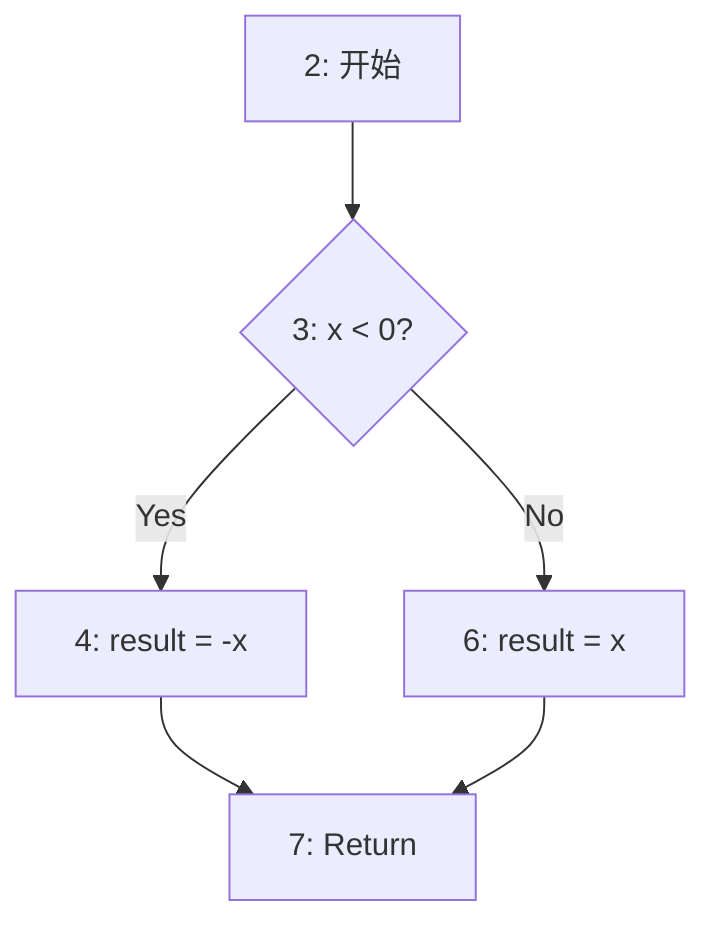

# 单元测试（Unit Testing）的时机与内容（模块接口、局部数据结构、独立路径、出错处理、边界条件）

## 单元测试的核心：时机与五大检查点

单元测试（Unit Testing）是软件测试螺旋模型的起点，对应详细设计阶段。它针对软件的最小可测试单元（如函数、类或组件）进行验证。

> [!IMPORTANT]
> **核心结论**：单元测试应遵循 ==“先设计用例，后编写代码”== 的原则。在 XP（极限编程等敏捷方法）中，单元测试需每日执行，以确保模块内部逻辑无误，为后续集成测试打下基础。

### 为什么需要单元测试？

想象一下，如果每个砖块（模块）都有裂缝，砌成的墙（系统）必然倒塌。单元测试的目的就是确保==模块内无问题==。它主要依赖白盒测试技术，重点关注以下五个方面：

| 检查维度 | 英文术语 | 关注重点 |
| :--- | :--- | :--- |
| **模块接口** | Module Interface | 信息能否正确流入和流出单元？参数匹配吗？ |
| **局部数据结构** | Local Data Structures | 执行过程中，临时变量和数据是否保持完整性？ |
| **独立路径** | Independent Paths | 所有语句是否至少被执行一次？覆盖关键逻辑分支。 |
| **边界条件** | Boundary Conditions | 在极限值（如最大值、最小值、空值）下模块是否正常？ |
| **出错处理** | Error Handling | 当输入错误或异常发生时，程序能否正确捕获并处理？ |

> [!TIP]
> **记忆技巧**：接口进出、数据存留、路径走遍、边界守牢、错误兜底。

### 怎么做：脚手架与基本路径

由于被测模块往往不是独立运行的，我们需要构建**脚手架（Scaffolding）**：
*   **驱动模块（Driver）**：模拟上层调用者，接收测试数据并调用被测模块。
*   **桩模块（Stub）**：模拟下层被调用者，返回预设数据，隔离外部依赖。

在“独立路径”测试中，常使用**基本路径测试法**。其核心是计算**环路复杂度** $V(G)$，确定最少需要多少条独立路径才能覆盖所有逻辑。

$$ V(G) = E - N + 2 = P + 1 $$
其中 $E$ 为边数，$N$ 为节点数，$P$ 为判定节点（谓词节点）数。

### 典型例题解析

假设有一段计算绝对值的代码，流图如下所示：

**解题步骤：**
1.  **计算复杂度**：判定节点 $P=1$（即 `if` 语句），故 $V(G) = 1 + 1 = 2$。这意味着至少有 2 条独立路径。
2.  **列出路径**：
    *   路径 1：`2 -> 3 -> 4 -> 7`（对应 $x < 0$）
    *   路径 2：`2 -> 3 -> 6 -> 7`（对应 $x \ge 0$）

> [!WARNING]
> **常见坑**：
> 1. 混淆“语句覆盖”与“路径覆盖”。单元测试强调独立路径，必须保证每条分支的真/假情况都被测试到。
> 2. 忽略**边界条件**。例如测试 `x=0` 的情况，这往往是 bug 高发区。
> 3. 误以为单元测试可以替代集成测试。单元测试只保证模块内部正确，不保证模块间接口（Interface）完全兼容，后者需在集成测试中解决。

通过每日执行的单元测试，我们能尽早发现缺陷，降低修复成本，确保软件架构的稳固性。
