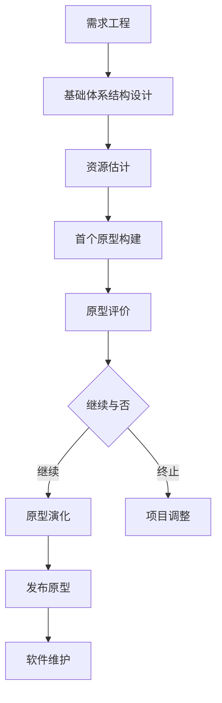

# 演化模型之原型法（Prototyping Paradigm）

## 是什么

原型法（Prototyping Paradigm）是演化模型的典型代表：==快速构建软件的一个或多个初步版本（原型）==，供用户与开发团队评估、反馈，再不断演化成最终产品。原型的主要目的是在开发早期验证需求、设计与功能，降低项目风险。它不要求一开始把需求写死，而是允许需求在迭代中逐步澄清——典型的"原型驱动（prototyping-driven）"思路。

## 为什么要它

传统瀑布模型假设需求可以一次性收集完整。但现实里，用户往往"说不清自己想要什么，但看到界面就能提意见"。想一想：如果你只用文字描述一个 App 的登录流程，用户改需求是不是要反复开会？如果先把登录界面做出来给用户点一点呢？这就是原型存在的意义——把抽象需求转化为可感知的实体，提升利益相关者（stakeholder）之间的沟通效率。

## 怎么做：原型法的过程

关键要点：

1. **需求工程**：收集所有利益相关者的 user stories（用户故事）。
2. **基础体系结构设计 + 资源估计**：原型阶段 ==聚焦可见的用户行为和短期目标==，不必过度设计。
3. **首个原型构建**：为 user stories 制定 acceptance criteria（验收标准）。
4. **原型评价**：原型是项目计划的有形实现（tangible implementation），能显著改善 stakeholder 之间的沟通。
5. **原型演化**：利益相关者基于原型提出更具体的修改意见，比凭空描述准确得多。

## 是否考虑部署

> [!IMPORTANT]
> ==首个原型应在考虑部署的情况下创建==。原因：第一个原型可以证明初始架构在满足性能约束的同时提供所需功能；考虑部署能避免走捷径做出难以维护的软件。软件一旦发布到全球用户，改架构成本极高，所以迭代时要慎重选择体系结构。

## 与相近概念的区别

| 概念 | 是否可运行 | 后台业务逻辑 | 最终交付？ |
|---|---|---|---|
| 原型（真原型） | 可运行 | 简化/可演化 | 常演化为产品 |
| UI 原型/线框图 | 不可运行 | 无 | 否，仅供参考 |
| 增量模型 | 可运行 | 每次增量都完整 | 是 |
| 抛弃式原型 | 可运行 | 仅验证需求 | 否，验证后抛弃 |

> [!TIP]
> 考试常见题："Evolutionary software process models"（演化过程模型）的特征——**迭代（iterative）**、**易适应需求变化**、**通常不产生抛弃式系统**，正确答案多为 **All of the above**。

## 常见坑

> [!WARNING]
> - 原型 ≠ UI 设计稿。==原型必须是可运行、可评价的软件模型==。
> - 原型若不考虑部署与架构，演化到后期会因架构改动而付出巨大代价（Archetype 是指体系结构原型，用于提前验证架构风险）。
> - 原型法中需求仍在演化，不能省略需求工程这一步，否则评价缺乏验收标准。

## 一个典型考题

填空：**An archctetype (P219)**——体系结构原型（Archetype）的定义见教材 P219。原型法通过快速构建原型获取用户需求，首个原型通常同时承担验证体系结构可行性的任务。

> [!NOTE]
> 原型常与 CRC（类-职责-协作者）卡片、基于构件的软件工程（CBSE）、重构（refactor）等技术配合使用：原型验证需求 → 重构固化设计 → 逐步交付增量。
