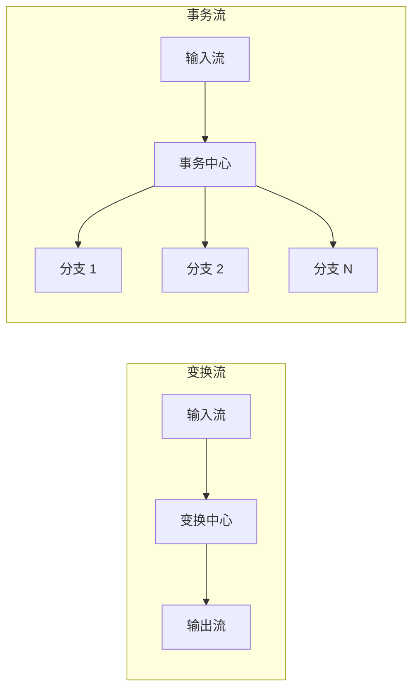
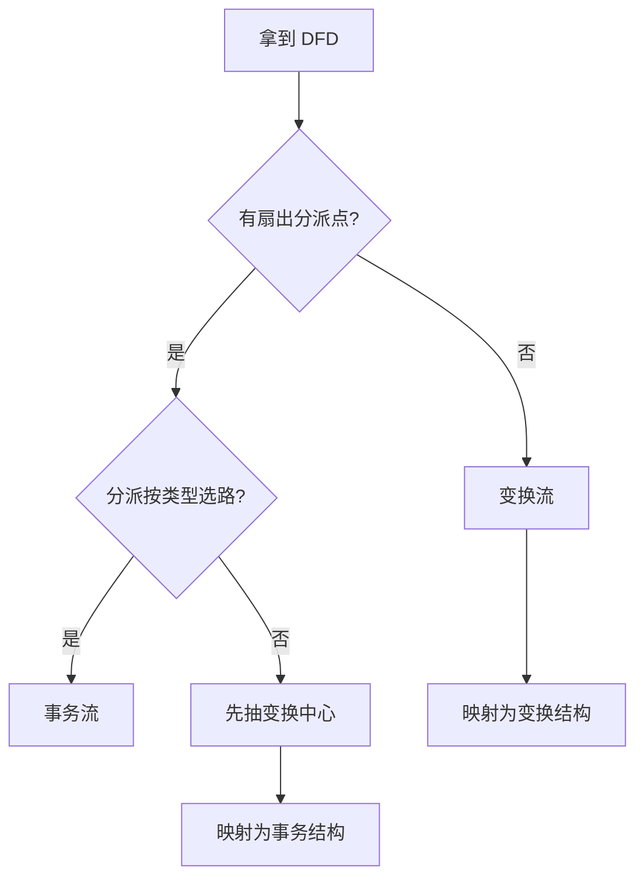

# 使用数据流进行体系结构映射：变换流与事务流

体系结构映射的输入是需求阶段产出的 **数据流图（DFD）**。拿到一张 DFD 后，第一步不是急着画架构，而是先判断：==这张图里的数据流到底是"变换型"还是"事务型"？== 判断错了，后面切分层次就会跑偏。这也是本知识点要解决的核心问题。

## 两类流型的含义

想象一下 DFD 里数据的"走位"：

- **变换流（Transform Flow）**：数据沿着一条"主链"从进入系统、被一步步加工、最后送出去，像一条流水线。结构呈 **输入 → 变换中心 → 输出** 的三段式。
- **事务流（Transaction Flow）**：数据进来后先被"识别/分类"，再根据事务类型分派到多条不同分支去处理，像一个分拣台。结构呈 **输入 → 事务中心 → 多路分派**。

> [!NOTE]
> 一张复杂的 DFD 常常==同时含变换流和事务流==，事务中心内部的一条分支又可能是变换流。真正做映射时是"先分事务、再按变换切分"。

## 如何判定流型

判定依据是 DFD 的**形状特征**，而非加工的语义：

| 判据 | 变换流 | 事务流 |
|---|---|---|
| 加工链 | 单条主链串联 | 有明显"扇出"点 |
| 扇入扇出 | 无明显分派点 | 存在一个中心加工向多路分支分派 |
| 数据走向 | 输入→处理→输出 | 输入→识别→按类型选分支 |
| 端口 | 进入/离开系统的流线性 | 一个入点对多个出分支 |

> [!TIP]
> 记忆口诀：=="一条龙"是变换，"一个挑多"是事务==。看到某个加工把同一份数据按类型送到不同下游，那就是事务中心。

## 判定步骤

## 一个算对了的例子

**题目**：某"成绩查询系统" DFD：学生提交查询请求 → 加工 `识别请求类型`（按"按学号/按课程/按姓名"三类分派）→ 三个加工各自查询数据库 → 三路结果分别格式化输出。请判定流型并说明理由。

**解答**：

1. 找到加工 `识别请求类型`，它对同一份查询请求按**事务类型**（学号/课程/姓名）分派到三个下游加工，形成明显 ==扇出分派点==；
2. 三条分支各自独立处理并输出，符合"输入 → 事务中心 → 多路分派"的形态；
3. 因此==主体是事务流==，每条分支内部（查询→格式化→输出）是**变换流**。

> [!WARNING]
> 常见坑：
> - 只看加工名字就下结论（"查询"看起来像变换），必须看**数据流的拓扑结构**；
> - 把"多路输出"误判为事务——只有当分支是**按数据类型/条件选路**时才是事务流，如果是同一份数据复制到多个出口，仍属变换流；
> - 判定完就忘了**混合情况**：事务中心的分支常是变换流，映射时要嵌套处理。

> [!CAUTION]
> 高危误区：流型判定是**结构性判定**，不要掺入业务语义。DFD 画得糊、加工名含糊都不要紧，==看箭头怎么分叉聚合就够了==。
