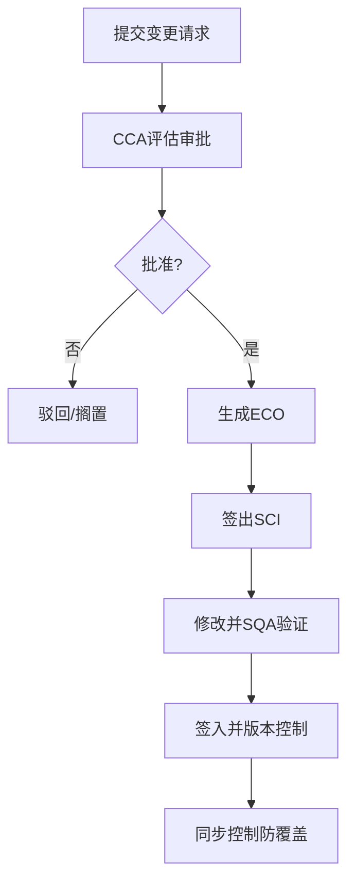

# SCM过程3：变更控制（Change Control）

当软件项目进入开发深水区，如果团队成员随意修改代码而不加约束，会发生什么？必然是版本混乱、缺陷激增。因此，我们需要一套机制来确保变更是==受控、可追溯且经过验证的==，这就是变更控制（Change Control）。

## 什么是变更控制

> [!IMPORTANT]
> 变更控制是 SCM 的核心过程，指在==基线（Baseline）==建立后，通过正式流程管理软件配置项（SCI）修改的活动。

基线是软件开发中的里程碑，标志着 SCI 已通过正式技术审查并入库。在此之前，变更是非正式的；在此之后，任何修改都必须走正式变更控制程序。变更控制的目标不是阻止变化，而是让变化在可控范围内发生，避免“改了一个 bug，引出三个新 bug”的混乱局面。

## 变更控制五步法

变更控制并非简单的“改代码”，而是一个闭环管理流程：

1.  **评估与审批**：将变更报告提交给变更控制机构（CCA），由其决定变更的状态与优先级。
2.  **生成 ECO**：对批准的变更签发工程变更单（Engineering Change Order），作为修改的正式授权凭证。
3.  **签出（Check-out）**：根据访问控制参数从项目数据库中签出待修改的 SCI，此时其他人通常无法同时修改该文件。
4.  **修改与验证**：完成修改后必须经过 SQA 程序验证，确认无误后再签入（Check-in）数据库。
5.  **版本与同步控制**：生成新版本，并通过同步控制机制确保多人并行变更不会互相覆盖。

> [!TIP]
> 记忆口诀：==评、单、出、验、入==。考试中常考步骤顺序或 ECO 的触发时机，务必记住 ECO 是在 CCA 批准之后才生成的。

## 变更控制 vs 版本控制

这两个概念极易混淆，需明确区分：

| 维度 | 变更控制 (Change Control) | 版本控制 (Version Control) |
| :--- | :--- | :--- |
| 关注点 | ==为什么改、谁批准== | ==改了什么、何时改== |
| 核心产出 | ECO、变更报告 | 版本号、差异记录 |
| 作用阶段 | 基线建立后的正式修改 | 贯穿整个开发周期 |
| 性质 | 管理流程 | 技术手段 |

> [!WARNING]
> 版本控制是变更控制的==技术支撑==，但不能替代变更控制。仅有版本控制而无变更审批，团队仍会陷入无序修改的泥潭。

## 结合建模题理解变更影响

回顾 SafeHome 系统考题：顺序图描述对象间消息交互的==时间序列==，状态图描述单个对象对事件的==响应行为==。当需求变更涉及“控制面板响应逻辑”时，若只改了状态图而未同步更新顺序图中的消息流，就会导致模型不一致。这正是变更控制强调==影响分析==的原因——CCA 审批时必须评估变更对所有相关 SCI（包括各类 UML 图）的波及范围，而非孤立看待单一修改。

> [!CAUTION]
> 常见误区：认为“小改动”可以跳过变更控制。实际上，==任何基线后的修改==，无论大小，都必须走正式流程。非正式变更是导致配置审计失败的最常见原因。
