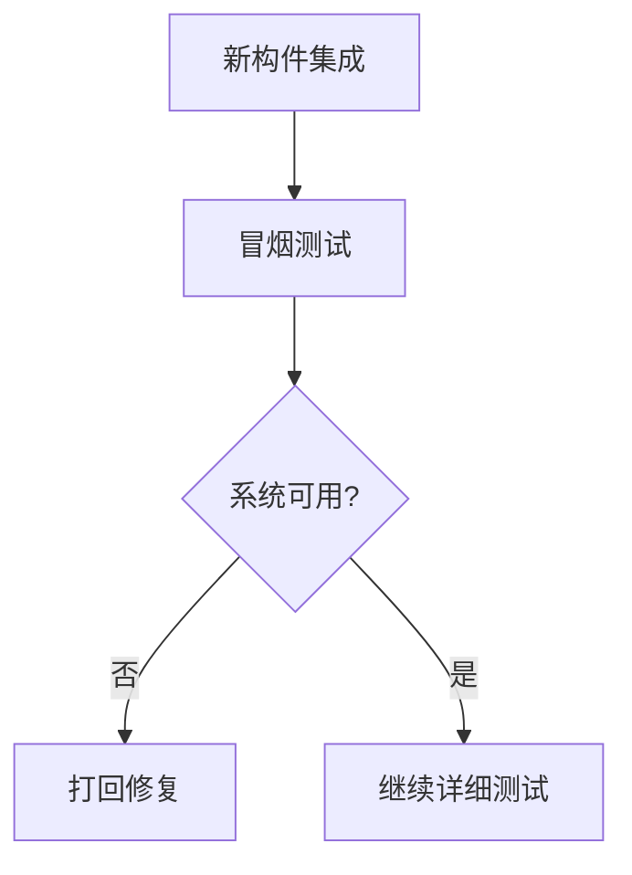

# 回归测试（Regression Testing）与冒烟测试（Smoke Testing）

回归测试与冒烟测试是集成测试阶段保证软件质量的两道重要关卡：回归测试专注于"过去的功能没坏"，冒烟测试专注于"现在的新版本能用"。两者在敏捷、持续集成、XP 等开发模式下尤其关键。

## 为什么需要这两种测试

软件是逐步构建的：每隔一段时间，新模块或新特性就会被集成进来。每次集成都可能引入副作用——==新代码意外破坏原本正确的功能==。因此必须回答两个问题：

1. 新模块进入后，整个系统还能不能正常跑起来？——冒烟测试。
2. 新模块进入后，之前已验证过的功能是否仍保持正确？——回归测试。

## 冒烟测试（Smoke Testing）

冒烟测试是对整个系统进行的快速、广度优先的完整性检查，用于判断新构件有没有给软件增加副作用。

> [!IMPORTANT]
> ==冒烟测试的核心：每次集成后对整个系统做一次快速可行性验证，只要有一处关键功能崩掉，就不必进入后续详细测试。==

它通常只覆盖最关键的业务路径，执行时间短，测试失败意味着这次构建（build）是"坏的"，应立即打回开发。

主要好处：

- 尽早暴露集成后的主要故障，减少无效测试成本；
- 为项目管理提供"版本可用性"的快速反馈；
- 与持续集成配合，使得每日构建都有质量底线。

## 回归测试（Regression Testing）

回归测试是在软件演化过程中==不断重复执行已有测试用例子集==，确保新加的特性没有让原来正确工作的功能出现退化。

> [!IMPORTANT]
> ==回归测试的核心：重复执行已有的测试用例，防止"改这儿坏那儿"。==

在自顶向下/自底向上等集成策略中，每完成一次模块集成，都应插入一轮回归测试；在进化式原型（evolutionary prototype）中，回归测试同样关键——它防止新原型意外破坏旧原型已经实现并验证过的功能。

[!TIP]
实用做法：把已有测试用例固化为自动化脚本，形成"回归测试套件"，随每次集成自动执行。这也是 XP 实践中"每日单元测试"的基础。

## 对比与辨析

| 维度 | 冒烟测试 | 回归测试 |
| --- | --- | --- |
| 目的 | 验证版本整体可用 | 验证旧功能未被破坏 |
| 覆盖范围 | 关键路径，广度优先 | 已有用例子集，按需选取 |
| 执行时机 | 每次集成后、构建完成后 | 每次集成/变更后 |
| 失败含义 | 构建不可用，直接打回 | 有功能退化，需定位原因 |

与单元测试、验收测试的区别：单元测试关注单个模块内部逻辑（常由开发人员每日执行）；验收测试关注是否满足客户需求（由客户定义）；冒烟与回归测试则位于集成与系统层面，关注"集成后的整体质量"。

## 常见坑

> [!WARNING]
> - 回归测试 ≠ 重测所有旧用例，实际工程通常按影响范围筛选子集，但考试答题时强调"执行已有用例子集"。
> - 冒烟测试通过 ≠ 系统无缺陷，只是"可以继续测"；不通过则连详细测试都不必做。
> - 把冒烟测试做得太细会拖慢节奏，做得太粗又会漏掉集成副作用，需要平衡。

## 例题示范

问题：为什么回归测试是任何集成测试过程的重要组成部分？

答：集成测试中每次新模块的加入都可能影响已集成模块的接口或行为，导致原本正确的功能出现退化（regression）。==回归测试通过重复执行已有测试用例，在每次集成后验证旧功能仍保持正确==，从而及时发现并定位集成引入的副作用，是保证集成过程不"越改越坏"的关键环节。与之配合的冒烟测试则用于快速判断新构建整体是否可用。
