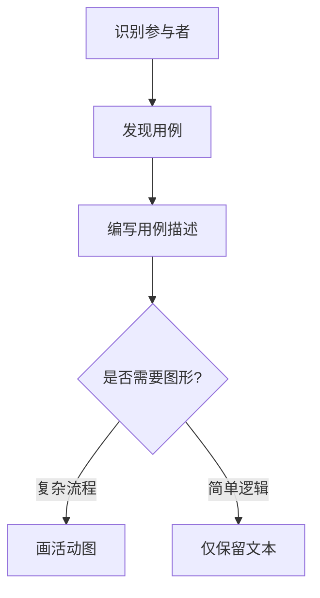

# 基于场景的建模（Scenario-Based Modeling）

> [!IMPORTANT]
> 基于场景的建模（Scenario-Based Modeling）是需求建模（Requirements Modeling）的第一步，其核心任务是==从用户视角描述系统与外部参与者的交互过程==。

## 它是什么

想象你正在为学校开发一个选课系统。如果你直接去画数据库表或写代码，很容易遗漏“学生选课时课程已满怎么办”这类真实情况。

基于场景的建模就是让你先讲“故事”：谁（Actor），在什么条件下，做了什么事（Use Case），系统怎么响应。它的主要产出物是 ==用例（Use Case）==、UML 用例图以及补充的活动图（Activity Diagram）。

## 为什么需要

课件中 Unified Process 被定义为 “use-case driven, architecture-centric, iterative and incremental”。注意第一个词——==用例驱动==。如果不先把场景理清，后续的 Class-Based Modeling（找类）和 Behavioral Modeling（找状态）就失去了依据。

## 怎么做

构建分析模型时，Scenario-Based Modeling 通常遵循以下步骤：

1. **识别参与者（Actors）**：与系统交互的外部实体（人或外部系统）。
2. **发现用例（Use Cases）**：参与者为了达成某个目标而执行的一系列动作。
3. **编写用例描述**：包括主成功场景（Main Success Scenario）、替代流（Alternative Courses）和异常流（Exceptions）。
4. **细化与完善**：通过提问来精炼初步的用例，例如：“如果这一步失败了会怎样？”“是否有其他路径可以完成这个目标？”

> [!TIP]
> 如何考察替代方案？在开发用例时，主动追问“What if...”，把正常流程之外的分支（如密码错误、网络超时）全部列出，这就是 Exceptions 的来源。

## 相近概念的区别

| 维度 | Scenario-Based Modeling | Class-Based Modeling | Behavioral Modeling |
| :--- | :--- | :--- | :--- |
| **关注点** | 外部交互（做什么） | 内部结构（由谁做） | 状态流转（怎么变） |
| **核心元素** | Actor, Use Case | Analysis Classes, CRC | State, Event |
| **典型图表** | 用例图、活动图 | 类图 | 状态图 |

这三者在 Requirements Modeling 中是递进关系：先有场景，再从场景中提炼类（Class-Based），最后分析对象的状态变化（Behavioral）。

## 常见的坑

> [!WARNING]
> 很多同学以为每个使用场景都必须画图。实际上，==在许多情况下不需要为使用场景创建图形表示==，纯文本描述可能就足够了。只有当交互流程复杂、包含大量并发或条件分支时，才需要引入 UML 活动图（Activity Diagram）来辅助说明。

> [!CAUTION]
> 不要把“系统内部实现细节”写进用例！用例只关心外部可见的行为，不要在里面写“查询 MySQL 表”或“调用 REST API”。

## 真题实战

我们来看两道典型的考试题，检验一下理解是否到位。

**判断题**：Creation and refinement of use cases is an important part of scenario-based modeling. ( )

这道题问的是用例的创建和完善是不是基于场景建模的重要部分。根据前面的讲解，用例正是场景建模的核心产出物，因此答案是 ==True==。

**选择题**：Activity diagrams are useful in representing which analysis model elements?
- A. Behavioral elements
- B. Class-based elements
- C. Flow-based elements
- D. Scenario-based elements

> [!NOTE]
> 虽然活动图有时也用于展示行为，但在需求建模的分类体系中，活动图主要用于描绘用例中的工作流和业务步骤，即对场景的可视化补充。因此，最具体且准确的对应选项是 ==D. Scenario-based elements==。
