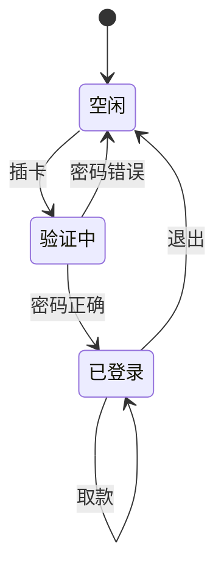

# 基于模型的测试（Model-Based Testing）

## 什么是基于模型的测试

基于模型的测试（Model-Based Testing，MBT）是一种==以系统模型为依据生成和执行测试用例==的方法。这里的“模型”不是只指 UML 类图，而是对软件行为、状态变化、业务规则或需求的可执行描述。

例如，电梯状态模型可以规定“门打开后才能进入空闲状态”。测试人员让模型自动生成状态迁移序列，检查实际电梯是否符合这些规定。

> [!IMPORTANT]
> MBT 的核心流程是：建立模型 → 自动生成测试 → 执行测试 → 比较实际结果与模型预期。

## 为什么需要它

传统黑盒测试通常根据需求手工设计输入，容易出现三个问题：

- 需求覆盖不全，遗漏少见但重要的状态组合；
- 测试用例数量随输入空间快速增长，难以穷举；
- 需求变化后，测试用例难以同步维护。

MBT 把需求、状态或业务规则显式地表达成模型，因此既能指导测试设计，也能自动检查软件行为是否与模型一致。

> [!TIP]
> 可将 MBT 理解为“用模型自动穷举或智能选择测试场景”，但模型本身不准确时，自动生成的测试也会系统性地遗漏问题。

## 怎么做

常见步骤如下：

1. **确定模型类型**  
   状态测试关注状态迁移，数据测试关注输入约束和等价类，业务流程测试关注事件顺序。

2. **建立测试模型**  
   将需求转化为状态机、状态图或形式化模型。模型应包含初始状态、状态变量、允许迁移、触发事件和预期结果。

3. **选择覆盖策略**  
   常用策略包括覆盖所有状态、覆盖所有迁移、覆盖事件组合，或根据历史缺陷提高某些路径的覆盖优先级。

4. **自动生成测试序列**  
   工具根据模型搜索满足约束的输入，并把对应的模型结果作为预期输出。

5. **执行并判定**  
   将实际输出与模型预期比较；若二者不一致，就报告模型差异或系统缺陷候选。

以一个简化的 ATM 状态模型为例：

测试可以自动生成“插卡—密码错误—再次插卡”和“插卡—密码正确—取款”等序列，并检查系统是否允许这些迁移。

## 与相近概念的区别

| 方法 | 主要依据 | 典型关注点 |
|---|---|---|
| 基于需求的测试 | 自然语言需求 | 功能是否满足用户要求 |
| 基于模型的测试 | 状态、行为或业务模型 | 系统是否遵守模型规定的迁移和规则 |
| 白盒测试 | 程序内部结构 | 分支、路径和语句覆盖 |
| 图形化测试 | 控制流、数据流等图形结构 | 环路、支配关系和基路径 |
| 随机测试 | 随机输入或随机对象序列 | 是否容易触发异常 |

MBT 可以与黑盒测试结合，也可以在实现层覆盖白盒逻辑；它并不排斥其他测试方法。

## 类级与类间测试

在面向对象测试中，MBT 常用于：

- **类级测试（Class Testing）**：验证单个类的操作是否符合其契约；
- **类间测试（Inter-Class Testing）**：验证多个协作类的消息交互和行为序列是否正确。

因此，复习题“如何从行为模型导出测试用例以支持类间测试”的答案可概括为：先识别对象间允许的交互和消息序列，再由模型生成覆盖这些交互的类间测试用例，并比较实际协作结果与模型预期。

> [!WARNING]
> 模型只能描述已经写入模型的行为。若需求遗漏或模型本身错误，MBT 不能发现“模型之外”的问题。

## 常见坑

- 把“基于模型”误解为“只测 UML 图”，忽略需求与模型的一致性审查。
- 只覆盖状态，没有覆盖状态迁移；状态全部出现，并不代表迁移都被测试。
- 把模型预期直接当作唯一真值，忽略模型与需求不一致的可能。
- 认为 MBT 可以取代黑盒、白盒或人工场景测试。
- 认为图结构测试只能用于面向对象系统。图中包含控制流、数据流等结构时，图结构方法同样适用于非面向对象系统，因此该判断题答案为 **False**。

> [!CAUTION]
> 使用 MBT 前必须先验证模型：模型若不完整，自动测试只会更快地重复同一种遗漏。
