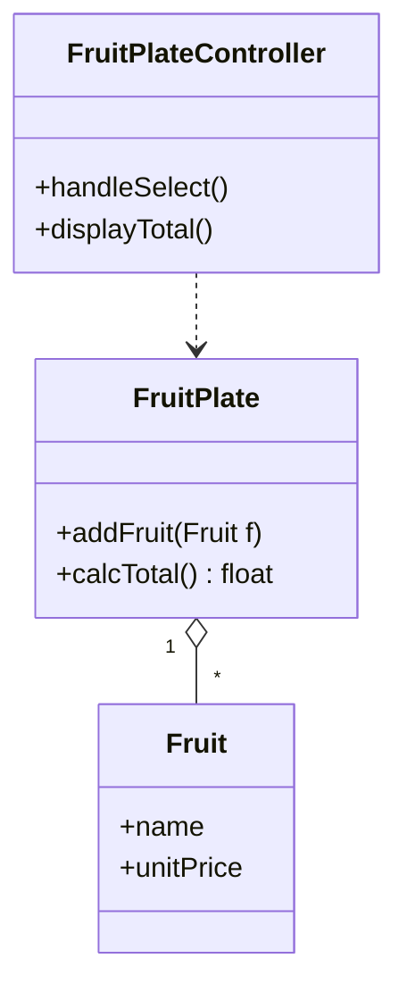

# 基于类的建模（Class-Based Modeling）与识别分析类

## 基于类的建模与识别分析类

在完成基于场景的建模（用况图、活动图等）之后，你手上已经有了一堆“用户想干什么”的描述。但场景描述用的是自然语言，离代码还很远。怎么把“系统要做什么”转成“系统里有哪些对象、它们各自管什么、互相怎么协作”？这就是基于类的建模要解决的问题。

> [!IMPORTANT]
> 类基建模（Class-Based Modeling）用“类”来组织需求中的事物：识别分析类、定义属性和操作、用 CRC 卡片分配职责、最后绘制 UML 类图。
> 这里的“类”是**分析类**，描述问题域中的概念，不涉及实现细节（如用什么语言、数据库怎么连）。它与设计阶段的类不同，后者会加入技术方案。

### 为什么场景建模不够，还要做类基建模？

先设想一个场景：用况“顾客下单”里写“系统校验库存并生成订单”。这句话只告诉你**发生了什么**，却没告诉你：

- “库存”和“订单”在系统里是什么关系？
- 谁来负责校验库存——订单自己？还是库存对象？
- 如果库存不足，系统要向哪个对象发起协作？

这些问题只能靠==分析类及其职责与协作==来回答。基于类的建模把“动词型”的场景描述转成“名词型”的对象结构，让需求更稳定、更接近设计。

### 识别分析类：从名词开始

课件中反复出现的路径是：

识别分析类的第一步常用**文法解析（grammatical parse）**：把用况文本中的**名词**圈出来，作为候选类。

> [!TIP]
> 口诀：**名词变候选，动词变操作，形容词变属性。** 比如“系统校验库存”中，“库存”是候选类，“校验”可能是操作，“可用库存量”是属性。

但名词不等于类。要按特征过滤：

| 保留（类特征） | 剔除（非类特征） |
|---|---|
| 保留的信息（retained information） | 外部实体（如“用户”“银行系统”） |
| 需要的服务（needed services） | 属性值（如“邮编”“数量”） |
| 多个属性 | 操作过程的描述 |
| 多个实例 | 系统边界外的角色 |
| 本质属于问题域 | 模糊、不明确的名词 |

比如“顾客提交订单”里，“顾客”是外部角色，不该成为分析类；“订单”有多个属性和多个实例，是典型分析类。

### 三类分析类

课件明确列出三类在分析模型中可能出现的类别：

| 类型 | 说明 | 例子 |
|---|---|---|
| **实体类（Entity classes）** | 代表系统中的主要数据对象或业务概念，常来自业务名词 | `Order`、`Product`、`Payment` |
| **边界类（Boundary classes）** | 负责系统与外部世界（用户、外部系统）的交互 | UI 类、接口适配类 |
| **控制类（Control classes）** | 协调其他类的业务逻辑，通常一个用况对应一个控制类 | `ManageOrderController` |

> [!WARNING]
> 填空和选择题经常直接问实体类的定义。实体类是问题域中的“业务名词”，不要把它和设计阶段的数据库表混为一谈。

### 定义属性与操作

识别出类后，要为它补充**属性（attributes）**和**操作（operations）**。

- 属性回答“这个类**知道什么**”：订单知道订单号、下单时间、状态。
- 操作回答“这个类**能做什么**”：订单能计算总价、取消。
- 操作的来源通常是场景中的**动词**。但要过滤掉属于外部系统或角色的动作。

> [!NOTE]
> 操作与“职责”不是一回事。CRC 卡片里写的是职责（一句话描述），操作是职责在类上的具体方法形式。比如职责“管理订单内容”，操作可能是 `addItem()`、`removeItem()`。

### CRC 建模：把职责摆到桌面上

CRC 即 **Class-Responsibility-Collaborator**。课件里的判断题明确指出：

> [!IMPORTANT]
> CRC card 包含三要素：**class name（类名）、responsibilities（职责）、collaborators（协作者）**。

一张 CRC 卡片长这样：

| Order（订单） |
|---|
| 职责：管理订单项；计算总价；更新状态 |
| 协作者：OrderItem、Product、Customer |

CRC 建模的做法通常是：把候选类写成卡片，小组成员围坐，一人扮演一个类，用手指着卡片说“我的职责是 X，我需要和 Y 协作来完成”。这种**走查**能很快暴露缺类、职责错配等问题。

分配职责的几条实用原则：

1. **信息专家**：谁拥有数据，谁负责处理该数据。订单总价由 `Order`（持有所有 `OrderItem`）算，不让 `Customer` 算。
2. **单一职责**：一个类只做一件事。不要一个类又管 UI 又管业务。
3. **协作最少化**：如果一个类要同时找三个协作者才能完成小任务，考虑是否拆类或引入控制类。

### 绘制类图：把 CRC 结晶成 UML

CRC 卡片是“脑暴和验证”工具，类图是正式的 UML 视图。类图要表达：

- 类名、属性、操作
- 类之间的关系：**关联（associations）、依赖（dependencies）、泛化（generalization）**

> [!TIP]
> CRC 里的“协作者”在类图中不一定都画成关联。如果协作是临时的（比如只是方法参数里用到），可能用**依赖**（虚线箭头）表达更合适。判题时注意：协作者对应的是类之间的**语义协作**，关联是更强的数据关系，不要机械地把所有协作者都画成关联线。

### 常见坑

> [!CAUTION]
> **把角色当类。** 用况里的“顾客”“管理员”是参与者，不是系统内部的分析类。如果“顾客”需要存储信息，那应该叫 `CustomerAccount` 之类的实体类。
> **把属性当类。** “订单号”没有行为，只是 `Order` 的属性。
> **跳过 CRC 直接画类图。** CRC 的职责分配会暴露很多隐藏的类，直接画类图容易漏掉控制类。
> **把需求和设计混在一起。** 分析类图中出现 `DatabaseManager`、`SpringController` 这类技术组件说明已经越界到设计了。

### 一个算对了的例子

以下面这道设计题为例：水果拼盘组合系统，要求顾客可以选择不同水果拼成拼盘，系统计算价格并显示。

先用文法解析场景描述：名词有“顾客”“水果”“拼盘”“价格”；动词有“选择”“计算”“显示”。

- “顾客”是外部角色 → 剔除。
- “水果”有名称、单价 → **实体类 `Fruit`**。
- “拼盘”有多个水果、总价 → **实体类 `FruitPlate`**。
- “价格”是属性，不是类。
- “计算”是操作 → 分配给 `FruitPlate`（信息专家），协作者是 `Fruit`。
- 控制类 `FruitPlateController` 协调界面与业务。

CRC 卡片：

| FruitPlate（水果拼盘） |
|---|
| 职责：维护水果列表；计算总价 |
| 协作者：Fruit |

| Fruit（水果） |
|---|
| 职责：提供名称与单价 |
| 协作者：— |

绘制的类图：

> [!NOTE]
> 控制类 `FruitPlateController` 既不属于实体，也不属于边界，它负责把“选择水果”的事件转成对 `FruitPlate` 的操作，再触发界面显示。去掉它，`FruitPlate` 就得自己处理界面事件，职责就会混乱。

### 与相近概念的区别

| 概念 | 关注点 | 产物 |
|---|---|---|
| 场景建模 | 系统与用户的交互流程 | 用况、活动图、泳道图 |
| 类基建模 | 系统内部的对象结构 | 类图、CRC 卡片 |
| 行为建模 | 对象随事件的状态变化 | 状态图、顺序图 |
| 面向数据建模 | 数据实体及其关系 | ER 图 |

类基建模回答“有哪些对象、谁负责什么”，行为建模回答“对象收到事件后怎么变”。两者在课件里是先后关系：先类基，后行为。
