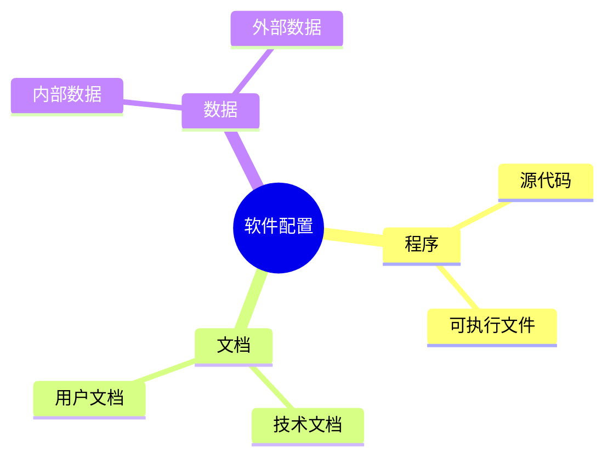
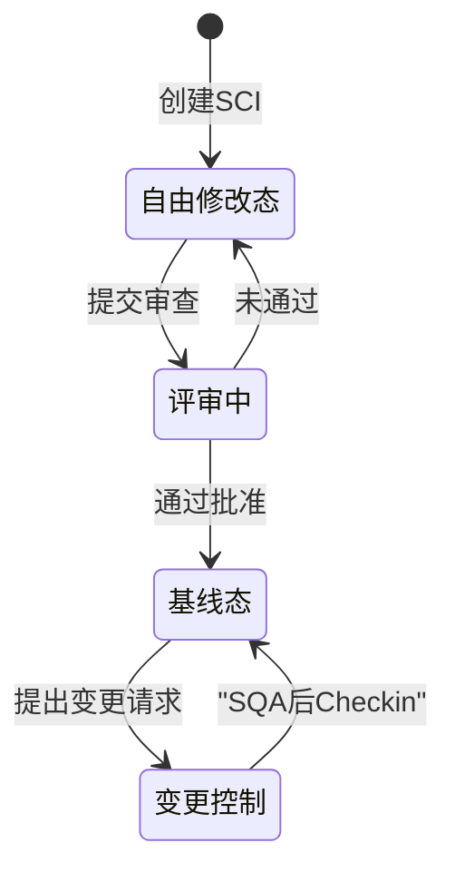

# 基线（Baselines）与软件配置项（Software Configuration Items, SCIs）

在软件开发中，工程师会产出大量文档、代码和数据。试想：如果任何人都能随时修改任何文件，项目会变成什么样？为了避免混乱，我们需要两样东西来“管住”这些产物——==软件配置项（SCI）==和==基线（Baseline）==。

## 软件配置项 SCI

> [!IMPORTANT]
> 在 SCM 过程中，每个工作产品称为**软件配置项（SCI, Software Configuration Item）**。

SCI 就是工程师在整个软件过程中创建的所有信息产物。具体包括三类：
- **计算机程序**（源代码与可执行文件）
- **文档**（技术文档与用户文档，如 SRS 需求规格说明书）
- **数据**（程序内部和外部的数据）

一个 SCI 可以是一整份文档、一套测试用例，极端情况下也可以是大规格说明中的某一节。多个 SCI 会被组织成**配置对象（Configuration Objects）**，在项目数据库中以单一名称编目，且 SCI 之间通常存在层次结构。

## 基线 Baseline

有了 SCI，为什么还需要基线？因为 SCI 在演化过程中会被反复修改，我们必须划定一条“界线”，让后续开发有稳定的基础。

> [!IMPORTANT]
> IEEE 定义：**基线**是已经正式审查并达成一致的规范或产品，此后作为进一步开发的基础，且只能通过正式的变更控制程序更改。

基线本质上是软件开发中的一个**里程碑（Milestone）**，它的成立必须同时满足两个条件：
1. 标志着一个或多个 SCI 的交付；
2. 这些 SCI 通过了正式的技术审查（Formal Technical Review）并获得批准。

## SCI 成为基线前后的区别

这是考试中最常考的对比点：

| 维度 | 成为基线前 | 成为基线后 |
| :--- | :--- | :--- |
| **变更方式** | 非正式变更，开发者可自行修改 | ==必须走正式变更控制流程== |
| **状态理解** | 正在演化、草稿阶段 | 已确认合理并存入项目数据库 |
| **检出/检入** | 无需严格权限控制 | 需按访问控制参数 Checkout，经 SQA 后再 Checkin |

> [!TIP]
> 记忆口诀：**基线前随便改，基线后走流程**。一旦 SCI 成为基线，它就像被“冻结”了，解冻（修改）的唯一钥匙就是变更控制。

## SCM 同心圆层次与 SCI 的生命周期

SCM 任务是一个同心圆的层次结构。SCI 在其有效生存期内从内到外经历各层。但注意：当 SCI 进入某一层时，该层的活动**不一定适用**。例如新建 SCI 时必须进行标识（Identification），但若没有变更请求，就不必应用变更控制层活动，可直接指定给特定版本交由版本控制管理。

> [!WARNING]
> 常见误区：认为“成为基线后就绝对不能再改了”。错！基线后依然经常发生变更，只是**必须经过正式变更控制**，不能随意改动。

## 典型考题示例

**题目**：什么是软件配置？基线是如何定义的？

**标准解答思路**：
1. **软件配置**由工程师在软件过程中创建的工作产品组成，包含程序（源码+可执行文件）、文档（技术+用户）和数据（内部+外部）。这些工作产品在 SCM 过程中统称为 SCI。
2. **基线**是软件开发中的里程碑。IEEE 将其定义为已通过正式审查并达成一致的规范或产品，作为进一步开发的基础，且只能通过正式变更控制程序更改。基线的确立标志着一个或多个 SCI 的交付，以及这些 SCI 通过正式技术审查获得批准。
