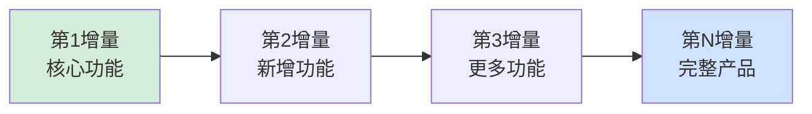
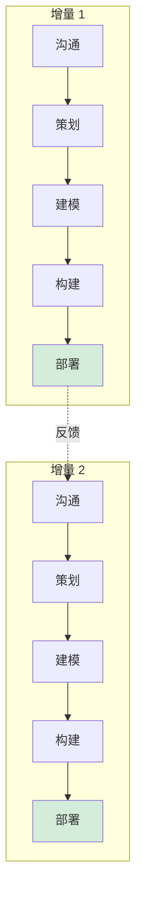

# 增量模型（The Incremental Model）

## 它是什么

增量模型把软件拆成若干**增量（increment）**，每个增量都经历沟通、策划、建模、构建、部署等框架活动，并==交付一个可运行的产品==。第一个增量实现最核心的功能，后续增量在其基础上叠加新功能，直到满足全部需求。

> [!IMPORTANT]
> 增量过程模型侧重于在**每个增量中交付可运行的产品**（an operational product with each increment），而不是等到项目末期才交付。

## 为什么需要

瀑布模型要求客户"有耐心"——可运行版本要到项目后期才出现，若此时发现需求理解偏差，返工代价巨大。增量模型让利益相关者**尽早且经常参与**，每次交付后都能获得反馈，从而==降低开发出不被客户接受产品的风险==。

## 怎么做

每个增量内部仍是一个小型瀑布，但增量之间允许 overlap（重叠）：

关键实践：
- 先划分功能优先级，把高价值功能放入早期增量
- 每个增量交付后收集反馈，调整后续计划
- 需求可有控制地扩展到演化的增量中

## 与相近模型的区别

| 模型 | 交付时机 | 需求变更 | 风险处理 | 适用场景 |
|------|---------|---------|---------|---------|
| **瀑布模型** | 项目末期一次性交付 | 难以适应 | 后期集中暴露 | 需求稳定、技术成熟 |
| **增量模型** | 每个增量交付可运行产品 | 可在增量间调整 | 早期反馈降低风险 | 需求可分解、需快速响应 |
| **螺旋模型** | 每次迭代交付原型 | 容易适应 | ==每次迭代评估风险== | 大型、高风险项目 |
| **演化模型** | 持续演化 | 容易适应 | 迭代式开发 | 需求不明确 |

> [!WARNING]
> 别把增量模型和螺旋模型混淆：**螺旋模型每次迭代都包含风险分析（risk evaluation）**，而增量模型没有这一强制环节。若选择题选项出现"includes project risks evaluation during each iteration"，那是螺旋模型的特征，不是增量模型。

## 常见考点

- 增量模型是**创建适应性过程的基础**，鼓励利益相关者尽早参与
- 适用于需求不确定的项目，允许有控制地将需求扩展到演化的增量中
- 项目团队规模较小时，需确保项目可分解为子系统实施

> [!TIP]
> 记忆口诀：**"增量交付可运行，螺旋迭代评风险"**——抓住"每个增量都有 operational product"这一核心，就能快速区分增量模型与瀑布、螺旋等模型。

## 例题验证

**题目**：The incremental process model focuses on the delivery of an operational product with each increment.

**答案**：True

**解析**：这正是增量模型的定义性特征。每个增量结束时都交付一个可运行的软件版本，客户可以实际使用并提供反馈，后续增量在此基础上继续扩展功能。这与瀑布模型"直到项目后期才有可运行版本"形成鲜明对比。
