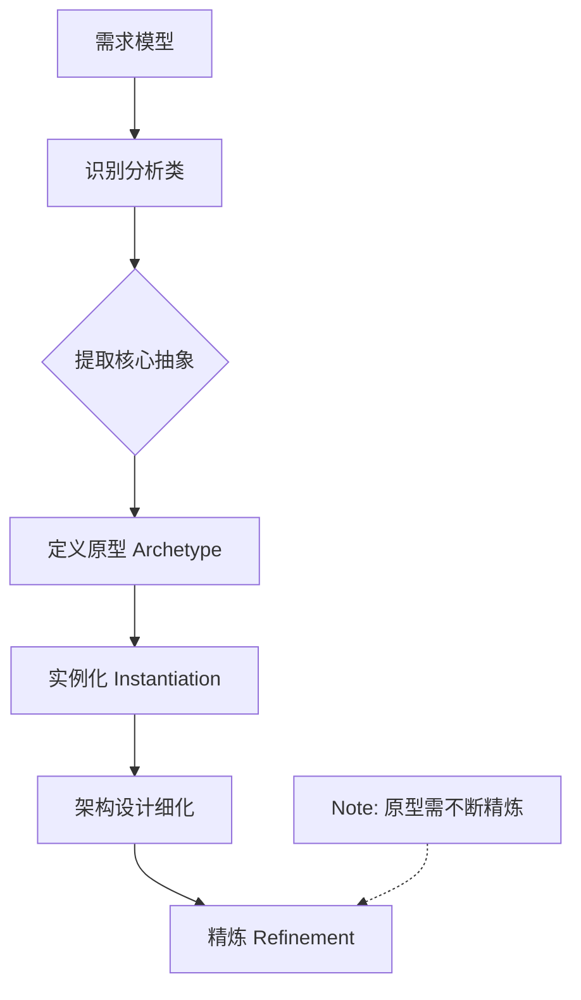

# 定义原型（Defining Archetypes）

# 定义原型（Defining Archetypes）

在软件架构设计中，面对复杂的系统需求，直接设计所有细节往往会导致结构混乱。**定义原型**（Archetypes）是架构设计的核心步骤，旨在从需求模型中提取出少数几个具有代表性的“稳定元素”。

## 什么是架构原型？

==架构原型本质上就是“模式”（Pattern）的概念==。它不是具体的代码实现，而是一种抽象的类或模板，代表了目标系统中具有核心抽象的稳定元素。

> [!IMPORTANT]
> 核心定义：Archetype 是一组相对较少的、代表系统核心抽象的稳定类或模式。它是架构设计的基石。

你可以这样理解：如果整个软件系统是一座大楼，那么“原型”就是承重墙、梁柱和地基这些基本构件类型。无论大楼建成酒店还是公寓，这些基本构件的类型是有限且稳定的。

## 为什么需要定义原型？

1.  **降低复杂度**：将庞大的系统分解为少量核心抽象。
2.  **提高复用性**：原型可以在系统中被多次实例化（Instantiated）。
3.  **连接分析与设计**：原型可以直接从需求分析阶段的“分析类”（Analysis Classes）中推导出来。

> [!TIP]
> 思考一下：如果一个家庭安保系统有传感器、报警器、控制面板，它们虽然功能不同，但是否都共享某些共同的行为特征（如“检测状态”、“触发响应”）？这些共同特征就是原型的来源。

## 如何定义与精炼原型？

原型的定义通常遵循以下流程：

1.  **识别**：检查需求模型中的分析类，寻找具有相似行为或结构的类簇。
2.  **抽象**：定义一个通用类（原型）， encapsulate 核心行为。
3.  **实例化**：根据系统具体行为，将原型实例化为不同的具体类。
4.  **精炼**：==一旦选定原型，随着架构设计的深入，必须对其进行进一步精炼==。原型不是一成不变的，它需要在设计过程中不断完善细节。

> [!WARNING]
> 常见误区：认为原型设计是一次性的。实际上，原型在架构设计过程中需要持续精炼（Refined further）。

## 原型 vs. 其他概念

| 概念 | 区别点 |
| :--- | :--- |
| **原型 (Archetype)** | 架构层面的抽象模式，代表稳定元素，数量少。 |
| **分析类 (Analysis Class)** | 需求阶段的产物，更贴近用户视角，可能包含冗余。 |
| **设计模式 (Design Pattern)** | 解决特定设计问题的通用方案，原型可视为一种高层模式。 |

## 典型示例：SafeHome 安全系统

在 SafeHome 案例中，体系结构原型集通常包括：
*   **Sensor（传感器）**：负责检测环境变化。
*   **Controller（控制器）**：负责逻辑判断。
*   **Actuator（执行器）**：负责执行动作（如报警）。

这些原型构成了系统的骨架。例如，“组合设计模式”可能用于处理传感器的层级结构。

> [!CAUTION]
> 易错判断题辨析：
> *   “系统架构的最佳表示是可运行的软件原型。” -> **False**。架构的最佳表示是架构模型/视图，而非代码原型。
> *   “一旦选定原型，无需再修改。” -> **False**。原型必须在架构设计过程中不断精炼。

通过定义原型，我们将复杂的 SafeHome 系统简化为几个核心交互单元，从而确保了架构的清晰性与可维护性。
