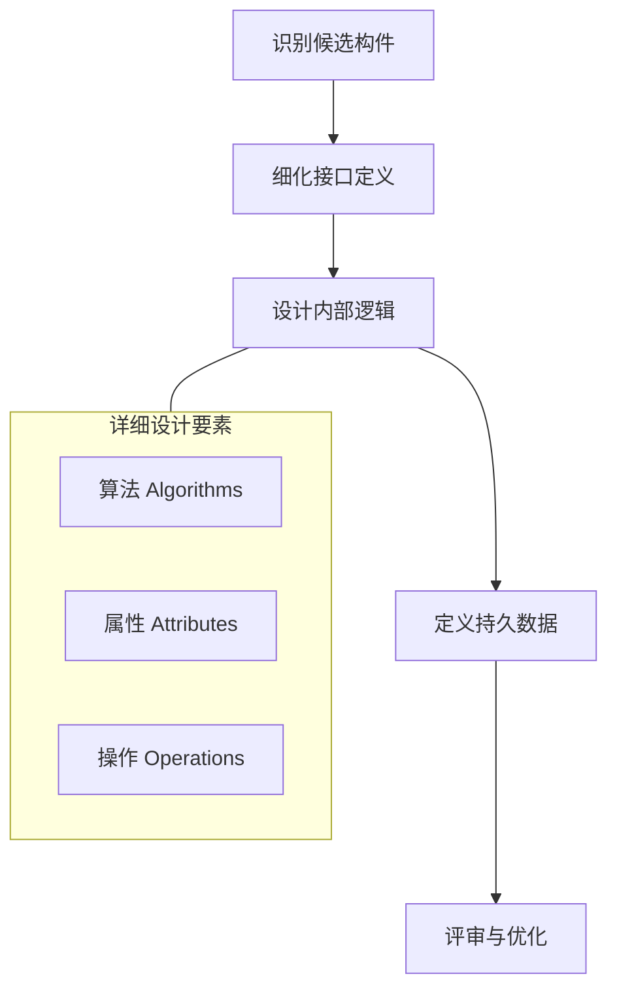

# 实施构件级设计（Conducting Component-Level Design）的过程

## 什么是构件级设计

构件级设计（Component-Level Design）是将架构设计中定义的“黑盒”转化为可编码的“白盒”的过程。如果说架构设计是房屋的蓝图，那么构件级设计就是==每个房间的详细施工图==。它关注的是软件内部的具体实现细节，包括算法、数据结构、接口定义以及类之间的协作关系。

> [!IMPORTANT]
> 核心目标：为代码生成者提供清晰的指南，确保设计在数据、功能和行为域上是完整的，且具备高内聚、低耦合的特性。

## 为什么要进行构件级设计

在直接编码前进行详细的构件设计，主要基于以下原因：
1.  **降低复杂度**：将大问题分解为小的、可管理的单元（类或模块）。
2.  **提高复用性**：通过标准化接口和内聚的设计，使构件易于在不同项目中复用。
3.  **便于测试与维护**：清晰的设计文档有助于编写单元测试（Design unit test cases before coding），并降低后期维护成本。

## 实施过程与关键步骤

完成一个高质量的构件级设计，通常遵循以下步骤：

1.  **识别与设计基于类的构件**：从分析模型中提取类，确定其职责。
2.  **细化接口**：明确输入、输出及异常处理机制。遵循==接口隔离原则==，避免胖接口。
3.  **设计内部细节**：
    *   **算法**：选择高效的处理逻辑。
    *   **数据结构**：定义属性及其类型。
    *   **行为**：描述操作的具体流程。
4.  **处理持久数据**：确定数据如何存储（数据库、文件等）。

> [!TIP]
> 记忆口诀：**接**口要清，**内**部要细，**数**据要存，**测**试先行。

## OO视图 vs 传统视图

| 特性 | 面向对象视图 (OO View) | 传统视图 (Traditional View) |
| :--- | :--- | :--- |
| **基本单元** | 类 (Class) / 对象 (Object) | 模块 (Module) / 函数 (Function) |
| **封装性** | 数据与操作绑定 | 数据与操作分离 |
| **复用机制** | 继承、多态、组合 | 库调用、包含文件 |
| **设计重点** | 消息传递、状态变化 | 控制流、数据流 |

## 常见误区与避坑指南

*   **误区1：耦合越低越好？**
    ==错误==。完全消除耦合是不可能的，也是不必要的。目标是==最小化耦合==，保持合理的依赖关系以维持系统完整性。
*   **误区2：忽略接口细节**
    在构件设计中，接口（Interface）是外部访问的唯一入口。如果接口定义模糊，会导致集成困难。必须详细描述 API、异常处理和所需工具。
*   **误区3：设计与编码脱节**
    设计应是代码的直接指南。如果设计文档无法指导编码或测试，则该设计是失败的。

## 典型例题解析

**题目**：In component design elaboration requires which of the following elements to be described in detail?
A. Algorithms
B. Attributes
C. Interfaces
D. Operations
E. b, c, d

**解析**：
构件级设计的细化（Elaboration）需要描述构件的内部结构和外部契约。
*   **Attributes (b)**：定义构件的状态数据。
*   **Interfaces (c)**：定义构件与外界交互的边界。
*   **Operations (d)**：定义构件能执行的行为（通常包含算法实现）。
*   Algorithms (a) 通常包含在 Operations 的实现细节中，但在选项组合中，E 涵盖了结构（属性）、交互（接口）和行为（操作）三个核心维度，是最全面的描述。

> [!NOTE]
> 正确答案是 **E**。这提醒我们，构件设计不仅是画框图，更要落实到具体的属性、接口和操作细节上。
