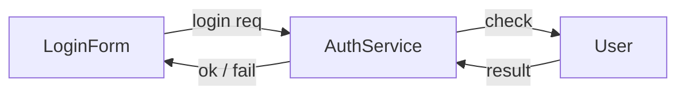
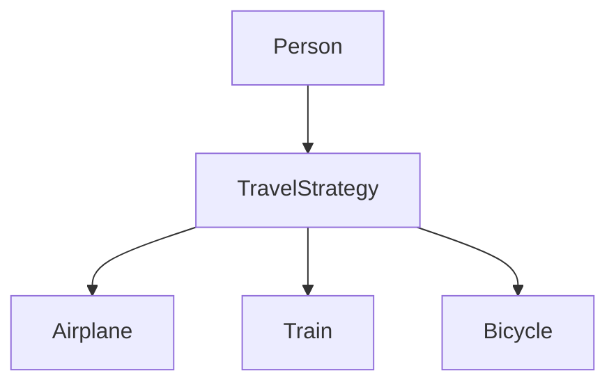

# MVC、管道-过滤器、面向对象、事件驱动、分层、数据共享风格实例

## 它是什么

在《软件工程（双语）》第 6 章“架构设计”里，==体系结构风格（architectural style）== 描述了一组构件（components）、连接件（connectors）以及把它们组织起来的约束。课件里重点讲了：调用-返回系统（主程序/子程序、面向对象、层次结构）、MVC、管道-过滤器、事件驱动、分层、数据共享风格实例。

其中“调用-返回系统”包括：

- 主程序和子程序
- ==面向对象系统==：把数据和操作封装成对象/类，通过消息通信协作
- 层次结构：上层调用下层，层间接口稳定

## 为什么需要、怎么做

看一个课件里的面向对象风格实例——登录界面：它不是按“先读输入、再查库、再打印”的流程写，而是拆成 `LoginForm`（界面构件）、`User`（领域对象）、`AuthService`（服务对象）。三者通过消息协作：`LoginForm` 发消息给 `AuthService`，后者调用 `User` 的校验操作。

再看银行系统对象协作：`Account`、`Customer`、`Transaction` 各自封装属性和行为，协作完成转账。这种风格的好处是易维护、易复用。

为什么需要风格？因为不同系统关注点不同：数字通信系统适合==管道-过滤器==（数据流逐步变换）；交互式界面适合==事件驱动==；企业系统常采用==分层==（表现层 / 业务层 / 数据层）。

## 相近概念的区别

| 风格 | 连接件 | 典型实例 |
|---|---|---|
| 面向对象 | 消息/方法调用 | 登录界面、银行系统 |
| 管道-过滤器 | 数据流 | 数字通信系统 |
| 事件驱动 | 事件触发回调 | GUI 调用/返回 |
| 分层 | 层间接口调用 | 三层/多层架构 |

## 常见坑与面向对象原则

[!WARNING]
不要把“类图里有类”就当成真正使用了面向对象思想；要看是否封装、继承、多态与消息通信（OO = 对象 + 类 + 继承 + 消息通信）。

一个算对了的例子来自考题：出行策略中 `TravelStrategy` 是接口，`AirplaneStrategy`、`TrainStrategy`、`BicycleStrategy` 是实现，`Person` 可互换使用它们。这里体现了：

- 多态：`Person` 把不同策略对象当作公共接口处理
- ==开闭原则 OCP==：新增 `BusStrategy` 不改 `Person`
- ==里氏替换 LSP==：子类可替换父类而不破坏逻辑
- ==依赖倒置 DIP==：`Person` 依赖抽象 `TravelStrategy`，不依赖具体策略

> [!IMPORTANT]
> 答题时先写“对象+类+继承+消息通信”，再逐条对应 OCP、LSP、DIP，就能拿全分。

最后提醒测试坑：面向对象软件的单元测试不能以孤立操作为单元，因为多态使子类行为不同；测试用例必须放在子类具体上下文里验证。
