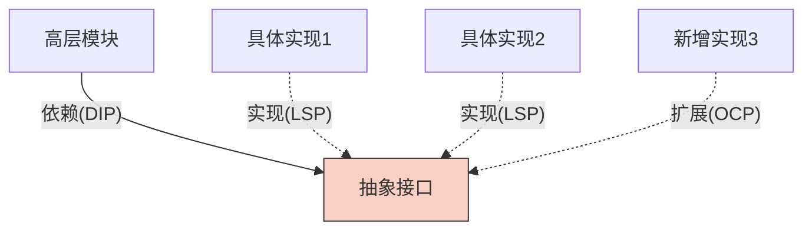

# 开闭原则（Open-Closed Principle, OCP）与多态条件

> [!IMPORTANT]
> 开闭原则（Open-Closed Principle, OCP）由 Bertrand Meyer 提出，其核心定义是：==软件实体（类、模块、函数等）应该对扩展开放，对修改关闭。==

想象一下：如果你每次给游戏加一个新角色，都要去改动原有角色的代码，系统会不会越改越容易崩溃？这就是 OCP 要解决的问题。

## 它是什么与为什么需要

- **对扩展开放（Open for extension）**：当需求变化时，可以通过添加新代码来扩展系统行为。
- **对修改关闭（Closed for modification）**：扩展功能时，不需要修改已有的源代码。

如果违背 OCP，每次新增功能都会引发“修改蔓延”，牵一发而动全身，导致高耦合、低内聚的构件级设计。OCP 的目标正是让模块行为可通过扩展增加，而不必触碰旧代码。

## 怎么做：多态条件与三大原则联动

如何实现“不改老代码就能加新功能”？答案是依赖 ==抽象（接口或抽象类）+ 多态==。

在构件级设计中，OCP 通常不是孤立存在的，而是通过里氏替换原则（LSP）和依赖倒置原则（DIP）共同支撑：



> [!TIP]
> 记忆口诀：**DIP 找接口，LSP 保替换，两者结合达成 OCP。**

以课件中的绘图软件系统为例（15分简答真题），我们需要绘制矩形（Rectangle）、圆形（Circle）和多边形（Polygon）。

**错误做法（违背 OCP）**：写一个 `drawShape(type)` 方法，里面全是 `if-else`。加新图形就得改这个方法的源码。

**正确做法（满足 OCP）**：

1. **DIP（依赖倒置原则）**：高层模块不依赖具体的图形类，而是依赖抽象的 `Shape` 接口。
2. **LSP（里氏替换原则）**：任何 `Shape` 的子类（如 `Circle`）都能无缝替换基类 `Shape`，且调用 `draw()` 语义正确，不会引起程序错误。
3. **OCP（开闭原则）**：若需新增三角形（Triangle），只需新建 `Triangle` 类并实现 `Shape` 接口，完全无需修改现有的 `Canvas` 或 `Shape` 代码。

```java
// 抽象层 (DIP)
interface Shape { void draw(); }

// 具体层 (LSP保证可替换)
class Circle implements Shape { public void draw() { /*画圆*/ } }
class Rectangle implements Shape { public void draw() { /*画矩形*/ } }

// 新增扩展 (OCP：只加不改)
class Polygon implements Shape { public void draw() { /*画多边形*/ } }

// 高层模块
class DrawingApp {
    // 依赖抽象，利用多态条件执行
    void render(Shape s) { s.draw(); } 
}
```

## 相近概念辨析

| 原则 | 关注点 | 核心要求 |
| :--- | :--- | :--- |
| **OCP** | 系统的演进方式 | 加新功能不加新 Bug（不改旧代码） |
| **LSP** | 继承体系的行为契约 | 子类能当父类用，逻辑不出错 |
| **DIP** | 模块间的依赖方向 | 面向接口编程，不依赖具体实现 |
| **ISP** | 接口的粒度 | 客户端不应被迫依赖它不使用的方法 |

> [!NOTE]
> LSP 和 DIP 是手段，OCP 是最终目的。没有 LSP 保证替换安全，或者没有 DIP 将依赖指向抽象，OCP 就无法落地。

## 常见的坑

> [!WARNING]
> **滥用继承而非组合**。为了扩展而强行建立深层继承树，一旦父类变更，所有子类受损，反而破坏了 OCP。

> [!CAUTION]
> **伪 OCP（预留无用接口）**。不要为了“未来可能的扩展”在当前设计一堆永远用不到的抽象接口。这违反了简单设计原则。OCP 应对的是合理的业务变化，而不是盲目猜测。
