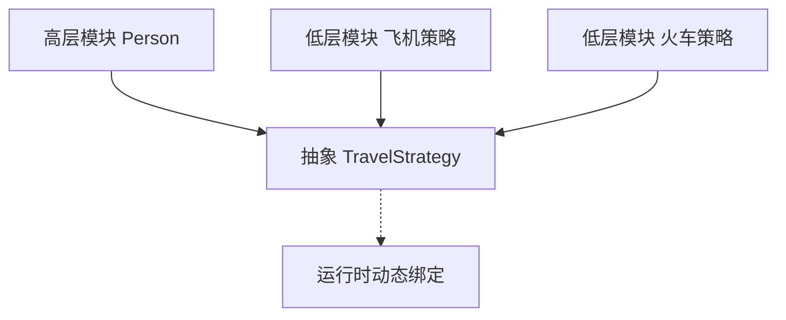
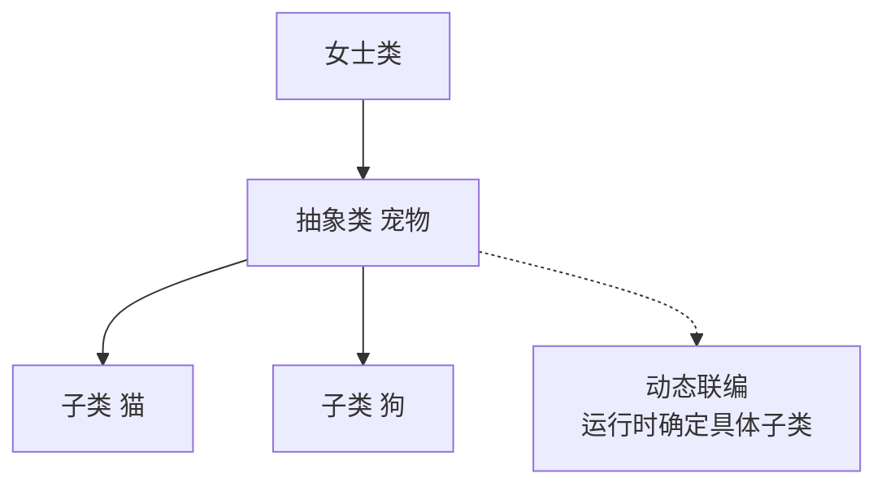

# 抽象（Abstraction）：过程抽象与数据抽象

## 抽象（Abstraction）

**抽象**是良好设计的核心特征之一：隐藏实现细节，只暴露必要的接口。它让设计者专注于"做什么"，而把"怎么做"推迟到具体实现阶段。

> [!IMPORTANT]
> 软件设计中使用三种抽象：**过程抽象（Procedural）**、**数据抽象（Data）**、**控制抽象（Control）**。考试选择题中若出现 Environmental 选项，==不选==。

## 过程抽象与数据抽象

| 抽象类型 | 关注点 | 例子 |
|---------|--------|------|
| 过程抽象 | 将操作序列封装为命名过程 | `open()`、`delete()` 等方法 |
| 数据抽象 | 定义数据类型及可施行的操作 | `FileSystemItem` 抽象基类 |
| 控制抽象 | 控制逻辑的封装与隐藏 | 条件、循环等控制结构的抽象表达 |

以文件系统为例，`FileSystemItem` 作为抽象基类，声明 `open()`、`delete()`、`rename()` 等通用方法——这就是**数据抽象**；客户端调用这些方法时无需关心文件或文件夹的具体实现差异——这就是**过程抽象**。

## 抽象耦合与依赖倒置

抽象的价值在**耦合关系**中体现得最清楚。课件强调：对象之间调用应在抽象层编程，即==尽量注入父类/接口对象，运行时用子类对象覆盖==。

> [!TIP]
> 三种注入方式：构造器注入、Setter 注入、接口注入。共同思想是：**依赖抽象的入口，而非具体的类**。

这正是**依赖倒置原则（DIP）**的核心：高层模块不应依赖低层模块，两者都应依赖抽象；抽象不应依赖细节，细节应依赖抽象。

## 抽象、多态与 LSP 的关系

抽象要真正生效，离不开**多态**与**里氏替换原则（LSP）**：

女士养宠物的例子中，若只实现"养猫"，未来需求变更（养狗、养鸟）就要大改代码。定义**宠物抽象类**后，新增功能只需添加子类，符合**开放封闭原则（OCP）**：对扩展开放，对修改关闭。

> [!WARNING]
> LSP 是 DIP 的基础：任何引用基类的地方，都必须能透明替换为其子类。若子类重写了父类方法却破坏原有契约，抽象耦合就会失效，系统陷入混乱。

## 缺乏抽象的代价：反模式

课件中的 **Blob 反模式**（大泥球）正是缺乏抽象的恶果：单个类承载大量属性和操作，缺乏内聚，难以修改、测试和重用。其典型原因之一就是"团队缺乏适当的抽象技能"。

## 与相近概念的区别

| 概念 | 关注点 | 与抽象的关系 |
|------|--------|-------------|
| 信息隐藏 | 隐藏内部数据与实现 | 抽象是手段，信息隐藏是目的 |
| 模块化 | 系统分解为独立模块 | 抽象定义模块间的契约接口 |
| 封装 | 绑定数据与操作 | 封装是实现抽象的语言机制 |

> [!NOTE]
> 设计模式本身也是一种抽象：它描述特定、有界问题的通用解决方案（如女士养宠物中的"宠物"抽象类），而非写好的代码。
