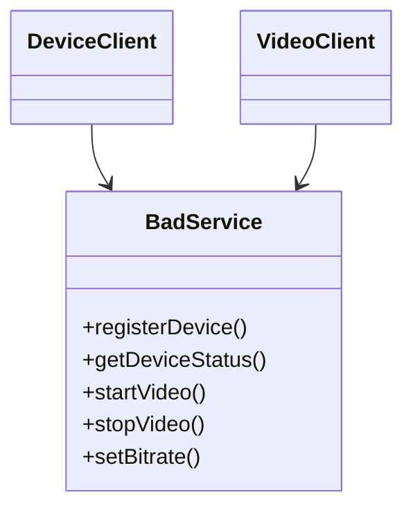
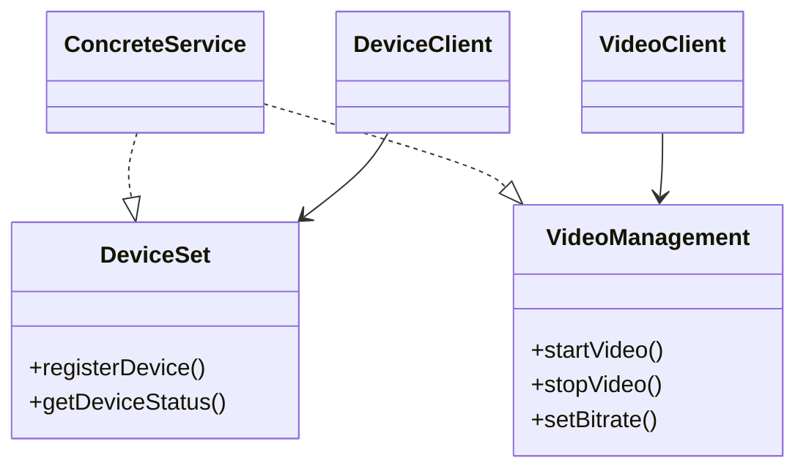

# 接口隔离原则（Interface Segregation Principle, ISP）

## 接口隔离原则（ISP）

先想一个问题：一个遥控器上堆满了 50 个按钮，而你只想调音量，会发生什么？你会被迫在一堆用不到的功能里寻找目标——设计接口也一样。客户端若被迫依赖它根本不需要的方法，接口一旦变动，无关的客户端也会被迫跟着改。

> [!IMPORTANT]
> 接口隔离原则（ISP）：“Many client-specific interfaces are better than one general purpose interface.”
> 即：==多个面向特定客户端的接口，优于一个通用的大接口==。客户端不应被迫依赖它不使用的方法。

课件里给了一句更直接的评价：==瘦接口比胖接口更好==。

### 为什么需要 ISP

一个“胖接口”（Fat Interface）把很多职责塞进同一个接口里。比如把设备管理和视频管理写在一个 `Service` 接口中：

`DeviceClient` 只想用设备相关方法，却被迫“知道”视频方法的存在。当视频方法签名变化时，`DeviceClient` 也必须重新编译。这就是耦合过紧的表现。

### 怎么做

把职责拆开：**为每组功能创建专门的接口**。

现在 `DeviceClient` 只依赖 `DeviceSet`，视频接口怎么改都与它无关。这正是课件典型例题 3 的核心：**关注点分离**——功能按领域划入不同接口，客户端只实现和依赖与自己需求相关的方法。

### 与其他设计原则的关系

| 原则 | 一句话 | 与 ISP 的区别 |
|---|---|---|
| OCP 开闭原则 | 对扩展开放，对修改关闭 | OCP 讲“怎么改”，ISP 讲“给谁用” |
| LSP 里氏替换原则 | 子类可替换父类 | LSP 保证替换正确，ISP 保证依赖最小 |
| DIP 依赖倒置原则 | 依赖抽象而非具体 | DIP 强调方向，ISP 强调大小 |
| ==ISP== | ==客户端不被强迫依赖不用的接口== | ==接口“粒度”要客户端化== |

四者常一起出现：**用 ISP 切小接口 → 用 DIP 依赖抽象 → 用 LSP 保证多态替换正确 → 最终实现 OCP**。

> [!TIP]
> 记忆顺序：先切（ISP）、再倒（DIP）、再替（LSP）、终开（OCP）。

### 常见的坑

> [!WARNING]
> 接口不是拆得越细越好。拆到每个接口只有一两个方法，可能导致接口爆炸、系统难以把握。==判断标准是客户端的使用模式==：同一组客户端总是一起调用的方法，可以留在同一个接口里。

> [!CAUTION]
> 不要用“一个类实现一个接口”来替代“一个接口服务一类客户端”。ISP 的“隔离”是按**客户端角色**切分的，不是按实现类切分。

### 一个判断例子

假设系统中两类消费者：`AdminClient` 需要 `addUser`、`deleteUser`；`ReportClient` 需要 `exportReport`。两种设计：

- 方案 A：一个 `OpsInterface` 包含全部三个方法 → `ReportClient` 被迫依赖 `addUser/deleteUser`，违反 ISP。
- 方案 B：拆成 `UserOps`（`addUser/deleteUser`）和 `ReportOps`（`exportReport`）→ 各客户端只依赖所需接口，==符合 ISP==。

方案 B 中，给 `UserOps` 增加 `updateUserPermission` 方法时，`ReportClient` 完全无感——这正是接口隔离带来的==最小化变更影响==。
