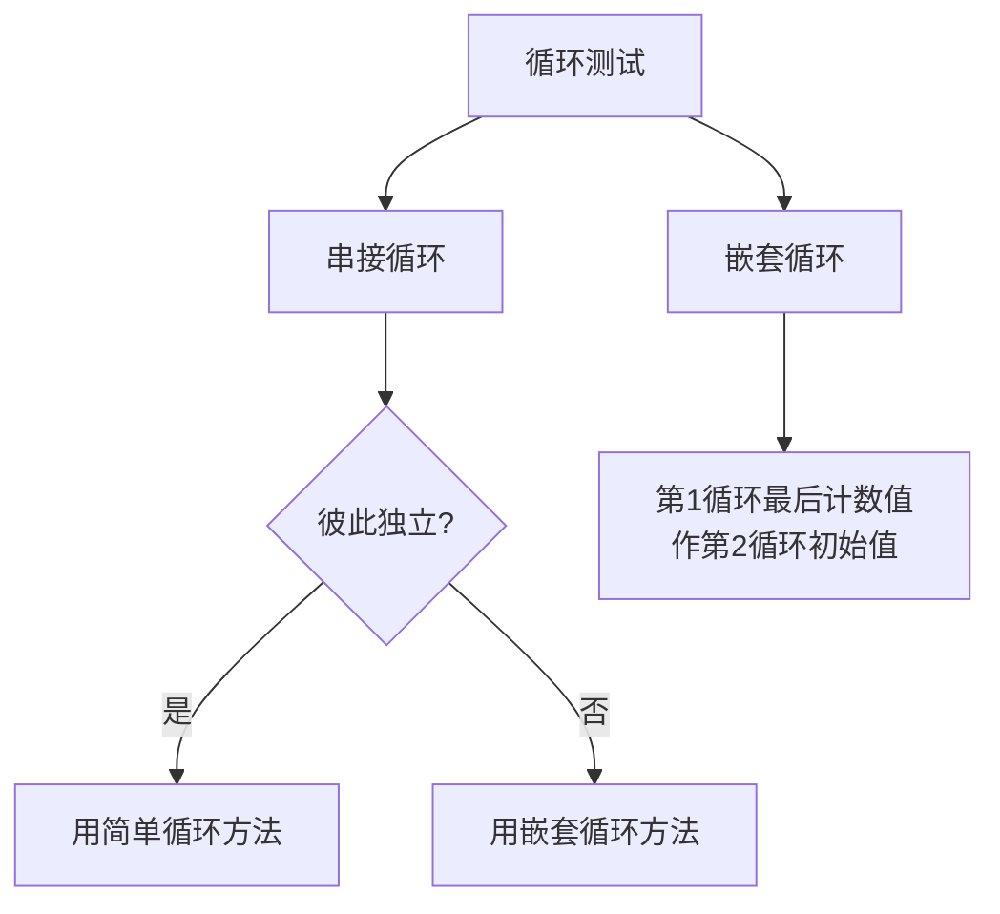

# 控制结构测试（Control Structure Testing）：条件测试与循环测试

## 控制结构测试

前面学基本路径测试时，你可能已经发现一个问题：**只保证每条独立路径跑一遍，并不能覆盖程序里所有"危险的地方"**。比如一个循环跑了 100 次和跑了 1 次，走的路径编号完全一样，但实际风险完全不同。

控制结构测试正是针对这个缺口提出的。它细化白盒测试中对**条件判断**和**循环**的检验，让你不只是"路过"了某个分支，而是真正检验了这些分支的**逻辑正确性**。

### 条件测试

基本路径测试把整个 `if` 当做一个"判定节点"，只关心它为真和为假两条路。但如果这个 `if` 写得很复杂呢？比如：

```c
if ((x > 0) && (y > 0) || (z == 1))
```

如果这条语句测试时永远因为 `z == 1` 为真而进入真分支，那 `x > 0` 和 `y > 0` 两个条件实际上**从未被单独检验过**。万一 `x > 0` 写成了 `x >= 0`，这就是一个漏掉的 bug。

> [!IMPORTANT]
> 条件测试的核心目标：把复合条件**拆解为原子条件**，检验每个原子条件的真/假取值都被覆盖，并过滤掉条件间的"短路掩盖"。

条件测试有两个层次：

| 方法 | 覆盖目标 | 强度 |
|---|---|---|
| 分支条件测试 | 每个原子条件取真、取假至少一次 | 弱 |
| 条件组合测试 | 所有原子条件的真/假**组合**全部覆盖 | 强，但数量爆炸 |

比如条件 `A && B`，分支条件测试只要 A 和 B 分别当真、假各一次即可；条件组合测试则要求 TT、TF、FT、FF 四种组合全部走到。

> [!WARNING]
> 条件组合测试的用例数是 $2^n$（n 为原子条件个数），实际工程中常结合“修正条件/判定覆盖（MC/DC）”做折中，不追求全组合。

### 循环测试

循环是软件中最容易出错、也最容易被基础路径测试忽视的结构。

想想看，`for (i = 0; i < n; i++)` 这条路在流图里是一个回路，无论循环 0 次、1 次还是 100 次，V(G) 算出来都一样——**环路复杂性没有能力暴露循环边界的错误**。

循环测试的做法是**针对边界次数设计最小用例集**。按课件中的分类：



简单循环的典型测试取值：

| 次数 | 意义 |
|---|---|
| 跳过循环（0 次） | 循环体根本不执行 |
| 1 次 | 最小执行 |
| 2 次 | 检查迭代间状态传递 |
| m 次（典型值） | 一般情况 |
| n-1、n、n+1 次 | ==边界值==（如 `i <= n` 与 `i < n` 写错） |

> [!TIP]
> 记法：**“零、一、二、典型、边界三条”**——0, 1, 2, m, n-1, n, n+1。

### 串接循环与嵌套循环的区别

课件里有一句值得注意的规定：

> [!IMPORTANT]
> 若串接循环的每个循环彼此独立，则使用简单循环测试方法；否则使用嵌套循环测试方法。

怎么理解？看两个代码片段：

```c
// 串接且独立：i 循环不依赖 j 循环
for (i = 0; i < 5; i++)  sum += a[i];
for (j = 0; j < 3; j++)  mul *= b[j];
```

```c
// 嵌套：内层循环依赖外层循环的当前值
for (i = 0; i < 5; i++)
    for (j = 0; j < i; j++)
        c[i][j] = 0;
```

第二个里内层循环的边界 `j < i` 由外层的**当前计数值**决定，用简单循环的独立取值方式无法暴露边界传递错误。这时代价较小的策略是：**固定外层循环为典型值，只对其他层做简单循环测试**。

> [!CAUTION]
> 嵌套循环全组合测试会爆炸：每层 7 个取值、3 层嵌套就是 $7^3 = 343$ 个用例。所以课件才要求“第 1 个循环的最后循环计数值为第 2 个循环的初始值”这类**依赖路径测试**，而非全组合。

### 一个算对了的例子

看课件里的绝对值和循环代码：

```c
1  while (n > 0) {
2      if (x < 0)
3          result = -x;
4      else
5          result = x;
6      n = n - 1;
7  }
8  return result;
```

用循环测试取 n 的值：0（跳过）、1（一次）、2（两次）、5（典型）、n-1=4、n=5、n+1=6 时各执行一轮。这样就能发现诸如 `n > 0` 写成 `n >= 0` 时 `n = 0` 是否多跑一次的问题——这是基本路径测试发现不了的。

| 对比项 | 基本路径测试 | 循环测试 |
|---|---|---|
| 关注点 | 独立路径覆盖 | 循环边界与迭代传递 |
| 循环次数 | 任意（只走通） | 0、1、2、典型、n-1、n、n+1 |
| 能发现 | 分支遗漏 | ==边界条件错误与迭代依赖== |

控制结构测试不是要替代基本路径测试，而是**对基本路径测试"只看路、不看路况"的补充**。条件测试盯住逻辑表达式的原子真假，循环测试盯住循环边界的极端取值，两者合起来，才算把白盒测试往“真能抓 bug”的方向推进了一步。
