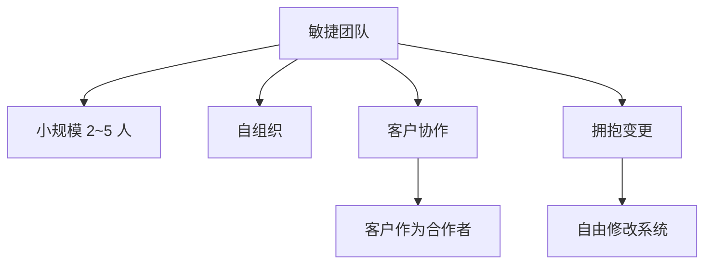

# 敏捷团队（Agile Teams）的特点

软件开发不是单打独斗，而是人与人之间的协作。**敏捷团队（Agile Team）** 就是专为快速响应变更而组织起来的小规模、自驱动团队。它与传统封闭式团队的核心区别在于：==敏捷团队通常被授权自由地修改系统以应对新需求==，而架构师只对关键架构决策负责，开发者则需与合适的利益相关者沟通确认。

## 为什么需要敏捷团队

瀑布模型强调"计划-执行-交付"，一旦需求变更就要付出昂贵代价。敏捷方法最具强制性的特点之一，就是通过软件过程来降低由变更所引起的代价。实现这一目标的关键不是文档，而是人。小团队 + 高频沟通 + 客户协作，才能让变更变得"便宜"。

## 敏捷团队的关键特点

| 维度 | 传统团队（closed paradigm） | 敏捷团队（Agile Team） |
|------|-----------------------------|------------------------|
| 结构 | 传统权威层级 | 扁平、自组织（self-directed） |
| 规模 | 较大 | 一般 2~5 人核心开发 |
| 需求变更 | 抵制 | ==自由应对==，随需求演进 |
| 客户角色 | 评审者 | **合作者**（collaborator）参与全过程 |
| 架构决策 | 架构师全权决定 | 架构师管关键部分，开发者咨询利益相关者 |
| 过程控制 | 自上而下 | 团队成员拥有更多过程和技术决策权 |

## 高效团队的属性

回忆一下：一个总是加班却互相埋怨的团队，和一个规模不大却能快速交付的团队，差别在哪？答案不在技术栈，而在属性：

- ==目标感==（Sense of purpose）：清楚项目目标和范围
- ==参与感==（Sense of involvement）：每个人都有归属
- ==信任感==（Trust）：成员之间相互信任
- ==改进意识==（Sense of improvement）：持续反思、复盘
- ==技能多样性==（Mix of skills）：分析、设计、编码、测试能力互补

> [!IMPORTANT]
> 有效软件团队的五个关键属性：目标感、参与感、信任感、改进意识、技能多样性。这是考题高频点（P77 第二段到第四段）。

## W⁵HH 原则与团队领导

敏捷团队需要清晰的沟通框架，Pressman 提出的 W⁵HH 原则覆盖了 Why / What / Where / Who / When / How / How much。团队领导者（team leader）不是发号施令的经理，而是促进协调与沟通（coordination and communication）的角色。

> [!TIP]
> 记忆：**W⁵HH = Why, What, Where, Who, When, How, How much**，"五 W 两 H"。

## 常见的坑

> [!WARNING]
> 别把"敏捷"理解成"不要文档、不要架构"。敏捷 != 反工程。敏捷是覆盖所有软件工作的总体哲学（overriding philosophy），不与扎实的软件工程实践对立（antithetical）。

> [!CAUTION]
> 避免挫败感的最佳方式之一是==让团队成员拥有更多过程和技术决策权==，而不是少给权限、或隐瞒坏消息。（对应往年选择题第 31 题，答案 A。）

## 一道对了的例子

**Team Software Process (TSP) 的目标是什么？**

- A. 加速软件过程改进
- B. 让训练有素的专业人员更好管理时间
- C. 建立自驱动的软件团队
- D. 向管理者展示如何降本提质
- E. B 和 C

**答案：E**。TSP 由 Watts Humphrey 提出，核心正是 ==build self-directed software teams==（建立自驱动团队）+ 让专业人员管理自己的时间。注意 A、D 是 PSP/CMMI 层面的目标，不是 TSP 直接聚焦的团队建设目标。

> [!NOTE]
> TSP（Team Software Process）常与 PSP（Personal Software Process）对照记：PSP 管个人，TSP 管团队，CMMI 管组织。TSP 的团队属性与敏捷团队高度一致——自组织、技能多样、信任。
