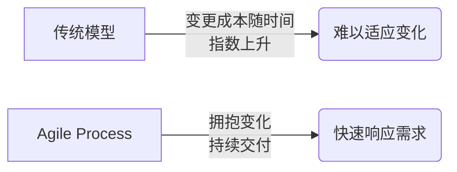
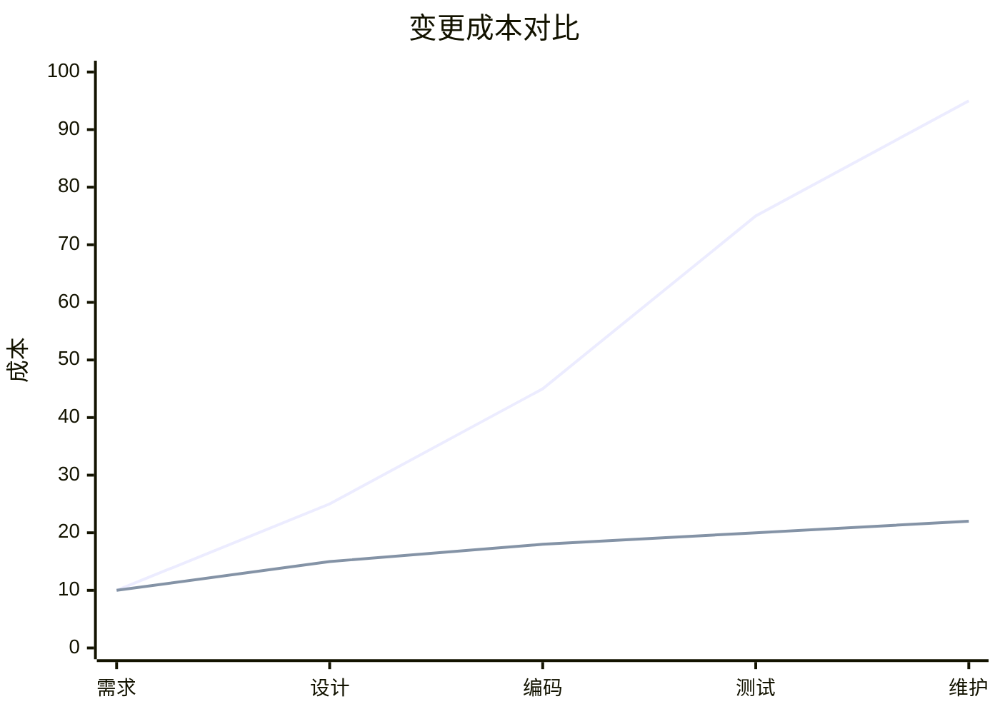

# 敏捷思想（Agility）、敏捷原则及变更成本

> [!IMPORTANT]
> 核心定义：==Agility（敏捷思想）== 是一种以人为核心、迭代、循序渐进的开发理念，强调快速响应变化而非死守计划。

## 为什么需要敏捷？

传统 prescriptive process models（如 waterfall model）假设需求在初期就能冻结。但现实是：客户往往在看到 software 之前都不知道自己要什么。一旦进入后期才发现问题，修改代价极高。

那么，有没有一种过程能让“变更”不再昂贵？

## 什么是 Agility？

根据 Pressman 教材 P(62)，Agility 不仅仅是“快”，它包含三个关键维度：

1. **有效响应变化**（Responding to change）
2. **团队自组织与沟通**（Individuals and interactions）
3. **持续交付可工作的软件**（Working software）

2001 年，Agile Alliance 提出了《敏捷宣言》（Manifesto for Agile Software Development），明确了四项权衡（Tradeoffs）：

| 更看重（Over） | 相对看轻 |
| :--- | :--- |
| ==个体和互动== (Individuals and interactions) | 过程和工具 (processes and tools) |
| ==可工作的软件== (Working software) | 详尽的文档 (comprehensive documentation) |
| ==客户协作== (Customer collaboration) | 合同谈判 (contract negotiation) |
| ==响应变化== (Responding to change) | 遵循计划 (following a plan) |

> [!WARNING]
> 常见误区：敏捷**不是**不要文档、不要计划或反纪律！右侧的内容也有价值，只是左侧的价值**更高**。Agile is not antithetical to solid SE practice.

## 变更成本曲线

为什么 agility 能降低变更成本？

在传统 evolutionary model 或 waterfall model 中，变更成本 $C_{change}$ 随时间 $t$ 呈指数增长：$C_{change} \propto e^{kt}$。到了测试甚至运维阶段再改架构，代价极其高昂。

而在 agile process 中，通过 short iterations（短迭代）、continuous integration（持续集成）和 acceptance tests，变更被分摊到每个小周期里，使得 $C_{change}$ 曲线趋于平缓。

> [!TIP]
> 记忆口诀：“传统越晚越要命，敏捷切块平摊掉”。结合冒烟测试（Smoke Testing）和回归测试（Regression Testing），新模块进入时能快速判断是否引入副作用，从而锁住变更成本。

## Agility Principles

Agility Principles 是将宣言落地的指导准则，核心包括：
- **最高优先级**：通过早期和持续交付有价值的 software 满足客户。
- **欢迎变更**：即使在开发后期，也利用变化为客户创造竞争优势。
- **频繁交付**：按周或月交付 working software。
- **简洁为本**：最大化“未完成工作量”的艺术（即少做无用功）。

## 相近概念辨析

| 概念 | 侧重点 | 关系 |
| :--- | :--- | :--- |
| **Agility** | 哲学思想与价值观 | 宏观指导思想 |
| **Agile Process** | 具体的软件开发过程框架 | Agility 的落地载体 |
| **Extreme Programming (XP)** | 具体的敏捷方法（含 pair programming, XP story 等实践） | Agile Process 的一种特化实例 |

> [!NOTE]
> 考题常问：“What are the tradeoffs proposed by the Manifesto?” 答题时必须写出那 4 组“X over Y”的完整英文对照，这是南邮双语课的采分点。

## 算对了的例子

**题目**：简述《敏捷宣言》提出的四个 Tradeoffs，并说明为什么它对软件工程至关重要？

**解答要点**：
1. 列出四组 Tradeoffs（见上文表格英文版）。
2. 指出其意义：它提出了一种现实的机制（realistic mechanism），在保证 discipline（纪律）的同时，宽容对待工程师产生的可控错误；使团队能够应对现代软件开发中不可避免的需求变更，确保最终交付的是 customer 真正需要的 working software。
