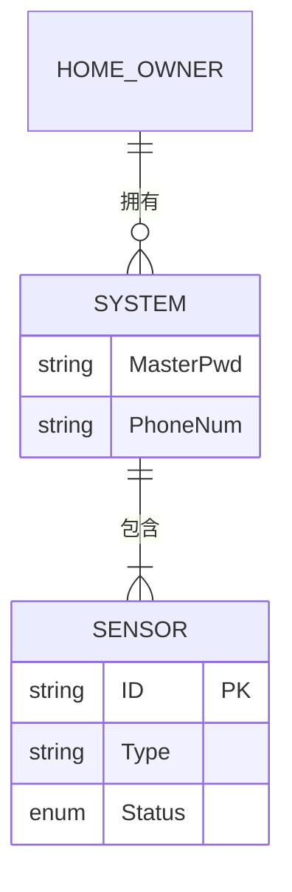

# 数据建模：数据对象、属性、关系与构建ERD

## 数据建模的核心要素

在需求分析阶段，当我们从用例场景中提取出“内容对象”后，下一步该如何组织这些信息？仅仅列出名词是不够的，我们需要构建一个独立于具体处理逻辑的==信息域模型==。数据建模（Data Modeling）正是用来描述数据对象、属性及其相互关系的结构化方法，它直接对应设计模型中的“数据设计元素”，是从用户视角理解系统信息的基础。

> [!IMPORTANT]
> 核心定义：数据建模关注==数据域==而非控制流，旨在为数据对象及其属性设计恰当的数据结构，确保信息完整性与充分性。

## 识别数据对象与属性

如何判断一个名词是独立的“数据对象”还是仅仅是某个对象的“属性”？这是建模中最容易混淆的点。我们可以依据以下特征进行筛选：

-   **独立存在性**：该实体是否能脱离其他实体被单独标识或存储？
-   **多属性特征**：是否拥有多个描述性特征？若只有一个值，通常在分析阶段作为属性处理。
-   **操作关联性**：是否存在针对该实体的增删改查操作？

以课件中的“家庭安全系统”为例，“传感器”具备编号、类型、状态等多个属性且有独立操作，因此是数据对象；而“编号”本身只是传感器的一个描述符，不具备独立性，应作为==属性==处理。

| 候选词 | 判定结果 | 关键理由 |
| :--- | :--- | :--- |
| 传感器 | ✅ 数据对象 | 具备多属性、独立操作、可标识 |
| 编号/类型 | ❌ 属性 | 仅描述传感器，无独立行为 |
| 房主 | ⚠️ 外部实体 | 属于角色，非系统内部数据对象 |
| 安装 | ❌ 事件 | 属于动态行为，非静态数据结构 |

> [!TIP]
> 记忆口诀：==多名多操才为类，单值依附是属性==。分析阶段聚焦“主”信息，避免过早将属性拆分为独立类。

## 构建 ERD 与关系映射

确定了对象和属性后，需要通过实体-关系图（ERD）将它们关联起来。ERD 专注于数据的==静态结构==，这与描述交互行为的 UML 类图有本质区别。

在绘制 ERD 时，需明确三种基本关系基数：一对一（1:1）、一对多（1:N）和多对多（M:N）。注意区分==聚合==与==组合==的概念差异：虽然 ERD 主要表达数据关联，但在后续向类图转换时，若部分对象不能脱离整体独立存在（如传感器与系统），应视为组合关系；反之则为聚合。

> [!WARNING]
> 常见误区：不要将“数据流”混入 ERD。ERD 只描述数据“是什么”及“如何关联”，绝不包含数据“如何流动”或“何时被处理”。

## 真题解析与验证

回顾经典考题：“Content objects are extracted from use cases by examining the scenario description for direct or indirect content references.” 答案为 True。这印证了数据对象的来源必须基于==用例场景==的直接引用或间接推导，而非凭空臆造。

再看选择题：“Which design model elements are used to depict a model of information represented from the user's view?” 答案选 C（Data design elements）。这是因为只有数据设计元素专门负责从用户视角描绘信息的结构与关系，架构设计关注整体框架，组件设计关注模块实现，接口设计关注交互边界，均不直接等同于用户视角的信息模型。

> [!CAUTION]
> 高危陷阱：在设计阶段细化属性时，切勿直接将数据库表结构等同于分析模型。分析模型应保持==原始性==与==高内聚==，避免过早引入外键等物理实现细节，以免破坏问题域的本来面貌。
