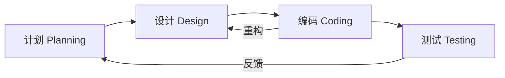

# 极限编程（Extreme Programming, XP）的计划、设计、编码与测试

## 它是什么

极限编程（Extreme Programming, XP）是敏捷开发中最具代表性的过程模型，由 Kent Beck 等人推动。它把软件过程组织成四个框架活动：==计划（planning）、设计（design）、编码（coding）、测试（testing）==。XP 的底层价值观是沟通、简单、反馈、勇气和尊重，强调小团队、短迭代、持续交付可运行软件，而不是先写大量文档再集中开发。

## 为什么需要

传统过程容易把需求、设计、编码和测试拉得很长，需求变化后返工成本高。XP 的思路是：既然变化难以避免，就用频繁反馈降低变化代价。客户持续参与，团队快速做出小版本；测试先行和持续集成让错误尽早暴露；简单设计与重构避免系统因临时修补而越来越乱。

## 四个活动怎么做

| 活动 | 核心做法 | 学生应抓住的关键词 |
|---|---|---|
| 计划 | 客户编写 **XP story**，描述需求价值；团队估算成本，拆分短迭代，按优先级安排发布 | 用户故事、迭代计划、发布计划 |
| 设计 | 坚持简单设计，只满足当前需求；必要时用 **spike solution** 做小型探索性原型，降低技术不确定性 | 简单设计、CRC 卡、探索方案 |
| 编码 | 推荐先写单元测试再编码；采用 **pair programming**，两人共用一台电脑，一人编码、一人审查思考；持续集成并及时重构 | 结对编程、测试先行、重构 |
| 测试 | 开发者频繁执行单元测试；客户参与制定 **acceptance tests**，验证故事是否满足；测试可重复执行，支持回归 | 单元测试、验收测试、持续集成 |

> [!IMPORTANT]
> XP 不是“不计划、不设计、直接写代码”。它的中心观点是：==设计既发生在编码之前，也发生在编码之后==；编码后的设计改进主要通过重构完成。

## 单元测试与 JUnit

单元测试是开发者编写的一小段代码，用来检验被测代码中很小、很明确的功能，通常判断某个特定条件下某个函数的行为。JUnit 是 Java 社区常用的单元测试框架，由 Erich Gamma 和 Kent Beck 共同开发。

经典 JUnit 3.8 风格的基本步骤是：

1. 重载 `setUp()`，准备测试环境和数据，即 fixture；
2. 编写 `testXXX()` 测试方法；
3. 使用 `assertEquals()`、`assertTrue()` 等断言检查结果；
4. 用 `TestSuite` 组织多个测试，并由 `TestRunner` 执行；
5. 重载 `tearDown()`，释放资源、清理环境。

`TestCase` 表示测试用例，`TestSuite` 组合多个测试，`TestResult` 收集成功、失败和错误信息。运行器常用绿条表示通过、红条表示失败。测试代码应与产品代码分目录保存，但可使用相同包名，兼顾分离与查找方便。

## 和相近概念的区别

| 概念 | 关注点 | 与 XP 的关系 |
|---|---|---|
| 单元测试 | 验证小函数或类的局部行为 | XP 编码与测试的基础实践 |
| 验收测试 | 验证用户故事是否满足客户要求 | 通常由客户参与定义 |
| 回归测试 | 重复执行已有用例，防止修改引入旧问题 | 持续集成时尤其重要 |
| 重构 | 不改变外部行为，改善内部结构 | 不是随意加功能，也不是重写系统 |
| 结对编程 | 两人协作完成同一编码任务 | 不等于两人分别写模块 |

## 常见的坑

> [!WARNING]
> - 四个框架活动中没有 `analysis`，不要套用瀑布模型的阶段名称。
> - `spike solution` 是探索难题的临时方案，不是直接交付的完整原型。
> - 断言失败通常表示结果不符合预期；被测代码抛出未预料异常则属于测试错误，二者不要混淆。
> - 一个功能可以有多个测试方法，用不同输入覆盖正常、边界和异常情况。

## 例题

题目：What are the four framework activities found in the Extreme Programming process model?

A. analysis, design, coding, testing  
B. planning, analysis, design, coding  
C. planning, analysis, coding, testing  
D. planning, design, coding, testing  

正确答案是 **D**。解题时直接回忆 XP 主线：==故事驱动计划，简单设计指导编码，编码伴随结对与重构，测试提供快速反馈==；选项中出现 `analysis` 即可排除。
