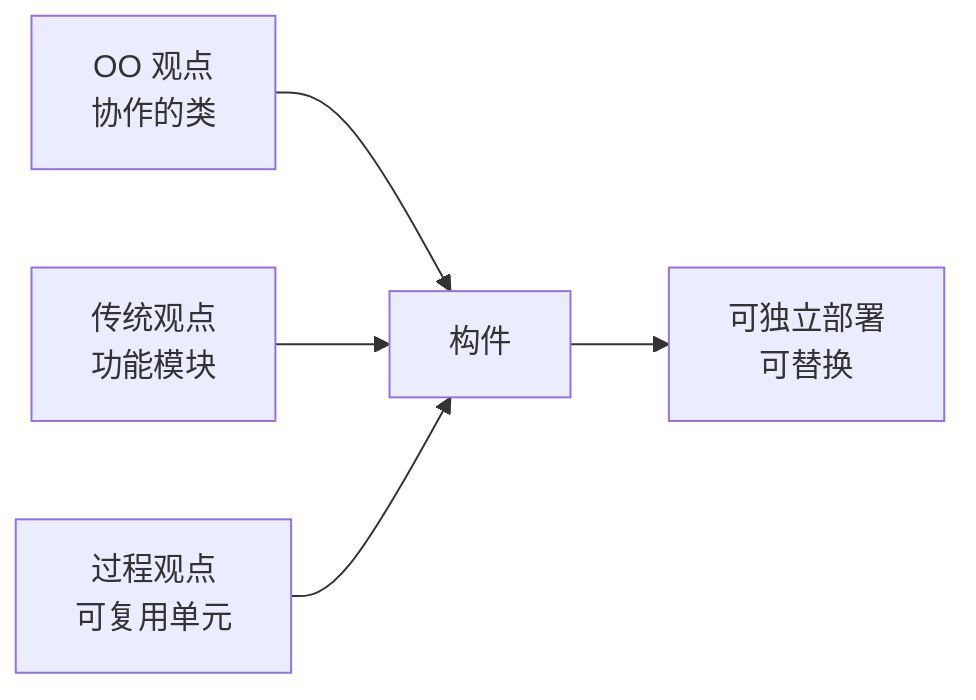

# 什么是构件（What is a Component）及示例

## 什么是构件

先从一个问题入手：软件最终要交付的东西，究竟是一团“代码”，还是一组可以**分别管理、替换、组装的积木**？

在软件配置管理（SCM）中，每个可交付的工作产品被称为**软件配置项（SCI）**——可以是一份文档、一组测试用例、一个多媒体资产，也可以是一个**命名的程序构件**。这说明：构件首先是“可被配置管理识别的最小或较大单元”，它需要有自己的版本、变更记录和审核边界。

但“构件”在软件工程中有更具体的内涵。最宽泛的定义是：

> [!IMPORTANT]
> 构件（component）是计算机软件的一个模块化积木（modular building block），是系统中**可独立部署、可替换、具有明确接口**的组成部分。

判断一个东西是不是构件，核心看三点：**有清晰边界、有对外接口、可被替换**。

---

## 三种观点看构件

课件中给出三组不同观点，它们是理解构件的关键：

| 观点 | 构件是什么 | 典型例子 |
|------|-----------|---------|
| **面向对象观点（OO-View）** | 一组协作的类（a set of collaborating classes） | 一个 `PaymentService` 构件，内含 `Order`、`Invoice`、`PayPalGateway` 等类 |
| **传统观点（Traditional-View）** | 程序中的功能模块（functional element） | 控制模块、业务模块、基础设施模块，如一个排序函数或一个设备驱动 |
| **过程相关观点（Process-Related View）** | 基于构件开发（CBSE）中的可复用单元或设计模式 | 通过组装已有的合格构件来构建新系统 |

面向对象观点强调：构件不只是一个类，而是**类之间的协作关系**。类需要定义属性结构、操作流程和消息接口之后，才能构成可用的构件。传统观点则更直白——一个模块就是程序中的一个功能单元，内部有处理逻辑、数据结构和调用接口。

---

## 为什么需要构件

软件变更不可避免——无论处于生命周期的哪个阶段，系统都会变，而且“想改它”的欲望会一直存在。如果系统是一整块无法分割的代码，那么每次修改都意味着牵一发动全身，风险极高。

构件的价值正在于此：

- **变更局部化**：修改只影响构件的内部实现，只要接口不变，其他构件无感知。
- **支持复用**：基于构件的开发（CBSE）通过组装经过**合格性检验**的构件来构建系统，降低开发成本。
- **便于配置管理**：每个构件作为独立的 SCI 被存储、签入签出、版本化。
- **支持增量集成**：构件可以逐个集成和测试，实现持续集成（CI）。

> [!TIP]
> 记忆口诀：构件的三要素可以记为“**接口 + 封装 + 可替换**”。
> 接口对外是承诺，封装对内是隐藏，可替换是最终价值。

---

## 构件与相关概念的区别

| 概念 | 区别 |
|------|------|
| **构件 vs 类（class）** | 类是源代码级概念，构件是部署级概念；一个构件通常包含多个类 |
| **构件 vs SCI** | SCI 是配置管理的概念，构件是设计概念；构件可以是一个 SCI，但 SCI 还可以是文档、测试用例 |
| **构件 vs 模块（module）** | 传统视图中两者几乎等价，但“模块”更偏源代码组织，“构件”更强调运行时交付和替换 |
| **构件 vs 模式（pattern）** | 模式是设计经验的抽象描述，构件是具体的可运行实现 |

---

## 一个选对了的例子

> [!NOTE]
> 真题回顾：The component-based development model is（ ）  
> 答案：**C. Dependent on object technologies for support.**

这里有一个**常见的坑**：很多人选 B，认为基于构件的开发“不能支持可复用构件的开发”。恰恰相反，CBSE 的**前提**就是 要有可复用构件库——这些构件通常来自领域工程，通过面向对象技术（接口、抽象类、设计模式）来实现和标准化。

再看一个判断题：

> [!NOTE]
> “In the most general sense, a component is a modular building block for computer software.”  
> 答案：**True**

这印证了最宽泛的定义：构件首先是模块化积木。即使不用面向对象语言，一个组织良好的 C 函数库中的模块也可以视为传统构件。

---

## 常见误区

> [!CAUTION]
> **高危误区：把构件等同于“一个 .java 文件”或“一个类”。**
> 构件是运行时或部署单元，一个构件可能包含数十个类和若干资源文件，它的边界由**接口**决定，而不是由文件决定。

> [!WARNING]
> **容易忽略：构件级设计不是要“重新发明轮子”。**
> 设计时首先应做**构件合格性检验**——看现有构件库中是否已有满足需求的构件，而不是上来就写新代码。这也是 CBSE 与从零开发的本质区别。
