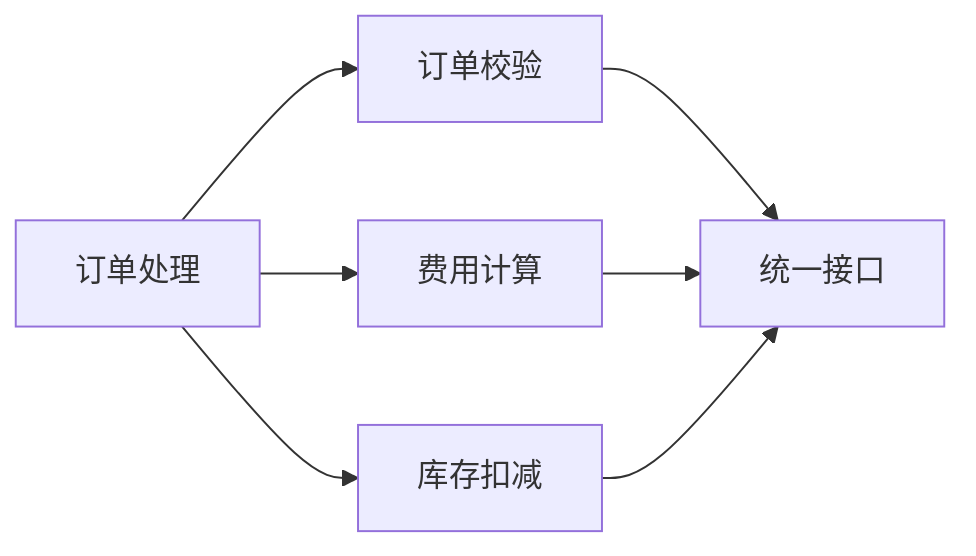

# 实施构件级设计的指南（Design Guidelines）

## 实施构件级设计的指南

实施构件级设计，是把体系结构中的构件进一步细化为可编码、可测试、可维护的类或模块。设计指南就是实施过程中应遵循的一组检查原则，主要用于回答两个问题：

1. 构件内部应包含哪些职责和操作？
2. 构件之间应如何协作，才能降低耦合、提高内聚？

> [!IMPORTANT]
> 构件级设计的目标不是尽早写代码，而是形成一份==完整、可读、可实现、可测试、可维护==的设计说明。

## 为什么需要设计指南

如果仅凭程序员经验划分类和模块，容易出现以下问题：

- 一个类承担过多职责，修改一个功能时影响多个无关部分；
- 类中只有几个简单方法，却把复杂流程交给调用者；
- 多个构件共享大量内部数据，形成较高耦合；
- 接口只考虑“能调用”，没有考虑复用、替换和测试；
- 设计文档只画结构图，没有说明数据、功能和行为。

因此，教材强调：设计应当成为代码生成者、测试人员以及后续维护人员都能理解的指南，并从实现角度覆盖==数据、功能和行为==三个领域。

## 怎样实施构件级设计

### 先确定构件职责

每个构件应具有清晰、单一且可说明的职责。命名时使用含义明确的名词，如 `OrderProcessor`、`PaymentService`，避免含义模糊的 `Manager`、`Handler` 或 `CommonUtils`。

对基于类的构件，可按以下思路检查：

- 构件是否拥有完成职责所需的全部属性和操作；
- 是否混入与职责无关的成员；
- 每个操作是否足够基本、单一；
- 数据是否应封装在拥有该数据的构件内部；
- 类之间是否只通过公开接口协作。

### 保证高内聚、低耦合

内聚描述一个构件内部成员围绕同一职责结合的紧密程度；耦合描述一个构件依赖其他构件的程度。高内聚、低耦合意味着：相关功能集中在一起，而构件之间只交换必要的信息。

图中各子功能职责明确，并通过统一接口协作。订单处理构件不应直接访问库存、支付系统的内部数据库，否则耦合会明显增加。

### 设计可替换、可复用的接口

接口隔离原则要求接口只向客户端暴露其真正需要的功能。若一个接口同时包含支付、查询、退款和报表操作，那么只需要支付的客户端也会被迫依赖无关方法。

同时还应考虑：

- **开闭原则**：增加新行为时，尽量扩展而不是修改稳定代码；
- **里氏替换原则**：子类必须能够替换父类，而不能破坏原有约定；
- **依赖倒置原则**：高层策略和低层实现都应依赖抽象接口。

### 编码前设计单元测试

构件级设计不仅要说明“如何实现”，还应说明“如何验证”。应为每个构件或类预先设计单元测试，检查接口、正常流程、异常流程和边界条件，使设计人员能够据此判断实现是否正确。

## 常见误区

> [!WARNING]
> “模块越多越体现模块化”是错误的。模块过少可能导致职责集中和修改困难；模块过多则会增加接口管理、导航、测试与集成成本。

其他常见问题包括：

- 把所有数据设为 `public`，破坏信息隐藏；
- 为了“方便”而让一个类直接调用另一个类的内部实现；
- 一个方法同时负责输入处理、业务计算、数据库访问和界面输出；
- 只设计成功路径，没有规定无效输入或异常情况的行为；
- 认为内聚越高越好，却忽略类的职责是否单一且合理。

## 一个算对了的例子

以“汽车与驾驶员”为例：

- `Car` 封装车辆状态，并提供 `drive()`、`stop()` 等基本操作；
- `Driver` 保存驾驶员信息并发出驾驶意图；
- `Driver` 不负责实现加速、制动等车辆内部细节；
- `Car` 与 `Driver` 通过清晰接口交互；
- 两者分别具有与车辆操作、驾驶员行为相关的高内聚成员。

若以后更换不同类型的汽车，只要它遵守相同接口，`Driver` 就无需修改。这同时体现了==单一职责、高内聚、低耦合和面向复用设计==。
