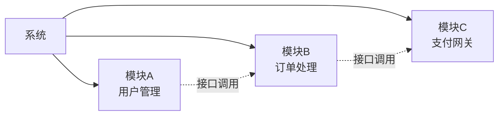
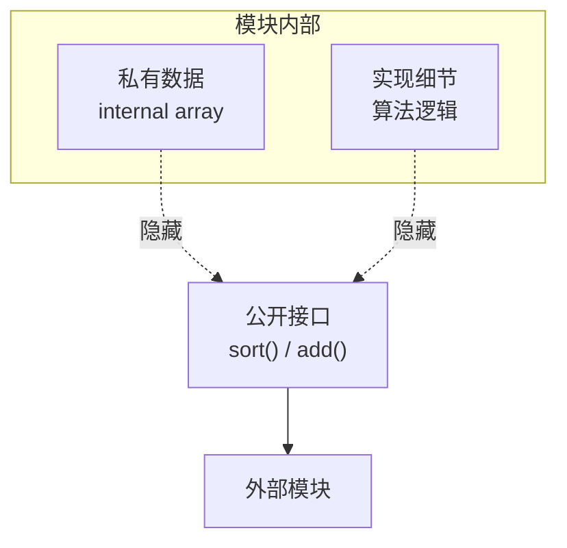

# 模块化（Modularity）与信息隐藏（Information Hiding）

## 模块化与信息隐藏

先从一个直觉问题入手：如果让你一个人写完一个 10 万行的系统，你会一口气从头写到尾吗？不会。你会把它拆成登录模块、订单模块、支付模块……**拆，是人的本能**。但“怎么拆”决定了设计的好坏——这就是模块化的核心命题。

### 什么是模块化

模块化（Modularity）指将系统功能分解为**独立、可识别、可组合**的软件单元（模块/组件）。每个模块承担明确的职责，模块之间通过接口通信。



模块化的价值在于==降低复杂度==。心理学中的“七加减二”规律表明，人一次能处理的认知单元有限。把大问题拆成小问题，每次只需关注一个模块，这是工程可行性的前提。

> [!IMPORTANT]
> 模块化的目标不是“拆得越细越好”，而是**每个模块恰好承担一个清晰职责，且模块间依赖最小化**。

### 信息隐藏：模块化的另一半

模块化回答了“怎么拆”，信息隐藏（Information Hiding）回答了**“拆开后彼此之间该知道多少”**。

信息隐藏要求：模块内部的数据结构和实现细节**对外部不可见**，外部只能通过公开接口交互。比如调用排序模块的客户端只需要知道 `sort(list)` 返回排好序的列表，不需要也不应该知道内部用快速排序还是归并排序。



这样做的好处：==当模块内部改变时，不波及调用方==。内部改用更高效的算法、更换数据结构，只要接口不变，整个系统照常运行。信息隐藏本质上是在模块之间**建一道防火墙**。

### 与相近概念的关系

| 概念 | 关注点 | 回答的问题 |
|---|---|---|
| 模块化 | 拆分的结构与边界 | 系统由哪些模块组成？ |
| 信息隐藏 | 模块间的可见性规则 | 外部能知道模块内部的什么？ |
| 高内聚 | 模块内部的紧密程度 | 模块内的元素是否围绕同一目标？ |
| 低耦合 | 模块间的依赖强度 | 模块之间的连接是否最小化？ |

四者环环相扣：**模块化是起点，信息隐藏是手段，高内聚低耦合是结果**。没有信息隐藏，模块之间互相窥探内部，“低耦合”就是空谈。

### 迪米特法则：信息隐藏的行为准则

迪米特法则（Law of Demeter），也叫**最少知识原则**，用一句话概括：==不要和“陌生人”说话，只与直接朋友通信==。

一个对象应当对它调用的对象知道得尽可能少。假设一个类 `A` 的方法里写了：

```java
// 反例：A 知道了太多“陌生人”
order.getCustomer().getAddress().getCity();
```

`A` 不仅依赖 `Order`，还穿透依赖了 `Customer` 和 `Address`。一旦 `Customer` 的结构变了，`A` 也得改。正确做法是让 `Order` 提供一个方法隐藏内部链：

```java
// 正例：只和直接朋友 Order 通信
order.getCustomerCity();
```

> [!WARNING]
> 迪米特法则不是要求“类与类之间完全不通信”，而是**通信链路中不要跨越自己不认识的中间对象**。过度机械地套用会导致过度包装，产生一堆只做转发的冗余方法。

### 一道典型题的分析

简答题曾考过 *The characteristics of a good design?*（良好设计的特征）。参考答案中前三条正是本节内容的核心：

1. **模块化**——功能分解为独立模块，降低复杂性；
2. **抽象**——隐藏实现细节，只暴露必要接口；
3. **信息隐藏**——模块内部数据和实现对**外不可见**，减少耦合。

注意区分第 2 条和第 3 条：**抽象**是“提炼出本质特征供外部使用”，**信息隐藏**是“把非本质的实现细节藏起来”。抽象说的是“露出什么”，信息隐藏说的是“藏起什么”——==两者是一体两面==。

> [!TIP]
> 记忆口诀：**模块化拆结构，抽象定界面，信息隐藏管隐私，迪米特守边界。** 考试中“良好设计特征”类题目，这四项往往互为支撑地出现：模块化是骨架，抽象定义接口，信息隐藏保证独立性，迪米特法则落实为具体编码规范。
