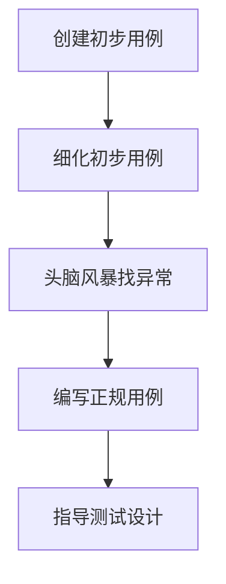

# 编写正规的用例（Formal Use Case）

---
requires: [软件工程/需求建模, 软件工程/用例图]
---

在用例图（Use Case Diagram）中，我们画出了 Actor 和 Use Case 之间的连线，但这根线只告诉我们“谁”能“做什么”，却没说“怎么做”。如果开发团队只看图就开始写代码，会遇到什么问题？==正规的用例（Formal Use Case）正是为了把这幅图的骨架填上血肉而存在的。==

## 它是什么

正规用例是一份结构化的文本规约（Specification），被当作系统行为的“契约”（contract for behavior）。它详细描述了参与者（Actor）与系统之间为完成某个目标而进行的一系列交互步骤，包括正常流程和异常流程。

> [!IMPORTANT]
> 核心定义：正规用例是比用户故事（User Story）更正式的需求描述方式，它不仅说明系统“应该执行什么”，还明确了前置条件、后置条件以及所有可能的分支路径。

## 为什么需要

课件中提到，需求验证（Requirements Validation）的一个关键关注点是**一致性（consistency）**。仅靠初步用例（Preliminary Use Case）或简单的场景描述，很难保证不同开发人员对同一功能的理解一致。正规用例通过标准化的模板，消除了歧义，同时也为后续基于场景的测试用例设计（Scenario-Based Test Case Design）提供了直接依据。

## 怎么写：从初步到正规

编写过程通常分为三步：创建初步用例 $\rightarrow$ 细化初步用例 $\rightarrow$ 编写正规用例。

在细化阶段，一个极易遗漏的环节是**异常处理**。如何推导出一套完整的用例异常集（use case exceptions）？课件明确指出：==头脑风暴（Brainstorming）是一种可用于推导完整用例异常集的技术。==

一个标准的正规用例通常包含以下核心字段：

| 字段 | 说明 |
| :--- | :--- |
| **Use Case Name** | 用例名称（动宾短语，如“取款”） |
| **Actor** | 触发该用例的参与者 |
| **Preconditions** | 用例启动前必须满足的系统状态 |
| **Main Success Scenario** | 主成功场景（基本流），即一切顺利时的步骤 |
| **Extensions / Exceptions** | 扩展/异常场景（备选流），即出错或走分支时的步骤 |
| **Postconditions** | 用例执行后系统的状态变化 |

> [!TIP]
> 记忆口诀：**名角前后，主次分明**。即名字、角色、前置/后置条件、主成功场景、扩展异常场景。

## 与相近概念的区别

初学者常将几个“Case”混为一谈，请注意区分：

| 概念 | 所属阶段 | 本质 |
| :--- | :--- | :--- |
| **Formal Use Case** | 需求建模（第4章） | 描述系统行为契约的文本规约 |
| **Test Case (JUnit)** | 软件测试 | 继承自 `TestCase` 类、以 `testXXX` 方法运行的代码单元 |
| **User Story** | 敏捷需求 | 简短的用户视角描述，不如正规用例正式 |

> [!WARNING]
> 考试易错坑：不要把需求阶段的“用例（Use Case）”和测试阶段 JUnit 框架里的“测试用例（TestCase）”搞混！前者是文档，后者是代码。

## 算对了的例子

结合课件中的 ATM 场景，我们来看一段正规用例的截取示例：

**Use Case Name**: ATM 取款
**Actor**: 银行客户
**Preconditions**: 已插入有效银行卡且通过密码验证
**Main Success Scenario**:
1. 客户选择“取款”事务。
2. 系统提示输入金额。
3. 客户输入金额并提交。
4. 系统验证余额充足并出钞。
5. 系统更新账户余额并退卡。

**Exceptions**:
- 3a. 若输入金额非 $100$ 的整数倍，系统提示重新输入。
- 4a. 若余额不足，系统提示余额不足并终止事务。

> [!NOTE]
> 回顾考题：“Brainstorming is one technique that may be used to derive a complete set of use case exceptions.” 答案选 True。正是因为像上面 3a、4a 这样的异常场景很难由单人穷举，才需要团队通过头脑风暴来完善正规用例的 Extensions 部分。
