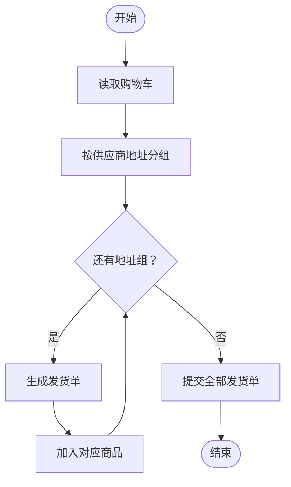

# 用活动图（Activity Diagram）做用例补充

## 它是什么

用例图回答“系统为谁提供什么功能”，用例文本描述主成功场景和扩展场景；**活动图（Activity Diagram）**则把某个用例中的动作、判断、分支与并发画成控制流，属于 **Scenario-based elements**，用于补充用例描述，而不是替代用例图。泳道图（Swimlane Diagram）还能按参与者或系统职责划分活动。

> [!IMPORTANT]
> 活动图补充的是==特定场景中的活动流程==；用例图强调系统边界与参与者，顺序图强调对象间消息的时间顺序。

## 为什么需要

文字用例容易写清步骤，却不便直观呈现条件分支、循环和并行处理。活动图适合检查流程是否完整，例如订单是否覆盖所有商品、每个发货单是否只包含同一供应商地址的商品，以及所有分支最终是否正确汇合。

## 怎么画

基本符号包括：起始节点、活动、判断节点、分支与汇合、结束节点；需要表达职责时增加泳道。建模步骤如下：

1. 选定一个用例或场景，明确触发条件和结束结果。
2. 按执行顺序列出活动，动词短语命名，如“读取购物车”“生成发货单”。
3. 用判断节点表示条件，并给每条流出边写监护条件。
4. 用分叉（fork）和汇合（join）表示可并行且需要等待的流程。
5. 检查每个商品均被处理、每个分支有去向、流程能够终止。

## 算对了的例子：拆分发货单

题中购物车含上海、北京、广州三个供应商地址，因此拆成三个发货单：

| 发货单 | 供应商地址 | 商品 |
|---|---|---|
| D1 | 上海 | C01 华为手机、C02 iPad |
| D2 | 北京 | S03 打印纸、N01 牛仔裤 |
| D3 | 广州 | D01 滑板 |

若三个发货单可并行生成，可在“按地址分组”后用 fork 分出三条支路，每条支路执行“生成发货单→加入商品”，再用 join 等待全部完成，最后提交订单。关键不是机械地画三个顺序活动，而是体现==同一地址的商品归入同一发货单==。

> [!TIP]
> 遇到“拆单、分组、批量处理”，先写清分组键，再画循环或并发；本题分组键是“供应商地址”，不是商品类别或商品编号。

## 相近概念与常见坑

| 模型 | 主要回答 | 本例中的用法 |
|---|---|---|
| 用例图 | 谁使用什么功能 | 用户与“拆分订单”功能 |
| 活动图 | 活动怎样流转 | 分组、生成、提交发货单 |
| 顺序图 | 对象何时交换消息 | 购物车、订单服务等的调用次序 |
| 状态图 | 对象状态怎样改变 | 订单从待拆分到已发货 |

> [!WARNING]
> 不要把每个商品画成一个发货单；不要在判断节点上省略“是/否”等监护条件；fork 与判断分支不同，fork 的各支路都执行，判断分支只选择满足条件的路径。若题目只要求活动图，也不必额外堆叠类、对象或详细消息参数。
