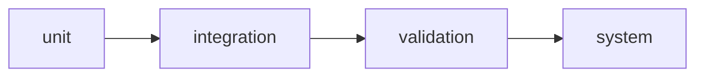
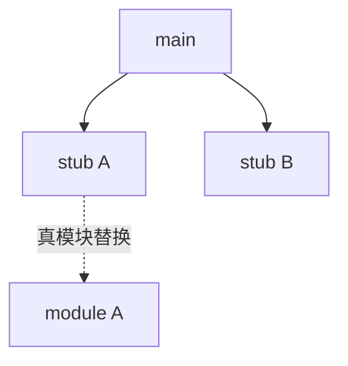

# 软件测试的战略方法（Strategic Approach）与谁来测试

## 软件测试的战略方法

先问一句：如果让你测一个刚写完的学生管理系统，你是拿到代码就开始乱点，还是先想好路线？显然，软件工程要的是**战略方法（Strategic Approach）**：在测试前先规划==宏观步骤==——单元测试（unit testing）→ 集成测试（integration testing）→ 确认测试（validation testing）→ 系统测试（system testing）。它回答两个问题：“总体策略是什么？”和“何时完成（completion）？”

为什么需要分层走？因为底层模块没验过，拼起来出错你根本不知道是谁的锅。

## 谁来测试

开发者和独立测试组（independent test group, ITG）分工不同：

- 开发者：写代码并测单个组件，以“交付（delivery）”驱动，态度温和（gently）。
- ITG：从集成测试开始介入，以“质量（quality）”驱动，目标是==打破软件、找错误==。它在架构完成后进场，但对 SQA 团队独立负责。

> [!IMPORTANT]
> 核心考点：ITG 不替开发者做单元测试；开发者始终对组件行为负责。

## 传统软件的集成策略

传统策略里集成测试有两种：自顶向下（top-down integration）和自底向上（bottom-up integration）。课件考过简答：**自顶向下集成的步骤是什么？**

1. 先测主控制模块；
2. 沿控制层次向下集成（深度优先或宽度优先，==优先深度优先==）；
3. 未集成的下层用桩（stubs）代替；
4. 逐步用真模块替换桩；
5. 每集成一次做回归测试（regression testing）；
6. 全部集成完做系统测试。

常见坑：以为宽度优先和深度随便选——课件明确说 depth-first 更好，因为能尽早让一条路径完整跑通。另一个坑是忘记回归测试，新模块把老功能搞坏就完蛋。相近概念区别：确认测试看功能符不符合需求，系统测试看软硬件合起来行不行，别混。

一个算对了的例子（简答标准答法）：问 top-down steps，答出“主控先测、沿层次集成、用 stub、替换 stub、回归测试、系统收尾”六点即满分。
